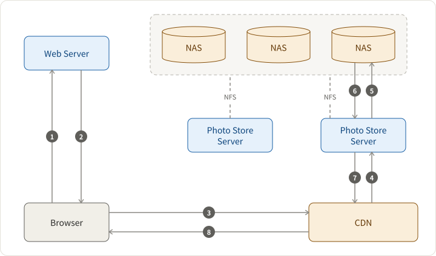
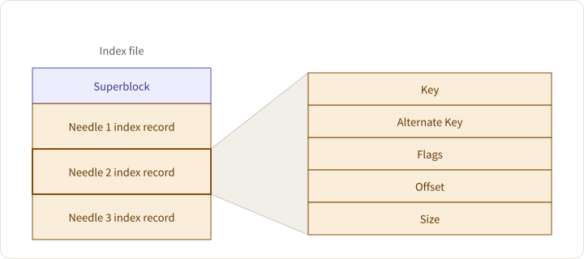
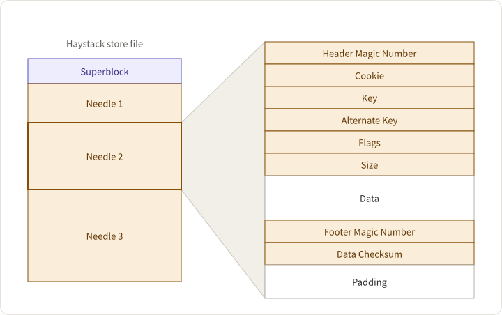
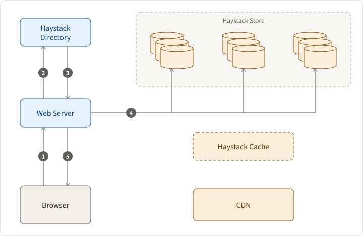
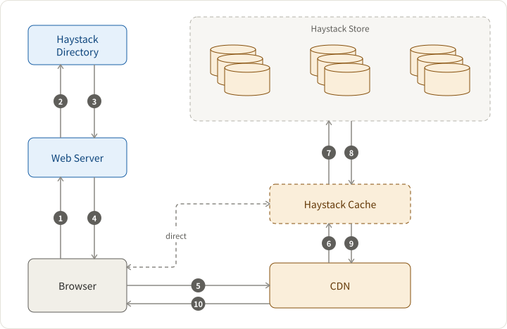

## Motivation & Assumptions

- PB-level Blob storage
- Traditional NFS based desgin (Each image stored as a file) has metadata bottleneck: large metadata size severely limits the metadata hit ratio.
  - Explain more about the metadata overhead

> For the Photos application most of this metadata, such as permissions, is unused and thereby wastes storage capacity. Yet the more significant cost is that the file’s metadata must be read from disk into memory in order to find the file itself. While insignificant on a small scale, multiplied over billions of photos and petabytes of data, accessing metadata is the throughput bottleneck.

## Solution

Eliminates the metadata overhead by aggregating hundreds of thousands of images in a single haystack store file.

## Architecture

## Data Layout

index file (for quick memory load) + haystack store file containing needles.

index file layout

haystack store file

### CRUD Operations

- Create: write to store file and then ==async== write index file, because index is not critical
- Read: read(offset, key, alternate_key, cookie, data_size)
- Update: Append only. If the app meets duplicate keys, then it can choose one with largest offset to update.
- Delete: soft delete by marking the deleted bit in the flag field. Hard delete is executed by the compact operation.

## Usecases

Upload

Download

