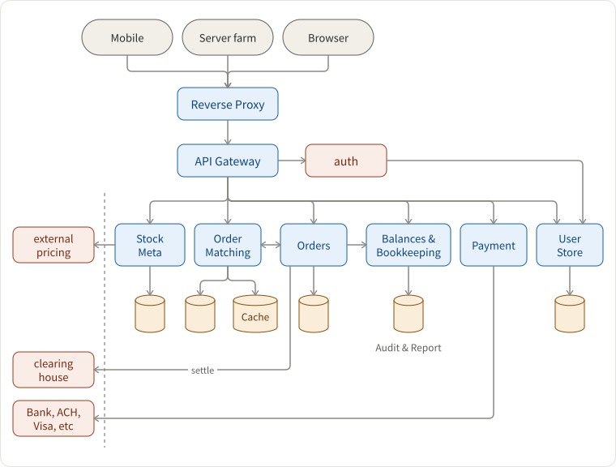
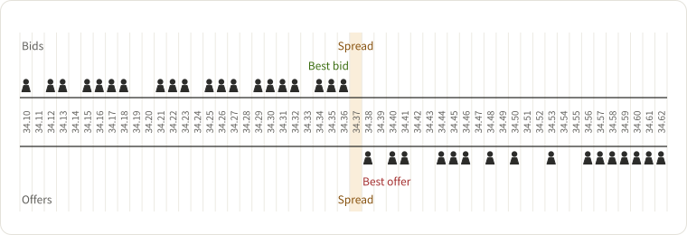
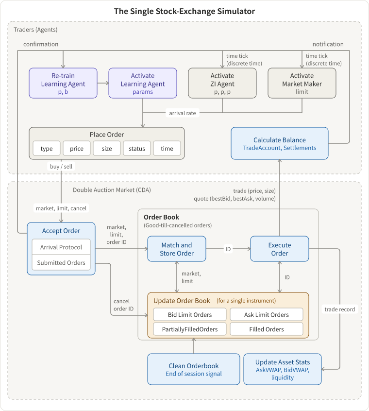
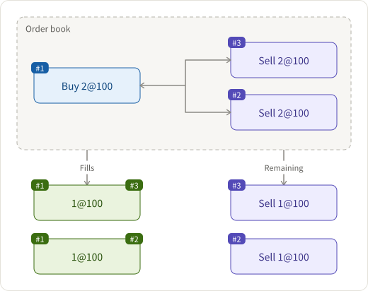

## Requirements

- order-matching system for `buy` and `sell` orders. Types of orders:
  - Market Orders
  - Limit Orders
  - Stop-Loss Orders
  - Fill-or-Kill Orders
  - Duration of Orders
- high availability and low latency for millions of users
  - async design - use messaging queue extensively (btw. side-effect: engineers work on one service pub to a queue and does not even know where exactly is the downstream service and hence cannot do evil.)

## Architecture



## Components and How do they interact with each other.

### order matching system

- shard by stock code
- order's basic data model (other metadata are omitted): `Order(id, stock, side, time, qty, price)`
- the core abstraction of the order book is the matching algorithm. there are a bunch of matching algorithms([ref to stackoverflow](http://web.archive.org/web/20120626161034/http://www.cmegroup.com/confluence/display/EPICSANDBOX/Match+Algorithms), [ref to medium](https://medium.com/lgogroup/a-matching-engine-for-our-values-part-1-795a29b400fa))
- example 1: [price-time FIFO](https://stackoverflow.com/questions/13112062/which-are-the-order-matching-algorithms-most-commonly-used-by-electronic-financi) - a kind of 2D vector cast or flatten into 1D vector
  - x-axis is price
  - y-axis is orders. Price/time priority queue, FIFO.
    - Buy-side: ascending in price, descending in time.
    - Sell-side: ascending in price, ascending in time.
  - in other words
    - Buy-side: the higher the price and the earlier the order, the nearer we should put it to the center of the matching.
    - Sell-side: the lower the price and the earlier the order, the nearer we should put it to the center of the matching.

x-axis



with y-axis cast into x-axis

```text
Id   Side    Time   Qty   Price   Qty    Time   Side
---+------+-------+-----+-------+-----+-------+------
#3                        20.30   200   09:05   SELL
#1                        20.30   100   09:01   SELL
#2                        20.25   100   09:03   SELL
#5   BUY    09:08   200   20.20
#4   BUY    09:06   100   20.15
#6   BUY    09:09   200   20.15
```

Order book from Coinbase Pro


[The Single Stock-Exchange Simulator](http://homepages.gold.ac.uk/nikolaev/aalts.htm)



- example 2: pro-rata



How to implement the price-time FIFO matching algorithm?

- shard by stock, CP over AP: one stock one partition
- stateful in-memory tree-map
  - periodically iterate the treemap to match orders
- data persistence with cassandra
- in/out requests of the order matching services are made through messaging queues
- failover
  - the in-memory tree-maps are snapshotting into database
  - in an error case, recover from the snapshot and de-duplicate with cache

How to transmit data of the order book to the client-side in realtime?

- websocket

How to support different kinds of orders?

- same `SELL or BUY: qty @ price` in the treemap with different creation setup and matching conditions
  - Market Orders: place the order at the last market price.
  - Limit Orders: place the order with at a specific price.
  - Stop-Loss Orders: place the order with at a specific price, and match it in certain conditions.
  - Fill-or-Kill Orders: place the order with at a specific price, but match it only once.
  - Duration of Orders: place the order with at a specific price, but match it only in the given time span.

### Orders Service

- Preserves all active orders and order history.
- Writes to order matching when receives a new order.
- Receives matched orders and settle with external clearing house (async external gateway call + cronjob to sync DB)

### References

- How Exchange Happen? [Simulating a financial exchange in Scala](http://falconair.github.io/2015/01/05/financial-exchange.html)
- Open Sources
  - [GitHub - objectcomputing/liquibook: Modern C++ order matching engine](https://github.com/objectcomputing/liquibook)
  - [GitHub - cyanly/gotrade: A proof of concept of an electronic trading system written in Golang](https://github.com/cyanly/gotrade)
- [The Financial Information eXchange ("FIX") Protocol](http://help.cqg.com/continuum/default.htm#!Documents/fixserver.htm)
- Types of orders: [Technical Analysis Course. Training,Coaching & Mentoring for Traders / Investors - Types of orders used when buying or selling a stock](http://www.tradersplace.in/TypesofOrders.html)
- [GitHub - fmstephe/matching_engine: A simple financial trading matching engine. Built to learn more about how they work.](https://github.com/fmstephe/matching_engine)
- [Automated Algorithmic Trading: Learning Agents for Limit Order Book Trading](http://homepages.gold.ac.uk/nikolaev/aalts.htm)
