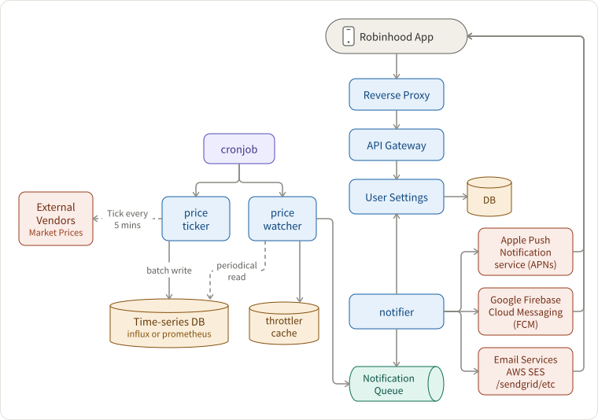

## Requirements

- 3 million users
- 5000 stocks + 250 global stocks
- a user gets notified about the price change when
  1. subscribing the stock
  1. the stock has 5% or 10% changes
  1. since a) the last week or b) the last day
- extensibility. may support other kinds of notifications like breaking news, earnings call, etc.

## Sketching out the Architecture

Contexts:

- What is clearing? Clearing is the procedure by which financial trades settle – that is, the correct and timely transfer of funds to the seller and securities to the buyer. Often with clearing, a specialized organization acts as an intermediary known as a clearinghouse.
- What is a stock exchange? A facility where stock brokers and traders can buy and sell securities.

## What are those components and how do they interact with each other?

- Price ticker
  - data fetching policies
    - option 1 preliminary: fetches data every 5 mins and flush into the time-series database in batches.
    - option 2 advanced: nowadays external systems usually push data directly so that we do not have to pull all the time.
  - ~6000 points per request or per price change.
  - data retention of 1 week, because this is just the speeding layer of the lambda architecture.
- Price watcher
  - read the data ranging from last week or last 24 hours for each stock.
  - calculate if the fluctuation exceeds 5% or 10% in those two time spans. we get tuples like (stock, up 5%, 1 week).
    - corner case: should we normalize the price data? for example, some abnormal price like someone sold UBER mistakenly for \$1 USD.
  - **ratelimit (because 5% or 10% delta may occur many times within one day)**, and then emit an event `PRICE_CHANGE(STOCK_CODE, timeSpan, percentage)` to the notification queue.
- Periodical triggers are cron jobs, e.g. Airflow, Cadence.
- notification queue
  - may not necessarily be introduced in the first place when users and stocks are small.
  - may accept generic messaging event, like `PRICE_CHANGE`, `EARNINGS_CALL`, `BREAKING_NEWS`, etc.
- Notifier
  - subscribe the notification queue to get the event
  - and then fetch who to notify from the user settings service
  - finally based on user settings, send out messages through APNs, FCM or AWS SES.
