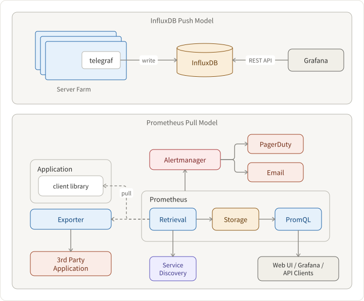

## Requirements

Log v.s Metric: A log is an event that happened, and a metric is a measurement of the health of a system.

We are assuming that this system’s purpose is to serve metrics - namely, counters, conversion rate, timers, etc. for monitoring the system performance and health. If the conversion rate drops drastically, the system should alert the on-call.

1. Monitoring business metrics like signup funnel’s conversion rate
2. Supporting various queries, like on different platforms (IE/Chrome/Safari, iOS/Android/Desktop, etc.)
3. data visualization
4. Scalability and Availability

## Architecture

Two ways to build the system:

1. Push Model: Influx/Telegraf/Grafana
2. Pull Model: Prometheus/Grafana

The pull model is more scalable because it decreases the number of requests going into the metrics databases - there is no hot path and concurrency issue.



## Features and Components

### Measuring Sign-up Funnel

Take a four-step sign up on the mobile app for example

```txt
INPUT_PHONE_NUMBER -> VERIFY_SMS_CODE -> INPUT_NAME -> INPUT_PASSWORD
```

Every step has `IMPRESSION` and `POST_VERIFICATION` phases. And emit metrics like this:

```json5
{
  sign_up_session_id: "uuid",
  step: "VERIFY_SMS_CODE",
  os: "iOS",
  phase: "POST_VERIFICATION",
  status: "SUCCESS",
  // ... ts, contexts, ...
}
```

Consequently, we can query the overall conversion rate of `VERIFY_SMS_CODE` step on `iOS` like

```txt
(counts of step=VERIFY_SMS_CODE, os=iOS, status: SUCCESS, phase: POST_VERIFICATION) / (counts of step=VERIFY_SMS_CODE, os=iOS, phase: IMPRESSION)
```

### Data Visualization

Graphana is mature enough for the data visualization work. If you do not want to expose the whole site, you can use [Embed Panel with iframe](https://grafana.com/docs/reference/sharing/#embed-panel).
