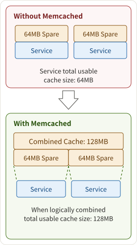
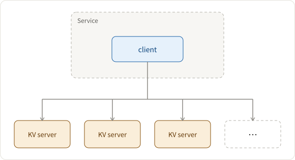
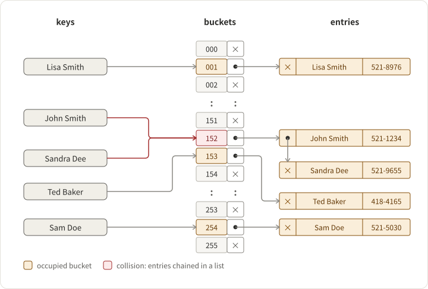

## Requirements

1. High-performance, distributed key-value store

- Why distributed?
  - Answer: to hold a larger size of data
    

2. For in-memory storage of small data objects
3. Simple server (pushing complexity to the client) and hence reliable and easy to deploy

## Architecture

Big Picture: Client-server

- client
- given a list of Memcached servers
- chooses a server based on the key
- server
- store KVs into the internal hash table
- LRU eviction

The Key-value server consists of a fixed-size hash table + single-threaded handler + coarse locking

How to handle collisions? Mostly three ways to resolve:

1. Separate chaining: the collided bucket chains a list of entries with the same index, and you can always append the newly collided key-value pair to the list.
2. open addressing: if there is a collision, go to the next index until finding an available bucket.
3. dynamic resizing: resize the hash table and allocate more spaces; hence, collisions will happen less frequently.

## How does the client determine which server to query?

See [Data Partition and Routing](https://puncsky.com/notes/2018-07-21-data-partition-and-routing)

## How to use cache?

See [Key value cache](https://puncsky.com/notes/122-key-value-cache)

## How to further optimize?

See [How Facebook Scale its Social Graph Store? TAO](https://puncsky.com/notes/49-facebook-tao)
