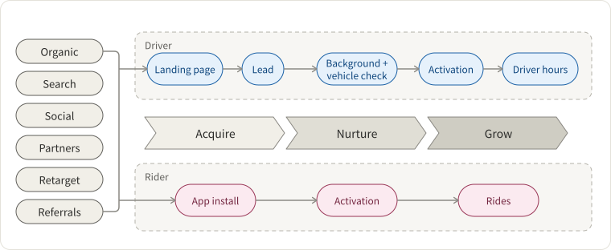
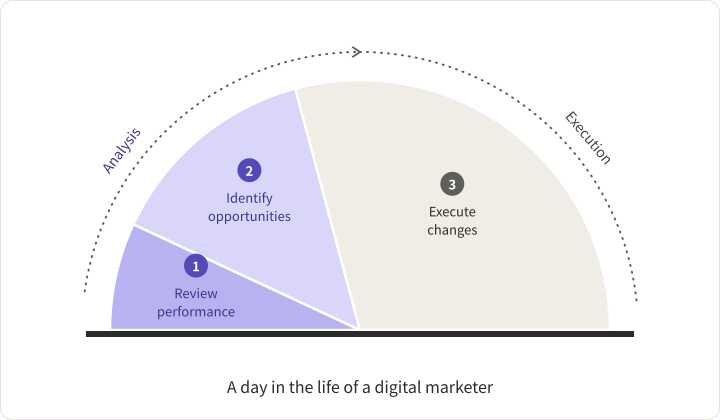
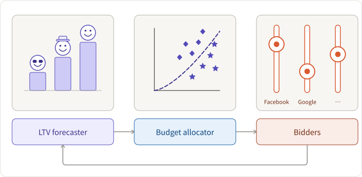
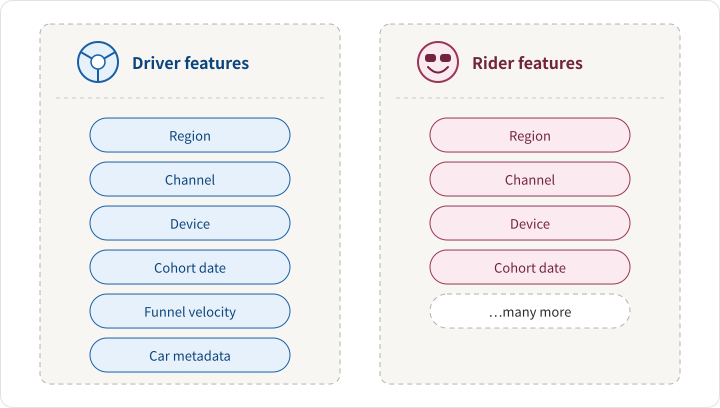
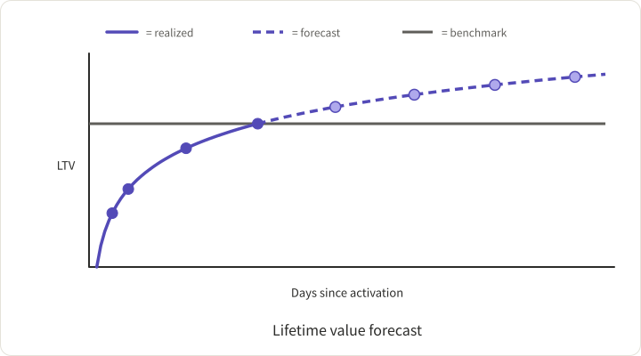
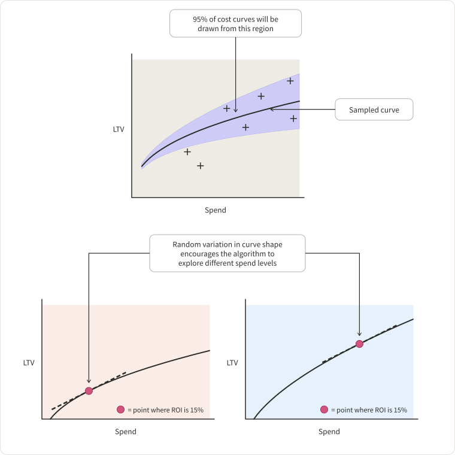
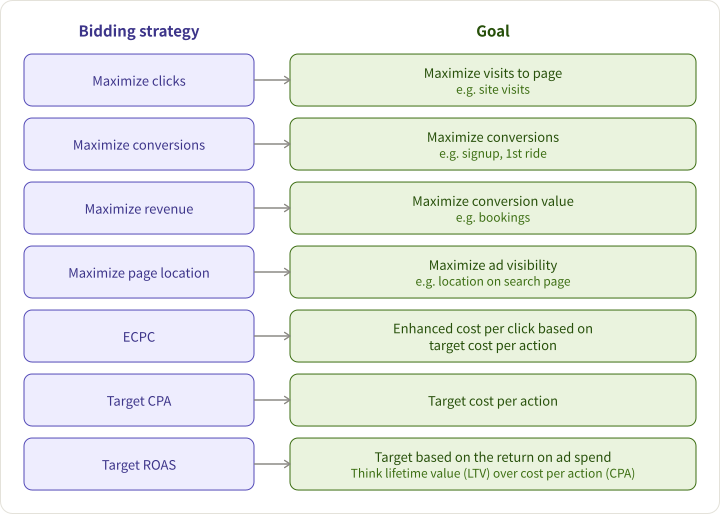

## Acquisition Efficiency Problem：How to achieve a better ROI in advertising?

In details, Lyft's advertisements should meet requirements as below:

1. being able to manage region-specific ad campaigns
2. guided by data-driven growth: The growth must be scalable, measurable, and predictable
3. supporting Lyft's unique growth model as shown below

However, the biggest challenge is to manage all the processes of cross-region marketing at scale, which include choosing bids, budgets, creatives, incentives, and audiences, running A/B tests, and so on. You can see what occupies a day in the life of a digital marketer:

We can find out that _execution_ occupies most of the time while _analysis_, thought as more important, takes much less time. A scaling strategy will enable marketers to concentrate on analysis and decision-making process instead of operational activities.

## Solution: Automation

To reduce costs and improve experimental efficiency, we need to

1. predict the likelihood of a new user to be interested in our product
2. evaluate effectively and allocate marketing budgets across channels
3. manage thousands of ad campaigns handily

The marketing performance data flows into the reinforcement-learning system of Lyft: [Amundsen](https://guigu.io/blog/2018-12-03-making-progress-30-kilometers-per-day)

The problems that need to be automated include:

1. updating bids across search keywords
2. turning off poor-performing creatives
3. changing referrals values by market
4. identifying high-value user segments
5. sharing strategies across campaigns

## Architecture

The tech stack includes - Apache Hive, Presto, ML platform, Airflow, 3rd-party APIs, UI.

## Main components

### Lifetime Value(LTV) forecaster

The lifetime value of a user is an important criterion to measure the efficiency of acquisition channels. The budget is determined together by LTV and the price we are willing to pay in that region.

Our knowledge of a new user is limited. The historical data can help us to predict more accurately as the user interacts with our services.

Initial eigenvalue:

The forecast improves as the historical data of interactivity accumulates:

### Budget allocator

After LTV is predicted, the next is to estimate budgets based on the price. A curve of the form `LTV = a * (spend)^b` is fit to the data. A degree of randomness will be injected into the cost-curve creation process in order to converge a global optimum.

### Bidders

Bidders are made up of two parts - the tuners and actors. The tuners decide exact channel-specific parameters based on the price. The actors communicate the actual bid to different channels.

Some popular bidding strategies, applied in different channels, are listed as below:

### Conclusion

We have to value human experiences in the automation process; otherwise, the quality of the models may be "garbage in, garbage out". Once saved from laboring tasks, marketers can focus more on understanding users, channels, and the messages they want to convey to audiences, and thus obtain better ad impacts. That's how Lyft can achieve a higher ROI with less time and efforts.
