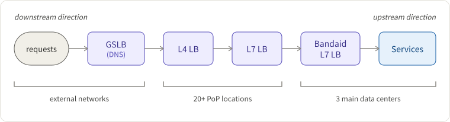
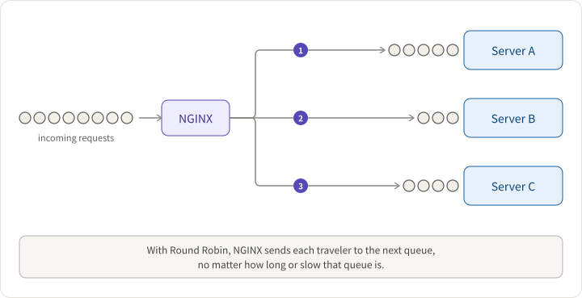
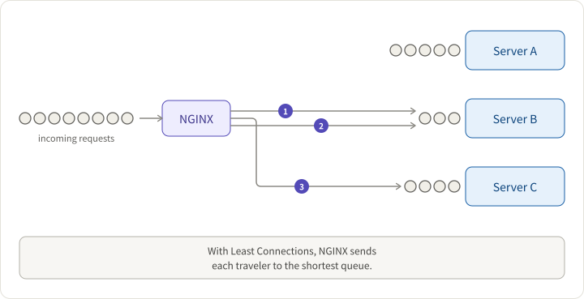
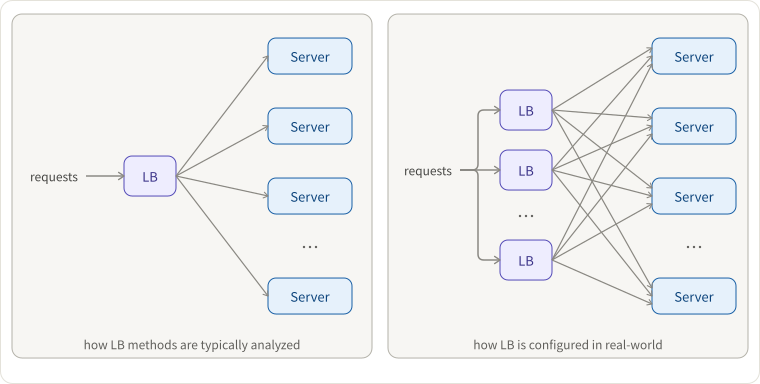
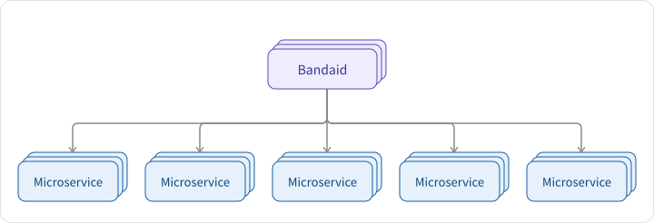
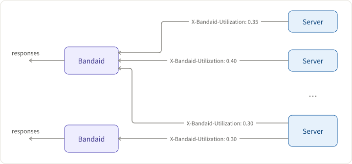

## Requirements

Internet-scale web services deal with high-volume traffic from the whole world. However, one server could only serve a limited amount of requests at the same time. Consequently, there is usually a server farm or a large cluster of servers to undertake the traffic altogether. Here comes the question: how to route them so that each host could evenly receive and process the request?

Since there are many hops and layers of load balancers from the user to the server, specifically speaking, this time our design requirements are

- [designing an L7 Load Balancer inside a data center](https://tianpan.co/notes/2018-07-23-load-balancer-types)
- leveraging real-time load information from the backend
- serving 10 m RPS, 10 T traffic per sec

> Note: If Service A depends on (or consumes) Service B, then A is downstream service of B, and B is upstream service of A.

## Challenges

Why is it hard to balance loads? The answer is that it is hard to collect accurate load distribution stats and act accordingly.

### Distributing-by-requests ≠ distributing-by-load

Random and round-robin distribute the traffic by requests. However, the actual load is not per request - some are heavy in CPU or thread utilization, while some are lightweight.

To be more accurate on the load, load balancers have to maintain local states of observed active request number, connection number, or request process latencies for each backend server. And based on them, we can use distribution algorithms like Least-connections, least-time, and Random N choices:

**Least-connections**: a request is passed to the server with the least number of active connections.

**latency-based (least-time)**: a request is passed to the server with the least average response time and least number of active connections, taking into account weights of servers.

However, these two algorithms work well only with only one load balancer. If there are multiple ones, there might have **herd effect**. That is to say; all the load balancers notice that one service is momentarily faster, and then all send requests to that service.

**Random N choices** (where N=2 in most cases / a.k.a _Power of Two Choices_): pick two at random and chose the better option of the two, _avoiding the worse choice_.

### Distributed environments.

Local LB is unaware of global downstream and upstream states, including

- upstream service loads
- upstream service may be super large, and thus it is hard to pick the right subset to cover with the load balancer
- downstream service loads
- the processing time of various requests are hard to predict

## Solutions

There are three options to collect load the stats accurately and then act accordingly:

- centralized & dynamic controller
- distributed but with shared states
- piggybacking server-side information in response messages or active probing

Dropbox Bandaid team chose the third option because it fits into their existing _random N choices_ approach well.

However, instead of using local states, like the original _random N choices_ do, they use real-time global information from the backend servers via the response headers.

**Server utilization**: Backend servers are configured with a max capacity and count the on-going requests, and then they have utilization percentage calculated ranging from 0.0 to 1.0.

There are two problems to consider:

1. **Handling HTTP errors**: If a server fast fails requests, it attracts more traffic and fails more.
2. **Stats decay**: If a server’s load is too high, no requests will be distributed there and hence the server gets stuck. They use a decay function of the inverted sigmoid curve to solve the problem.

## Results: requests are more balanced

