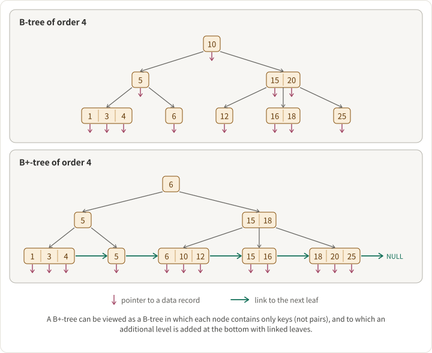

B-trees and B+ trees are the on-disk data structures that hold up most of the database industry. MySQL (InnoDB), PostgreSQL indexes, SQL Server, Oracle, SQLite, and virtually every file system metadata store uses one or the other. Once you understand the structural difference, the operational trade-offs fall out directly.

## The structural difference

Both are balanced, multi-way search trees optimized for block-oriented storage: each node corresponds to a disk page (typically 4-16 KB), and the branching factor is wide enough that the tree height stays very small (usually 3-5 levels even for billions of keys).

The difference is where the data lives:

- **B-tree:** Every node — internal or leaf — holds keys _and_ their associated data (or data pointers).
- **B+ tree:** Internal nodes hold only keys (as routing information). All data lives in the leaves. Leaves are linked together in a doubly-linked list.

```
B-tree (data in every node):
                    [10:val | 20:val]
                   /       |         \
        [4:val | 7:val]  [12:val|15:val]  [23:val|28:val]

B+ tree (data only in leaves, leaves linked):
                    [10 | 20]
                   /    |    \
        [4 | 7] ↔ [10 | 12 | 15] ↔ [20 | 23 | 28]
        values      values           values
```

Notice that in the B+ tree, keys in the internal nodes are _duplicated_ in the leaves — they're just routing, not storage. The leaf-level linked list is the feature that changes everything downstream.

## Where B-tree wins

- **Point lookups for hot keys can be faster.** A frequently accessed key stored in an internal node can be returned after traversing only partway down the tree. In a B+ tree, every lookup goes all the way to a leaf.
- **Slightly less storage overhead** in workloads where the key is large relative to the value — you avoid the key duplication that B+ trees incur.

These wins are real but narrow. For most real workloads, the downsides dominate.

## Where B+ tree wins (and why it dominates in practice)

### 1. Higher branching factor → shorter tree → fewer seeks

Because internal nodes carry only keys (no values or value pointers), more keys fit per page. A 16 KB page that holds 500 keys in a B+ tree might only hold 200 in an equivalent B-tree. Higher branching factor compounds at every level:

- B-tree with fanout 200, 1 billion keys → height ≈ `log₂₀₀(10⁹) ≈ 4`
- B+ tree with fanout 500, 1 billion keys → height ≈ `log₅₀₀(10⁹) ≈ 3.3`

Every level is one disk seek on a cache miss. On spinning disks this was a 10-20% reduction in p99 latency for point lookups. On SSD it's less dramatic but still meaningful, because fewer pages = better buffer-pool cache utilization.

### 2. Range scans are trivial

This is the single biggest reason B+ trees dominate. A range scan (`WHERE price BETWEEN 100 AND 500`, `ORDER BY timestamp LIMIT 100`, any `GROUP BY` over ordered data) requires iterating keys in order. In a B+ tree:

```
Find starting leaf → walk the leaf linked list → stop at upper bound.
```

In a B-tree, there's no leaf linked list. You have to do an in-order traversal of the tree — go back up to parent, descend to the next subtree, back up, descend, and so on. That's a lot more pointer-chasing and a lot more page accesses for the same range.

Any workload with ordered scans — OLTP with secondary indexes, time-series queries, pagination, sorted result sets — is faster on a B+ tree by a material margin.

### 3. Better cache behavior for scans

Leaf nodes in a B+ tree are laid out sequentially (or nearly so) in the linked list order, which lines up with how the OS and storage prefetch. A range scan often fits a mostly sequential I/O pattern. B-trees can't get this benefit because neighboring keys may be in distant subtrees.

### 4. Simpler concurrency

Because all reads and writes for a key terminate at the leaf level, locking protocols can be simpler and more localized. "Latch crabbing" (the standard B+ tree concurrency technique) is easier to reason about when internal nodes only carry routing.

## Why almost every relational DB uses a B+ tree

Given the trade-offs, it's no accident that all the major OLTP databases use B+ trees (or variants):

- **MySQL InnoDB:** clustered B+ tree — the primary-key index _is_ the table storage. Secondary indexes are separate B+ trees whose leaves point back via primary key.
- **PostgreSQL:** uses B+ trees for its default index type (`btree` — the name is misleading; it's a B+ tree). Table data itself lives in a heap, not the index.
- **SQL Server, Oracle, SQLite:** B+ tree variants.

The workloads these systems target — point lookups and range scans over large datasets with heavy read:write ratios — are exactly what B+ trees optimize for.

## When B-trees (or variants) still show up

- **Copy-on-write B-trees** in file systems: Btrfs, ZFS. The data-in-every-node property and the fractal-tree friendliness of B-trees makes CoW updates cheaper in some scenarios.
- **Memory-only stores:** if you're not paying the disk-page cost, the compactness advantage of B+ trees matters less. In-memory map implementations often pick other structures entirely (hash tables, skip lists, ART tries).
- **Academic and embedded systems** where the simpler recursive structure is easier to implement and the workload is known to be mostly point lookups.

## Variants worth knowing

- **B\* tree:** keeps nodes ~2/3 full rather than ~1/2 full, via rotation. Rarely used in modern DBs — the implementation complexity isn't worth the density gain.
- **B-link tree:** adds right-sibling pointers at every level, enabling better concurrency with fewer latches. Used inside some PostgreSQL index paths.
- **Fractal tree (TokuDB/MySQL):** buffers updates in internal nodes to amortize I/O. Excellent for write-heavy workloads with high branching factor; sees use in specialized DBs.
- **LSM tree:** a completely different approach (not a B-tree variant) that buffers writes in memory and flushes to sorted files. Used by RocksDB, Cassandra, HBase, LevelDB. Better write amplification, worse read amplification than B+ trees. The B-tree vs LSM choice is a separate and bigger architectural call.

## Quick decision

If you're reading this to pick one: **use a B+ tree** for any on-disk, ordered-key workload. The range-scan and cache-behavior advantages swamp B-tree's small point-lookup edge for almost all real-world access patterns. If you're building something that only does random point access with no ranges or ordering, consider a hash index instead of either.

## See also

- [Skiplist](https://tianpan.co/notes/69-skiplist) — the in-memory analogue when you don't need disk durability.
- [Bloom Filter](https://tianpan.co/notes/68-bloom-filter) — often placed in front of B+ tree leaves in LSM-tree systems to skip disk reads.
- [How to scale a web service?](https://tianpan.co/notes/41-how-to-scale-a-web-service) — Z-axis data partitioning decisions often sit on top of B+-tree-backed storage.
