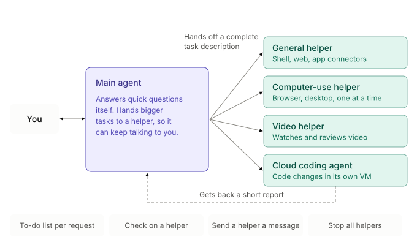

At its core, an agent is a model calling tools in a loop. Run that loop in a terminal and it dies when you close the laptop. An *always-on agent* takes the same loop and turns it into a long-lived service. It behaves like a colleague more than a command-line tool: it runs in the cloud, has its own computer, keeps memory for weeks, wakes up on events, and only reports back when something is worth your attention.

This chapter follows the architecture described in Lee Robinson's Stanford CS146S talk *How always-on agents work* (see references) and puts it into the book's 4-step framework.

## Requirements

Functional

* Users chat with the agent from any client: a mobile app, desktop, Slack, email, or a meeting.
* The agent can be woken up by things other than the user: incoming messages, scheduled routines, webhooks, or background tasks finishing.
* The agent has its own sandboxed computer (shell, files, browser, desktop) to do real work.
* The agent remembers the user, its past work, and the skills it has learned.
* The agent is selectively quiet. It works in the background and interrupts the user only when needed: for an important update, an approval, a 2FA code, and so on.
* Irreversible actions, such as sending an email or making a payment, need the user's approval.

Non-functional

* Durability: tasks can run for hours to weeks and survive crashes, deploys, and VM rebuilds without redoing finished steps.
* Cost efficiency: compute and tokens are the main costs. Idle agents and idle machines must sleep, and prompts should hit the provider's prompt cache as often as possible.
* Low latency for the conversation with the user. High throughput (not low latency) for long background work.
* Security: untrusted inputs (emails, webhooks, web pages) must never be treated as user instructions, and secrets should stay out of the model's context.

## Architecture

There are three tiers:

1. **Triggers and clients.** They are thin, and the only tool that connects them to the server is `send_to_user`.
2. **The agent server.** It is thick. It owns the agent loop, the tools, and all persistent state.
3. **The computer.** A disposable but snapshot-able Linux VM that the agent uses like a human would.

"Saved state" is really two stores: the app database for what the agent knows, and the durable workflow engine's history for how far each task has got (see [Durable workflows](#durable-workflows-not-job-queues)).

## Components

### Lifecycle: sleep by default

Running a server process and a VM for every user all the time is too expensive, and at scale there simply isn't enough hardware. So both tiers sleep by default:

1. A trigger arrives. The server loads the agent's state (conversation, memory, routines) from the database and starts a turn.
2. The VM boots only if the turn needs the computer.
3. When the work is done, state is saved and both the VM and the agent go back to sleep.

### Why the loop lives on the server, not on the VM

* **Thin client, thick server.** Agent logic changes ship as server deploys, not app-store releases. Heavy work such as transcription or image generation runs on server hardware. Scaling servers under variable traffic is a solved problem.
* **Independent lifecycles.** If the loop ran inside the VM, you could not rebuild the VM (for example, to patch a zero-day kernel bug) without killing the agent. Keeping all durable state on the server makes the VM disposable.

### Trigger router and priority queue

All triggers go through a router that:

* **Dedupes** retries and duplicate events.
* **Prioritizes.** A direct message from the owner interrupts the running loop: "actually, move it to Thursday" should take effect immediately. Group chats, Slack threads, and routines go to the back of the queue.
* **Batches** several messages that arrive close together into one turn.
* **Decides whether to notify.** A good colleague doesn't ping you on every bit of progress. Tuning when to stay quiet and when to be proactive is still an open problem.

The talk describes what this queue does, not how it is built. It can be a plain queue that hands each turn to the workflow engine below, or part of that engine.

Message delivery to clients is a normal real-time sync problem. The client acknowledges sends optimistically. The server writes each turn to the database. Clients subscribe to changes, then fetch the latest state, with idempotency keys so retries don't show duplicate messages (see [idempotent APIs](https://tianpan.co/notes/43-how-to-design-robust-and-predictable-apis-with-idempotency)).

### Durable workflows, not job queues

With a plain job queue, a crash at step 3 of a long task means replaying steps 1–3 on retry, which could mean sending the same email twice. A **durable workflow** engine (e.g. Temporal) records each completed step, so a retry resumes at step 3. Each helper runs as its own durable workflow. This makes weeks-long tasks survive deploys and infrastructure failures.

**Where Temporal fits.** Temporal is the layer that runs the agent's multi-step work and lets it resume after a crash. The agent loop is still your code; it runs on Temporal. That splits saved state in two: the app database and files hold what the agent *knows* (conversation, memory, skills, large outputs), while Temporal's history holds *how far it got* in each task (which steps finished, what they returned, what it is waiting for). Hand-written checkpoint files can do the second job too, but only as of the last save, and you end up writing your own retries, timeouts, and wait states.

The talk confirms only two things: Grok Bot uses Temporal instead of a job queue, and each helper is its own durable workflow. It does not say whether the incoming message queue is built on Temporal as well. The rest of this section is the standard way to build on Temporal, not Grok Bot's actual code.

#### Workflow vs. activity: who does what

Temporal splits code into two kinds:

* A **workflow** is the orchestration code. It must be deterministic: no network calls, no disk I/O, no clock reads, no randomness. Temporal records every event in the workflow's *event history*. After a crash, a worker re-runs the workflow code from the start, but instead of re-executing finished steps it feeds back their recorded results ("replay"), so the code arrives at the exact point where it stopped.
* An **activity** is anything that touches the outside world: calling the model, running a shell command on the VM, reading files, sending an email. Activities can fail and are retried according to a retry policy (attempts, exponential backoff, timeouts). Only their results go into the history.

For an agent, that gives a clear rule:

| Concern | Put it in | Why |
| --- | --- | --- |
| Model calls, tool calls, shell, browser, file edits | Activity | Non-deterministic side effects. They can fail, so they get retried. |
| Step order, loops over many items, "which step comes next" | Workflow | A crash at item 543 of 1,000 resumes at item 543. |
| Waiting: "remind me in 3 hours", backoff, deadlines | Workflow timers | A durable timer survives restarts; `sleep()` inside a process does not. |
| Waiting for a human: approval, 2FA code, a new chat message | Workflow signal | The workflow can wait for days without holding a process, memory, or CPU. |
| *Deciding* what to do (which tool, which language) | The model, inside an activity | The workflow only records the decision and routes on it. |

Your agent code never polls for results. Temporal hands work to the agent servers (its workers) and returns each step's result to the workflow, much like a local function call. Clients still learn about progress from the database, as with any other message.

#### Caveats

* Recovery is step-level, not line-level. An activity that was *in flight* when the worker crashed runs again, so activities execute **at least once**. Irreversible actions such as sending an email or making a payment need an [idempotency key](https://tianpan.co/notes/43-how-to-design-robust-and-predictable-apis-with-idempotency). Long activities, such as a 20-minute build, should send heartbeats so a dead worker is detected quickly.
* History is not a blob store. Temporal limits payload sizes, so keep transcripts, screenshots, and big tool outputs in object storage or on the VM's disk, and pass references through the workflow.

#### Option: the message queue on Temporal too

One way to build it is a long-running workflow per conversation that replaces the separate queue. It:

1. Waits durably until a signal delivers a new message from the router (user, Slack, email, routine).
2. Takes everything that has arrived since the last turn as one batch.
3. Runs the agent loop: one activity per model call, one activity per tool call. Between steps it checks for new messages, so the owner's message can preempt the turn.
4. When Temporal suggests the history is getting long, it restarts itself with Continue-As-New (see below), carrying only a reference to the saved state.

Either way, helpers map naturally onto **child workflows**: the main agent starts one per delegated task, can signal it ("send a helper a message"), query it ("check on a helper"), or cancel it ("stop all helpers"). Because each child has its own history, a crashed video helper resumes on its own without disturbing the conversation.

#### One-off tasks, routines, and cleanup

* **One-off task** ("fix this bug"): a workflow with a business ID such as `task-<id>`. It ends as completed, failed, or canceled, and its history stops growing.
* **Routine** ("every morning, summarize my inbox"): use a Temporal **Schedule**, which starts a fresh workflow run each time. Prefer Schedules over the older cron-workflow option.
* **Perpetual workflow** (such as the per-conversation workflow above): its history grows with every turn and has hard limits on event count and size. Before reaching them, it calls **Continue-As-New**: it closes the current run and starts a new one with the same workflow ID, carrying over only a compact state reference. This is the execution-level twin of context compaction.

Cleanup happens at three levels:

1. **Workflow history.** Closed runs are deleted automatically after the namespace's **retention period** (e.g. 7 days), or archived first if you need an audit trail. Runs closed by Continue-As-New count as closed runs.
2. **Sandbox state.** Helpers that work in scratch directories or containers delete them in a final cleanup activity, run even on failure or cancellation. The VM itself goes back to its snapshot when it sleeps.
3. **Memory.** Expire stale facts and scratchpad notes (see below). Temporal knows nothing about this layer.

### The computer: Firecracker microVMs

Each agent gets a Linux microVM (Firecracker), which:

* boots fast and can be **snapshotted**, put to sleep, and restored, so the agent's files and desktop persist cheaply between wake-ups;
* isolates risky shell commands from the user's own machine;
* runs Chrome and **virtual desktops**, so several agents or helpers can each use their own screen on shared infrastructure;
* supports a live view, so the user can watch or take over.

To read a page, the agent uses the cheapest option that works: the **accessibility tree** (compact, lists the clickable elements), then raw HTML, then a screenshot, and finally clicking on pixels for stubborn modals.

### One client tool: `send_to_user`

The only tool that crosses the client–server boundary is `send_to_user`. All the heavy tools (shell, files, browser, screen recording, cloud agents) stay on the server. This keeps every new surface (iOS, desktop, Slack, email) trivial to add. Each client decides how to render a message richly: sign-in forms tied to a password manager, payment sheets, an editable draft to approve before an irreversible send, or just an emoji reaction.

### Escalation ladder

Before bothering the user, the agent tries the cheapest and most reliable source first:

1. What it already knows from the conversation and memory.
2. A plugin, MCP server, or API.
3. Web search.
4. The browser on its computer.
5. The full desktop: scripts, builds, commands.
6. Only then, ask the user (approval, 2FA code, CAPTCHA).

### Orchestrator and sub-agents ("helpers")

The main agent acts as an orchestrator and keeps its own context sparse. Expensive or noisy work, such as many shell calls, screenshots, or video processing, is handed to **helpers**. A helper is a sub-agent with a fresh context window that returns only its result. The main agent tracks the helpers like a to-do list: it can check on them, message them, or stop them. Because each helper is its own durable workflow, a crashed helper resumes instead of restarting. This is how the product *feels* like it has infinite context.

### Tools and dynamic discovery

* Putting every connector's full tool schema into the prompt fills the context window before any work begins. Instead, list only tool **names** and let the model load a tool's schema when it needs it (a "tool search" tool).
* Don't add or remove tools in the middle of a turn, because that breaks the prompt cache. Keep descriptions short.
* "Just give it a shell" works, but if most shell calls go to one task, a dedicated tool is cheaper and easier for people to audit.
* Write error messages for the agent the way you would for a human: say what failed and what to do next.

### Context engineering and prompt caching

Each turn resends the whole conversation, so most input tokens should be **cached** tokens, which are much cheaper. Practices:

* Keep the prefix (system prompt, tool definitions) static and in a fixed order. Hash prompt sections so an A/B test or a new tool doesn't reorder the prompt and invalidate the cache for everyone.
* Write large outputs to files and let the agent read or grep them later, instead of putting them in context.
* Send screenshots and other expensive inputs to helpers.
* **Warm the cache early.** Start preparing the prompt when the user starts typing, like prefetching a page on hover.
* Treat a cache miss as a bug.

### Compaction and memory

Long-running agents have to summarize, and all compression is lossy. One useful trick: **compact while the cache is still warm.** When the user goes idle after a long session, summarize right away, while re-reading the long history is still cheap. When the user comes back, they continue from a short summary.

Memory is layered:

| Layer | Lifetime | Example |
| --- | --- | --- |
| Core user facts | Included in every prompt | "prefers lowercase messages" |
| Dated work log | Persistent, searched on demand | what the agent did last week |
| Scratchpad notes | Ephemeral, minutes to hours | the state of the current task |
| Skills / routines | Persistent, loaded when relevant | a markdown how-to; a cron-style scheduled prompt |
| Everything else | Files | found with `grep` / `find` when needed |

Files are the universal storage format because models are very good at searching them with shell commands. Facts need garbage collection: promote what keeps being relevant and let the rest expire.

### Safety

* **Auto review:** a separate model checks every command before it runs. This works better than a human approving hundreds of commands and getting tired.
* Treat emails, webhooks, and web content as **untrusted data**, not instructions, to defend against prompt injection.
* Require explicit user approval for irreversible actions.
* Keep passwords and payment credentials in product flows, never in the model's context.

## Wrap-up: bottlenecks and open problems

* **The improvement flywheel.** Inner loop: turn each failure into an eval, fix the harness, prompt, or inference, then ship. Outer loop: train the next model (SFT on the harness's tools, RL for instruction following, skill selection, and clicking) on those failures.
* **Latency vs. throughput.** Serve the main agent for fast replies. Helpers can trade latency for cost, since 10 minutes versus 12 minutes on a background task barely matters.
* **Evaluating month-long agents** when models ship monthly.
* **Memory algorithms** (files, graphs, or something else) and recall quality over months.
* **Proactivity heuristics:** helpful vs. annoying.
* **Multi-agent behavior** in group chats where bots talk to each other.
* **Token efficiency** as total token volume keeps growing.
* **Design for the next model.** Assume today's model is the worst you'll use, build as little as possible, and expect to rebuild the UI within months.
