An **agent** is an autonomous software system that uses an LLM to reason about a goal, call tools, and run multi-step actions until the task is done: *plan → act → observe → adapt → deliver*.

Think of it as a **new kind of computer**:

| Classic computer | Agent |
| --- | --- |
| CPU | LLM |
| RAM | Context window |
| Peripherals | Tools |
| OS | Agent harness |
| Application | Agent |

The LLM is superhuman at knowledge, language, and code, but weak at persistent memory, hallucination, and adversarial input. The rest of the system exists to cover those weaknesses.

## The stack (layers)

| Layer | Holds | Remember it as |
| --- | --- | --- |
| Application / User | The task and its owner | the goal |
| **Agent / Harness** | planning · context · memory · tools · subagents | the OS |
| Model | The LLM | the CPU |
| **Serving system** | batching · scheduling · routing · KV/prefix caching | the scheduler |
| Runtime / Kernels | CUDA · Triton · collectives | the drivers |
| Hardware | GPU · CPU · memory · network · storage | the machine |
| External environment | Tools: web · files · APIs · humans | the world |

Two halves:

* **Agent** (top): decides *what* to do.
* **Serving + hardware** (bottom): decides *how fast and how cheap*.

The best gains come from **co-design** across the halves, for example a harness that keeps its prompt prefix stable so the serving layer can cache it.

**What to optimize.** Not tokens per second. The objective is:

> maximize **task success**, subject to latency, cost, resources, reliability, security

Measure **$ per successful task** and end-to-end latency, not GPU utilization.

## Logical components (inside one agent)

| Component | Job | Detail |
| --- | --- | --- |
| **LLM** | The brain | One or several models, each with a role |
| **Workflow** | The control flow | A *planner* splits the task; *actors* execute the steps |
| **Memory** | What it remembers | Session trace · long-term store · internal RAG |
| **Tools** | The hands | Three kinds of action: **read**, **write**, **execute** |
| **Environment** | Where it acts | Web · computer · domain-specific · third-party services · external RAG · other agents |
| **User interface** | How people talk to it | Text, previews, interactive elements |

The loop: the LLM picks a **tool call** → the environment returns an **observation** → repeat.

Agents differ from traditional software in two ways:

1. They mix **AI models** with ordinary code.
2. Their workflow is **generated at runtime**, not written in advance.

## Why agents are a systems problem

Plain LLM serving is one hop: *request → inference → response*. An agent is a chain: *infer → tool → infer → tool → retrieval → infer…*. The critical path crosses GPU, CPU, storage, network, and outside services.

| Workload property | Systems problem |
| --- | --- |
| Long trajectories | State and context management |
| Repeated prefixes | Prefix caching |
| Tool dependencies | Dependency-aware scheduling |
| Variable tool latency | Asynchronous execution |
| Multiple agents | Orchestration and communication |
| Huge context | Memory hierarchy and retrieval |
| Branching reasoning | Speculative execution |
| Different models | Routing |
| External side effects | Security and isolation |
| Long-running tasks | Checkpointing and fault tolerance |

**Observability** is first-class: a trace becomes a nested trajectory (session → turn → agent step → model request → tool call → result → subagent). You cannot optimize what you cannot observe.

## Flexibility is risk

The SoK paper rates an agent on seven independent dimensions. Each goes from least to most flexible, and **every step up adds capability and attack surface**.

| Dimension | Least flexible | Most flexible |
| --- | --- | --- |
| Input trust | No external data | Arbitrary external data |
| Access sensitivity | No sensitive data | Arbitrary sensitive data |
| Workflow | Simple chatbot | LLM-defined, dynamic |
| Action | Response only | Response + retrieval + execution |
| Memory | None | Persistent across sessions |
| Tool | None | Arbitrary tools |
| User interface | Text only | Interactive web elements |

Three attacker types:

* **External:** controls only content the agent reads, such as web pages or documents (indirect prompt injection, tool poisoning).
* **User-level:** talks to the agent directly (direct prompt injection).
* **Internal:** a malicious developer or tool provider.

Three defense principles:

* **Defense in depth:** guardrails, information-flow control, monitoring, human approval, and hardening, layered together.
* **Least privilege:** each task gets only the tools it needs.
* **Complete mediation:** check every access to a sensitive resource.

## Cheat sheet

* An agent is **LLM + context + tools + harness**, a new kind of computer.
* Top half **decides**, bottom half **serves**; optimize them together.
* Components: **LLM, workflow, memory, tools, environment, UI**.
* Tools do three things: **read, write, execute**.
* Optimize **$ per successful task**, not tokens per second.
* More flexibility means more risk. Apply **least privilege**.

For a full worked design, see [Designing an Always-on Agent](https://tianpan.co/notes/2026-10-21-designing-always-on-agent).
