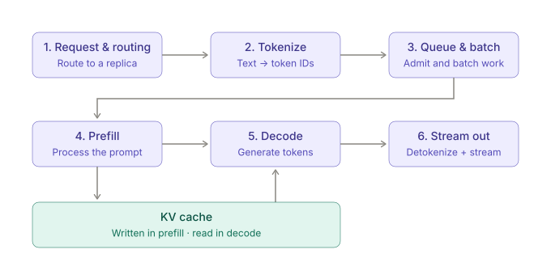

Inference deserves at least as much engineering attention as training. Using DeepSeek's published figures as an example, training took roughly 2.8 million H800-hours, while serving consumed about 43,000 H800-hours _per day_. At that rate annual inference compute is about 6x training compute, and over a two-year model lifetime inference accounts for roughly **12x** the computation. Inference efficiency therefore drives both serving cost and product margin, and model comparisons should account for inference compute, not just training compute.

## Life of a request

A request passes through these stages:

1. **Routing** to a data center and a GPU. FLEET LAYER, BEFORE THE GPUS
   • An API call lands at the gateway and is validated, then handed to the router
   • The router chooses a serving replica - by load, session affinity, or cache locality
   • Cluster-level and fleet-level choices affect cache rate, load balancing
2. **Tokenization**, including the correct representation of tool-call instructions. CPU-SIDE MILLISECONDS
   • The prompt text is split into token IDs from the model's vocabulary
   • Roughly 3-4 characters per token in English
   • Tool calling processing, etc at this layer - key for correctness and user experience
3. **Queuing and batching** with other in-flight requests. SCHEDULER. SHAPES TTFT.
   • Requests wait in a queue until the scheduler admits them
   • Continuous batching mixes new prompts with in-flight generations to keep GPUs busy
   • Workload requirements shape engine and load decisions
4. **Prefill**: process the whole prompt and build the KV cache. GPU. COMPUTE-BOUND. SETS TTFT
   • Prompt processed in one parallel forward pass
   • Compute-bound: large matrix multiplies saturate the tensor
   cores
   • Writes a KV-cache entry for every prompt token
   • Dominant factor for TTFT - key for low-latency (e.g. voice) applications, snappiness of first response
5. **Decode**: generate output tokens one at a time. GPU, MEMORY BOUND, SETS TPS
   • Tokens are generated one per forward pass, auto-regressively (+speculative decoding)
   • Memory-bound: every step re-reads the weights and the growing KV cache
   • Dominating factor for TPS - total end-to-end response
   completion
6. **Detokenization** back to text, plus parsing and handling of tool calls. CPU-side. User Visible.
   • Token IDs are detokenized back into text as they are
   produced
   • Tokens stream to the caller immediately - nobody waits for the full response
   • On completion the KV cache is freed, or kept warm for prefix
   reuse

A production service has to manage routing, cache locality, tokenization, batching, scheduling, GPU execution, and cache retention _jointly_. Scheduling is a trade-off: maximizing throughput across all users is not the same as minimizing one user's latency.

### Prefill vs. decode

| Phase   | What it does                  | Bottleneck             |
| ------- | ----------------------------- | ---------------------- |
| Prefill | Processes the prompt in bulk  | Compute-bound          |
| Decode  | Generates one token at a time | Memory-bandwidth-bound |

Prefill throughput is far higher than decode throughput, so decode is usually the main bottleneck. The two phases favor different scheduling and hardware optimizations.

### Metrics

- **Time to first token (TTFT)**: dominated by queueing and prefill.
- **Time per output token**: the decode step latency.
- **Throughput per GPU** at a given service level (SLO).

### KV cache and routing

Repeated prompts and agent workflows can reuse cached key-value (KV) data, while unrelated conversations usually cannot. Routing a request to a GPU that already holds the relevant KV cache improves performance, not just load balancing, so the router must be cache-aware.

## Three layers of optimization

1. **Model**: mixture-of-experts, state-space models, multi-head latent attention, quantization, and distillation reduce the work or memory needed per token.
2. **Kernel and runtime**: FlashAttention, PagedAttention, and RadixAttention borrow ideas from GPU programming, databases, and operating systems.
3. **Serving harness**: routing, speculative decoding, recursive language models, and context compaction avoid unnecessary computation or shrink cache requirements.

## GPU kernels

Small operations such as normalization and softmax underuse the hardware when each runs as a separate kernel. Fusing them helps, and workload-specific kernel tuning, even agent-driven, can be guided by real traffic patterns and production measurements.

## Parallel execution

Large models do not fit on one GPU, so the system needs tensor, pipeline, or data parallelism. Scale-up domains that connect many GPUs with high-bandwidth links (for example, 72-GPU racks) enable **expert parallelism**: each MoE expert lives on specific GPUs, which raises throughput sharply. The cost is reliability, because a failure in one GPU of a large replica can disrupt the whole workload.

## Quantization

Storing weights in fewer bits (FP16 → FP8 → FP4) cuts memory use and raises throughput, but may hurt quality. Check it carefully before deployment:

- Run benchmarks, tool-call tests, and end-to-end agent tasks (for example, asking the model to repeatedly write a small game) to make sure reasoning has not degraded.
- Training-free quantization recipes can stay close to the original FP8 quality, but only if you test them.

## Provider quality varies

The same open-model weights do not guarantee the same results across inference providers. Quantization, hardware, inference engine, sampling, model version, and tool-call handling all change the output. In a comparison of 31 Llama endpoints, the gap among providers serving the same open model could be larger than the gap between open and closed models.

This matters most for agents, where small errors compound across a chain of calls. Ways to monitor a provider:

- Run benchmarks and end-to-end evaluations (accurate but slow and costly).
- Validate tool-call behavior with dedicated test sets.
- Compare output distributions against a reference model.
- Track token log probabilities to detect "silent changes" in the serving stack.
- Monitor aggregate request patterns and tool-call success rates without retaining user data.
- Keep private, customer-specific test cases that public benchmarks will not cover.

## Compilers: search instead of heuristics

Instead of maintaining large collections of hand-written heuristics for every new chip, a compiler can use **equality saturation**:

- Reduce a model to a small set of primitive operations (about 15) in an intermediate representation that works across hardware backends.
- Apply small equivalence rules to build a search space of equivalent programs.
- Choose an implementation by **measuring candidates on the target hardware** (GPUs, TPUs) rather than relying on a predictive cost model.

The representation is PyTorch-complete but not Turing-complete, which bounds the search and lets some performance limits be computed analytically. The search itself is bounded, often using genetic algorithms, and aims for a strong local optimum. Since compiled code runs many times, extra compile time pays off. Such a compiler focuses on the model forward pass and complements serving engines like vLLM and SGLang rather than replacing their scheduling and batching.

## Caching and memory for agent workloads

Agents branch into sub-tasks that share the same system prompt, so shared context and memory management matter more and more.

- **RadixAttention**: store shared prompt prefixes in a radix tree, so requests with common context reuse cached computation and skip repeated prefill.
- **Overlap scheduling**: prepare the next batch on the CPU while the GPU runs the current one, cutting idle time. Up to 2x throughput was reported in some Blackwell configurations.
- **Hierarchical caching**: keep tokens across GPU memory, host memory, and storage, so evicted context is cheaper to reload. Time to first token dropped by up to 56% in experiments.
- **Unified memory pool**: manage full-attention tokens, sliding-window tokens, and recurrent states in one pool instead of fixed-size partitions per type. This avoids fragmentation and waste, and memory compaction reorganizes fragmented physical memory while preserving virtual mappings.

Longer contexts, repeated agent calls, and models with different attention or recurrent-state designs all need cache systems that share and manage memory flexibly.

## Takeaways

- Budget for inference first: it is the larger share of lifetime compute.
- Treat prefill and decode as different workloads, and route by KV-cache locality.
- Apply model, kernel, and serving-layer optimizations together.
- Verify quantization and every third-party provider with your own end-to-end and distribution tests.
- Design the cache and memory layer for agents: shared prefixes, tiered storage, and unified pools.

Further reading: the CS336 "Language Modeling from Scratch" lectures.
