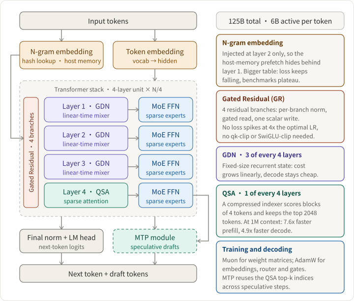

Designing an LLM architecture is a budget problem. You are not looking for the best model in the abstract; you are looking for the best model per unit of training compute, per token of serving cost, and per unit of instability risk. This chapter uses the Qwen team's paper [On the Design of Qwen3.8-Next Architecture: Evaluation, Efficiency, and Training Stability](https://arxiv.org/html/2608.30320v1) (arXiv 2608.30320, 31 Aug 2026) as a worked example. All numbers below are the paper's own reports.

The result is a sparse mixture-of-experts (MoE) model with **125B total and 6B active parameters** (called Qwen3.8-Flash-Next in the body of the paper). It leads the previous 397B-A17B flagship on 8 of 14 pretraining benchmarks and trails by at most 2.6 points on the rest, with about 1/3 of the activated parameters, 1/3 of the training tokens, and roughly 1/9 of the training FLOPs.

## Clarify requirements

The paper judges every architectural change on three axes at once, and stresses that they often disagree:

| Axis                 | What it asks                                                                              | How it is measured                                        |
| -------------------- | ----------------------------------------------------------------------------------------- | --------------------------------------------------------- |
| Quality              | Does the change lower loss and raise downstream scores?                                   | Pretraining loss, benchmark suites, long-context tests    |
| Cost                 | What does it cost in training, prefill, and decode?                                       | Kernel speed, FLOPs, memory traffic, activated parameters |
| Stability and tuning | Does it stay stable at high learning rate, and does it shift the optimal hyperparameters? | Loss spikes, gradient-norm statistics, clipping events    |

A concrete disagreement: making the n-gram embedding table larger lowers loss steadily, while downstream accuracy levels off. Loss alone would have picked the wrong design.

## High-level design

Follow one token through the model:

1. **Embeddings.** A token embedding plus an **n-gram embedding** that is injected into the residual stream at layer 2.
2. **Transformer stack.** A repeating four-layer unit: three **Gated DeltaNet (GDN)** layers, then one attention layer. In the long-context phase that attention layer becomes **Qwen Sparse Attention (QSA)**. Each token mixer is followed by a sparse MoE feed-forward block.
3. **Gated Residual (GR).** The residual stream is widened to four branches, and every sublayer reads from and writes to it through a learned gate.
4. **Head and MTP.** A final norm and LM head produce next-token logits. A multi-token prediction (MTP) module drafts extra tokens for speculative decoding and reuses the QSA indices.

Each component attacks one bottleneck:

| Component      | Bottleneck it attacks                 | What it costs or risks                                  |
| -------------- | ------------------------------------- | ------------------------------------------------------- |
| GDN hybrid     | Attention cost and KV cache growth    | Weaker exact recall than full attention, so keep 1 in 4 |
| QSA            | Quadratic attention at long context   | A second training stage and an extra indexer            |
| Gated Residual | Instability, which caps learning rate | Extra norms and gates on every sublayer                 |
| N-gram table   | Parameter capacity without compute    | Host memory, prefetch latency, saturating gains         |
| Muon optimizer | Convergence per token                 | Orthogonalization cost and per-parameter exceptions     |

## Token mixing: GDN plus QSA

### Why a hybrid

Full attention costs O(n²) compute and a KV cache that grows with length. GDN keeps a **fixed-size recurrent state**, so cost grows linearly. The gated delta rule combines a data-dependent decay αₜ with a write gate βₜ, and writes are error-correcting: the layer writes only the residual error for a key rather than blindly adding to the state. Queries and keys are L2-normalized, pass through short causal depthwise convolutions, and the output uses a sigmoid gate.

Pure recurrent layers lose exact long-range recall, so the stack keeps **one full-attention layer in every four**. In a 25B-A3B comparison trained on 400B + 80B tokens, the GDN hybrid averaged 53.81, against 51.15 for a sliding-window hybrid and 49.87 for full attention.

The full-attention layers keep RoPE. A NoPE variant looked the same in pretraining but produced more endless generations after post-training.

### Qwen Sparse Attention

Even one full-attention layer in four becomes the dominant cost at very long context. QSA is introduced during continued pretraining at 256K sequence length and replaces **every** full-attention layer, including the one in the MTP module.

- **Compressed lightweight indexer.** A multi-query attention with 4 query heads and 1 shared key head. Keys are average-pooled into micro-blocks of 4 tokens, and scores are ReLU dot products summed over heads. This cuts indexer cost from O(n²) to O(n²/4).
- **Selection.** The top 2048 tokens (up to 512 blocks), plus the incomplete tail block, feed sparse core attention.
- **Two training stages.** Dense distillation first (the indexer learns from the teacher's max-pooled attention with a KL loss, about 2B tokens), then sparse training of the backbone and indexer jointly (about 200B tokens).

Results: the average benchmark score went from 75.9 to 76.8, RULER beyond 512K from 90.08 to 93.00, and MRCR at 1M from 20.71 to 26.44. At 1M context the kernels are **7.6x faster in prefill and 4.9x faster in decode**. Note that the main pretraining run still uses full attention; QSA only appears in continued pretraining.

## Residual stream: Gated Residual

A plain pre-norm residual stream gives every sublayer the same unscaled input. GR widens it to **four branches** and makes each sublayer's read and write learnable:

1. Each branch has its own RMSNorm.
2. A small bottleneck gate (rank d/8, SiLU and sigmoid) is computed from all branches.
3. The block input is the average of the gated, normalized branches.
4. The block output is written back to every branch through one data-dependent **scalar** per branch.

There is no branch-mixing matrix, which removes a full residual-state read per block. The attention and MLP sublayers each get their own GR module, and GR replaces pre-normalization.

In a 25B-A3B run on 560B tokens, GR reached loss 1.590 and an average score of 54.66, against 1.617 and 50.91 for pre-norm. Design choices that held up: sigmoid gates beat tanh and SiLU, and a data-dependent read helps while the write stays a plain scalar. One that did not: writing to only the top-2 branches degraded after post-training, so it was dropped.

## N-gram embedding

A single n-gram embedding layer sits at **layer 2** and uses multi-head hashing to look up vectors, then injects them into the residual stream through a contextual gate. The tables (51B parameters) live in **host memory** and are prefetched, and placing them at layer 2 lets that prefetch overlap with layer 1's computation. Scaling the vocabulary from 20x to 200x the base tokenizer (250K) lowers loss monotonically, but downstream accuracy saturates. Splitting the layer across several depths gave no consistent gain.

## Optimizer and hyperparameters

- **Muon** (Nesterov momentum 0.95, 8 Newton-Schulz steps) handles the matrices: attention Q/K/V and output projections, GDN input and output projections, expert fc1/fc2, and the n-gram key/value projections.
- **AdamW** handles the rest: input embeddings, the output head, the MoE router, GR low-rank projections, GDN decay and beta projections, and output gates. The n-gram table uses Adam without weight decay.
- Fused parameters are **split before orthogonalization** (per head for QKV, gate and up halves for fc1). A partitioner balances Newton-Schulz work across data-parallel ranks, and the whole optimizer step is captured in a CUDA graph.
- A refit scaling law predicted larger batch sizes and learning rates. Batch-size warmup was dropped: it cost 18.8% more optimizer steps without a better endpoint.

## Stability is a design requirement

The team stress-tested stability by holding the learning rate at 2x and 4x its optimum on a 28-layer MoE, with a clipping threshold of 0.5:

- At 4x, AdamW produced 183 loss spikes per 10k steps and hit the clipping threshold on 213 of 19,932 steps, so clipping was engaged almost constantly. Both Muon runs never crossed the threshold, and **Muon with GR recorded zero spikes**.
- With AdamW at 3x, an earlier gate design from the same team (GatedNorm) alone cut the spike rate from 32.0 to 3.2 per 10k steps.
- In the production configuration, gated runs had 4.3x to 4.7x lower gradient-norm standard deviation within a 1000-step window.

At full scale, training reportedly had no loss spikes and needed no explicit clipping such as qk-clip or SwiGLU-clip. The key insight is that stability margin is convertible: it lets you raise the learning rate and batch size, which improves throughput and convergence.

## Trade-offs and rejected shortcuts

| Option                          | Decision | Why                                                                |
| ------------------------------- | -------- | ------------------------------------------------------------------ |
| Pure linear attention           | Rejected | Keep one full (later sparse) attention layer in four for recall    |
| NoPE in attention layers        | Rejected | Equal in pretraining, more endless generations after post-training |
| Sparse writes in Gated Residual | Rejected | Fine in pretraining, degraded after post-training                  |
| Batch-size warmup               | Rejected | 18.8% more optimizer steps, no better endpoint                     |
| Splitting n-gram across depths  | Rejected | No consistent gain over a single layer at layer 2                  |
| Larger n-gram vocabulary        | Bounded  | Loss keeps falling, benchmarks saturate                            |
| Sigmoid gate                    | Kept     | Beat tanh and SiLU                                                 |

Two lessons repeat: some effects only appear **after post-training**, so pretraining metrics alone can mislead, and cheap proxies can pick the wrong winner.

## Caveats

- Many ablations ran on smaller models (25B-A3B, 35B-A3B, a 20-layer MoE). Transfer to 125B is inferred, not shown.
- The parts of the paper summarized here do not specify MoE expert count, routing, or load balancing, so this chapter does not cover them.
- The paper names evaluation throughput as the remaining bottleneck: a cheaper mid-scale probe that predicts post-training ordering would make the design space much easier to search.

## Takeaways

- Judge every change on quality, cost, and stability together; they disagree more often than you expect.
- Mix cheap and exact token mixers: linear-time GDN for most layers, sparse attention for the long-range layers.
- Spend the instability budget on the residual stream: a gated, multi-branch residual lets you train at a higher learning rate.
- Put parameter capacity where compute is cheap, such as n-gram tables in host memory, and expect saturating returns.
- Stress-test at multiples of the optimal learning rate before committing to a recipe, and check decisions after post-training, not only after pretraining.
