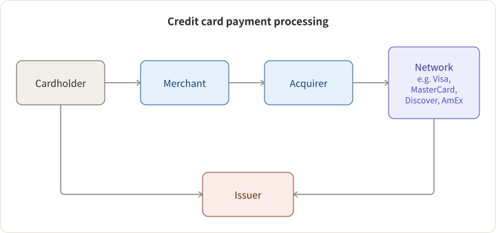

## 5 Parties

1. Cardholder: an authorized user of the card. e.g., anyone who has a credit card.
2. Issuer: an institution that issues credit cards to its users. e.g., Chase, BOA, discover, etc.
3. Merchant: an entity that provides products or services, and accepts payments via credit cards. e.g., Uber, Doordash, etc.
4. Acquirer: who provides card services to merchants. e.g., BOA Merchant Services, Chase Paymentech.
5. Electronic payments networks: a clear-house for acquirers and issuers. e.g., VisaNet, MasterCard, Discover, American Express, etc.

Are Square and Stripe acquirers? No, they are payment aggregators.

## 2 Workflows

1. Authorization: The cardholder provides the card / card info to the merchant, who processes it and sends (card number, amount, merchant ID) to the acquirer. The acquirer contacts the issuer via the electronic payments networks. The issuer checks against the credit line and fraud-prevention system, and then authorize or decline the transaction.

2. Clearing / Settlement
   1. batching: At the end of the business day, the merchant asks the acquirer with a batch of payment information for clearing.
   2. clearing and settlement: the acquirer coordinates the clearing with the issuer via the electronic payments networks, and the issuer settles the funds and bookkeeps the transaction for the cardholder.
