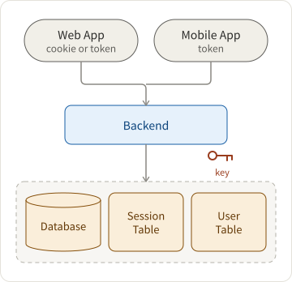
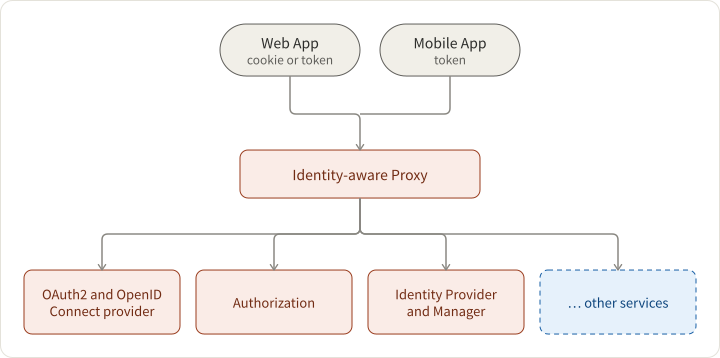
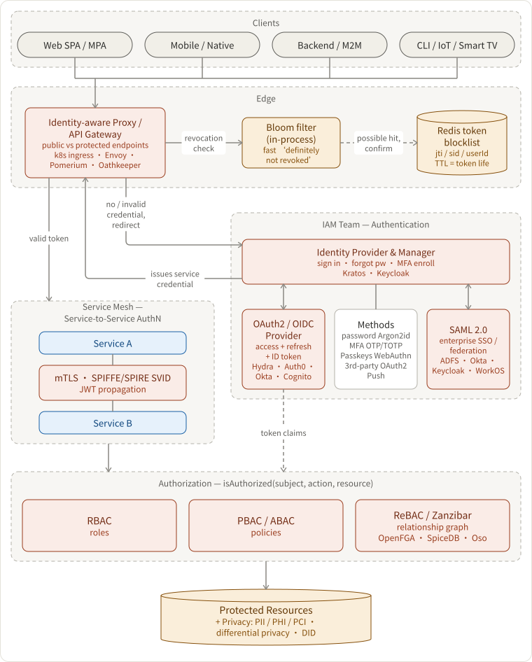
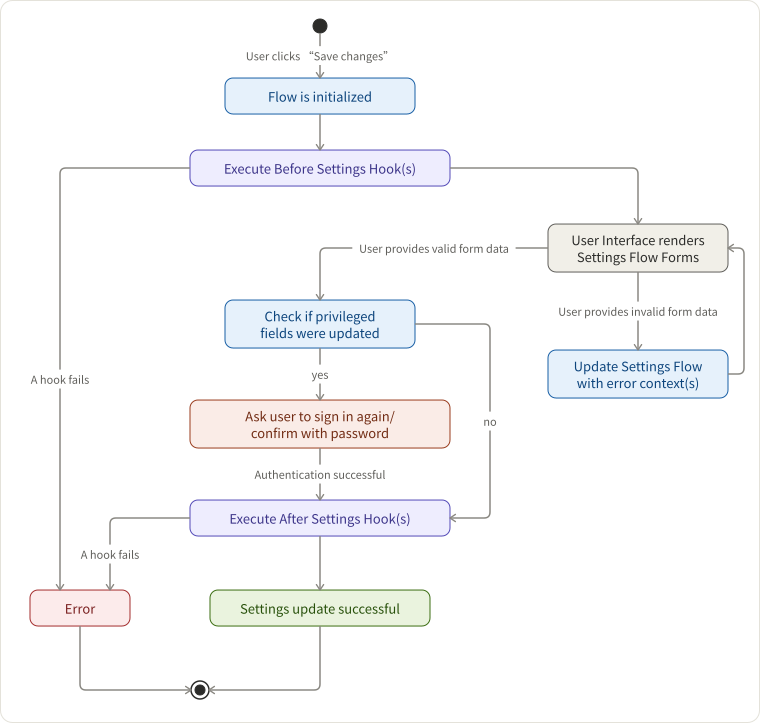
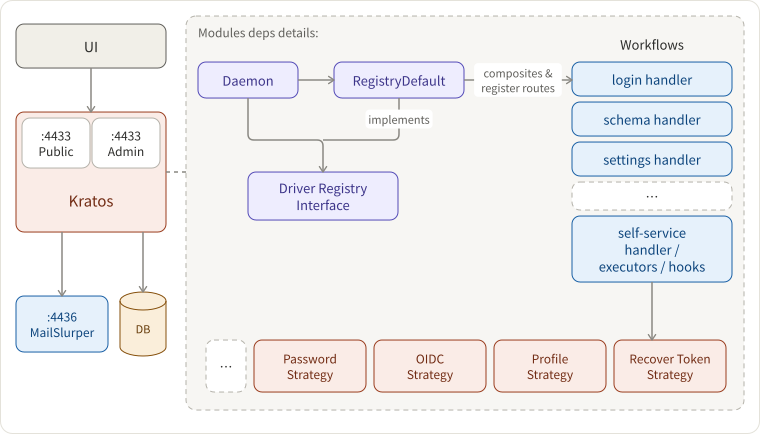
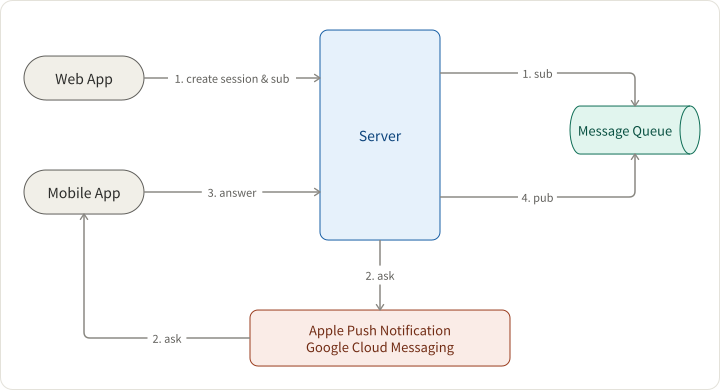
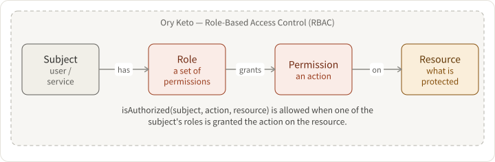
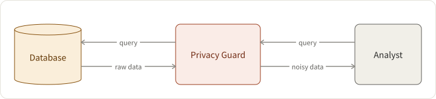

## Requirements

- design an auth solution that starts simple but could scale with the business
- consider both security and user experiences
- talk about the future trends in this area

## Big Picture: AuthN, AuthZ, and Identity Management

First-things-first, let's get back to basics

- Authentication: figure out who you are
- Authorization: figure out what you can do

In the beginning... Let there be a simple service...

<div style={{ display: "flex", flexDirection: "row" }}>
  <div style={{ width: "40%" }}>
    
  </div>
  <div style={{ width: "60%" }}>
    <ul>
      <li>Layered Architecture </li>
      <li>
        Client stores a cookie or token as the proof of login status. (valet key
        pattern){" "}
      </li>
      <li>Server persists a corresponding session </li>
      <li>
        Token is usually in the format of JWT, signed by keys fetched from
        somewhere secure (environment variables, AWS KMS, HashiCorp Vault,
        etc.)
      </li>
      <li>Popular web frameworks often prepare out-of-box auth solutions</li>
    </ul>
  </div>
</div>

Then, as the business grows, we scale the system with AKF scale cube:

- X-axis: Horizontal clone
- Y-axis: Functional decomposition
- Z-axis: Sharding

Plus Conway's law: organization designs the systems mirroring its communication structure. We usually evolve the architecture to micro-services (see [why microservices?](https://tianpan.co/notes/120-designing-uber#why-micro-services) for more)

- Btw, "microservices vs. monolith" and "multi-repo vs. mono-repo" are different things.
- For the enterprise, there are employee auth and customer auth. We focus more on the customer auth.

In the microservice world, let's take a functional slice of the authn and authz services, and there is an Identity and Access Management (IAM) team working on it.



- **Identity-aware proxy** is a reverse proxy that allows either public endpoints or checks credentials for protected endpoints. If the credential is not presented but required, redirect the user to an identity provider. e.g. [k8s ingress controller](https://res.cloudinary.com/dohtidfqh/image/upload/v1615539051/web-guiguio/ingress-controller.jpg), nginx, envoy, [Pomerium](https://www.pomerium.io/), [ory.sh/oathkeeper](https://www.ory.sh/oathkeeper), etc.
- **Identity provider and manager** manages user identity through workflows like sign in, forgot password, MFA enrollment, etc. e.g. [ory.sh/kratos](https://www.ory.sh/kratos/), [keycloak](https://www.keycloak.org/)
- **OAuth2 and OpenID Connect provider** issues tokens for first-party login (OIDC) and enables third-party developers to integrate via OAuth2. In practice this is often co-located with the identity provider — Keycloak, Auth0, and Okta all combine both — but can be separated: e.g., Ory Kratos for identity + Ory Hydra for OAuth2/OIDC.
- **Authorization** service controls who can do what.

### The whole picture in a nutshell



## Authentication

### 1. Identity Provider

- The simplest solution is to submit the user's proof of identity and issue service credentials.
  - Argon2id (OWASP's current top recommendation), bcrypt, or scrypt for password hashing
- However, modern apps often deal with complex workflows like conditional sign up, multi-step login, forgot password, etc.
  Those workflows are essentially state transition graphs in the state machine.



_Workflow: User Settings and Profile Updates_

Ory.sh/Kratos as an Example Architecture



### 2. Third-party OAuth2

OAuth2 let the user or client go through several grant types ([not sure which one to use? see this](https://auth0.com/docs/get-started/authentication-and-authorization-flow/which-oauth-2-0-flow-should-i-use)) like

1. Authorization Code + PKCE Grant — web (SPA) and mobile/native apps
1. Client Credentials Grant — backend/machine-to-machine (M2M) services
1. Device Authorization Grant — input-constrained devices (smart TVs, CLI tools, IoT)

And then finally get the access token and refresh token

1. access token is short-lived, and hence the attacking window is short if it is compromised
2. refresh token is single-use and rotated on each use; confidential clients (server-side) pair it with a client secret, while public clients (SPA, mobile) rely on rotating refresh tokens — store in an httpOnly cookie, never in localStorage

**Revocation at the edge.** A JWT is stateless and stays valid until it expires, but logout-all, a leaked token, or a banned user must take effect _before_ expiry. So the identity-aware proxy checks a revocation list on every protected request. The authoritative store is a **Redis token blocklist** keyed by `jti` / session id / user id, with each entry's TTL set to the token's remaining lifetime so it self-cleans. To avoid a Redis round-trip on the overwhelming majority of requests (which are _not_ revoked), an in-process **Bloom filter** sits in front: it answers "definitely not revoked" with zero network cost, and only on a possible hit (Bloom filters have false positives but never false negatives — so a revoked token is never wrongly allowed) does the proxy fall through to Redis to confirm. Standard Bloom filters can't delete, so rebuild it periodically from Redis (the entries expire with token TTL anyway), or use a counting/cuckoo variant. Short-lived access tokens (5–15 min) shrink the revocation window and reduce reliance on this path; if Redis is unreachable, auth typically fails closed.

The assumption is that there are so many entities involved in this workflow - client, resource owner, authorization server, resource server, network, etc. More entities introduce more exposure to attack. A comprehensive protocol should consider all kinds of edge cases. For example, what if the network is not HTTPs / cannot be fully trusted?

OpenID Connect is the identity protocol built on OAuth2, adding a signed ID token (JWT) that carries user identity claims, enabling Single Sign-On (SSO) across services.

SAML 2.0 is the older XML-based federation standard, still dominant for enterprise/B2B SSO (corporate IdPs like ADFS, Okta, Azure AD). New consumer apps default to OIDC; you typically need SAML support to sell into enterprises. Many providers (Okta, Keycloak, WorkOS) bridge both so the application sees a uniform identity regardless of the upstream protocol.

There are a lot of tricky details in those workflows and token handling processes. Don't reinvent the wheel.

### 3. Service-to-Service Authentication

In microservices, services also need to authenticate with each other — this is distinct from user-facing auth and is often overlooked:

- **mTLS (mutual TLS)** — both sides present certificates; the service mesh (Istio, Linkerd) handles this transparently via sidecars. Identity is bound to the workload, not a human user.
- **SPIFFE/SPIRE** — a standard for workload identity. Each service gets a cryptographic SVID (SPIFFE Verifiable Identity Document), usable with mTLS or JWT-SVIDs.
- **JWT propagation** — the original user JWT is forwarded downstream, or the gateway mints a new service-scoped token. Each downstream service can then authorize the request without re-validating user credentials.

Don't roll your own token validation in every service — use a shared library or a sidecar.

### 4. Multi-factor authentication

Problem: Credential stuffing attack

Users tend to reuse the same username and password across multiple sites. When one of those sites suffers from a data breach, hackers brute-force attack other sites with those leaked credentials.

- Multi-factor authentication: SMS, Email, Phone Voice OTP, Authenticator TOTP
- Rate limiter, fail to ban, and anomaly detection

Challenge: Bad deliverability of Email or SMS

- Do not share marketing email channels with transactional ones.
- Voice OTP usually has better deliverability.

### 5. Passwordless

1. **Passkeys (WebAuthn/FIDO2)** — the current standard for phishing-resistant passwordless auth. Supported natively by all major platforms (Apple, Google, Microsoft) and browsers. The credential is a private key bound to the device and origin domain, making phishing structurally impossible. Preferred for all new implementations.
   - Synced passkeys (iCloud Keychain, Google Password Manager) enable cross-device use
   - Hardware security keys (YubiKey) for high-assurance scenarios

2. Biometric: Fingerprints, facial ID — typically implemented via platform authenticators that use WebAuthn under the hood. [Trade-offs still apply](https://www.onelogin.com/learn/biometric-authentication).

3. Push Notification — used by apps like Duo, Okta Verify



How could clients subscribe to the server's state? Short polling, long polling, web socket, or server-sent events.

### 6. Vendors on the market

Don't reinvent the wheel.

- **Managed solutions**: [Auth0, Okta, Amazon Cognito, Firebase Authentication, Clerk, WorkOS, Stytch](https://tianpan.co/notes/116-auth-solutions-on-the-market). Clerk and WorkOS have become the go-to choices for new startups — Clerk for developer experience and Workos for B2B/enterprise SSO features; Auth0/Okta remain strong for large enterprise compliance requirements.
- **On-premise / self-host**: [ory.sh](https://www.ory.sh/), Keycloak, SuperTokens.

### 7. Optimization

Challenge 1: Web login is super slow or cannot submit login form at all.

- JS bundle is too large for mobile web
  - Build a lite PWA version of your SPA (single-page web app). whatever makes the bundle small - e.g. preact or inferno
  - Or do not use SPA at all. Simple MPA (multi-page web app) works well with a raw HTML form submission
- Browser compatibility
  - Use BrowserStack or other tools to test on different browsers
- Data centers are too far away
  - Put static resources to the edge / CDN and relay API requests through Google backbone network
  - Build a local DC 😄

See [Web App Delivery Optimization for more info](https://tianpan.co/notes/15-web-app-delivery-optimization)

Challenge 2: Account taking-over

- [Fraud Detection with Semi-supervised Learning](https://tianpan.co/notes/136-fraud-detection-with-semi-supervised-learning)
- [Unsupervised learning by datavisor](https://www.datavisor.com/industry-solutions/financial-services-old/account-takeover/)

Challenge 3: Account creation takes too long

When the backend system gets too large, a user creation may fan out to many services and create a lot of entries in different data sources. It feels bad to wait for 15 seconds at the end of sign up, right?

1. collect and sign up incrementally
2. async

## Authorization

`isAuthorized(subject, action, resource)`

### 1. Role-based Access Control (RBAC)



### 2. Policy-based Access Control (PBAC / ABAC)

```json
{
  "subjects": ["alice"],
  "resources": ["blog_posts:my-first-blog-post"],
  "actions": ["delete"],
  "effect": "allow"
}
```

Challenge: single point of failure and cascading failures

- preprocess and cache permissions
- leverage request contexts
  - assumptions: requests inside of a datacenter are trusted vs. not trusted
- fail open vs. fail closed

### 3. Relationship-Based Access Control (ReBAC)

Pioneered by the [Google Zanzibar paper](https://research.google/pubs/pub48190/), this model expresses permissions as a graph of relationships between users and objects — e.g., "alice is an editor of document:X, which is in folder:Y that alice's team has viewer access to." Permissions compose recursively through the graph, enabling fine-grained checks that scale to billions of objects.

- Open-source implementations: [OpenFGA](https://openfga.dev/) (by Okta), [SpiceDB](https://github.com/authzed/spicedb), [Oso](https://www.osohq.com/)
- Ideal for: document sharing, multi-tenant SaaS, social graphs — anywhere permissions derive from data relationships

## Privacy

### 1. PII, PHI, PCI

Western culture has a tradition to respect privacy, especially after the Nazis murdered millions of people.
Here are some typical sensitive data types: Personally Identifiable Information (PII), Protected Health Information (PHI, regulated by HIPAA), and Credit Card or Payment Card Industry (PCI) Information.

### 2. Differential Privacy

Redacting sensitive information alone may not be good enough to prevent data associated with other datasets.

Differential privacy helps analysts extract data from the databases containing personal information but still protects individuals' privacy.



### 3. Decentralized Identity

To decouple id from a centralized identity provider and its associated sensitive data, we can use [decentralized id (DID)](https://tianpan.co/notes/159-did) instead.

- it is essentially in the format of URN: `did:example:123456789abcdefghijk`
- it could be derived from asymmetric keys and its target business domain.
  - it does not involve your personal info, unlike the traditional way
  - See [DID method](https://w3c.github.io/did-spec-registries/#did-methods) for how it is working with blockchains.
- it preserves privacy by
  - use different DIDs for different purposes
  - selective disclosure / verifiable claims

Imagine that Alice has a state-issued DID and wants to buy some alcohol without disclosing her real name and precise age.


A DID solution:

- Alice has an identity profile having `did:ebfeb1f712ebc6f1c276e12ec21`, name, avatar url, birthday and other sensitive data.
- Create a claim that `did:ebfeb1f712ebc6f1c276e12ec21` is over the age 21
- A trusted third-party signs the claim and make it a **verifiable claim**
- Use the verifiable claim as the proof of age

## Summary

This article is an overview of authn and authz in microservices, and you don't have to memorize everything to be an expert. Here are some takeaways:

1. follow standard protocols and don't reinvent the wheel
2. do not under-estimate the power of the security researchers/hackers
3. it is hard to be perfect, and it does not have to be perfect. Prioritize your development comprehensively
