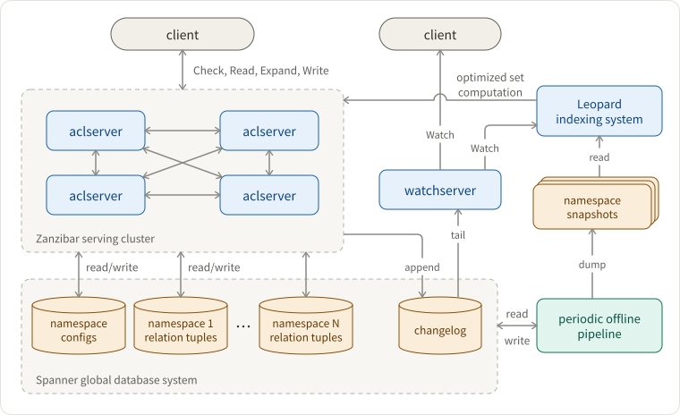
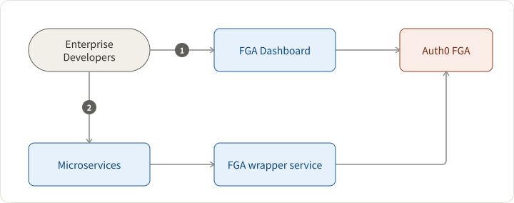
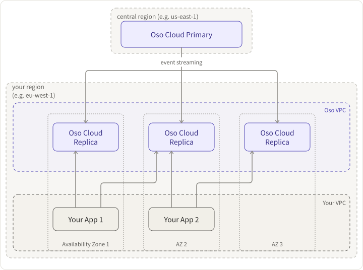
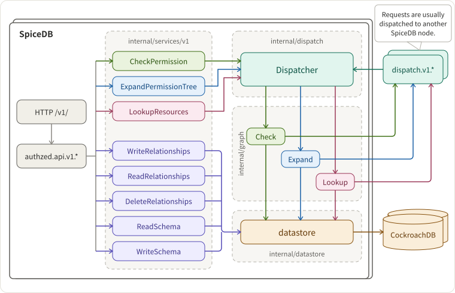
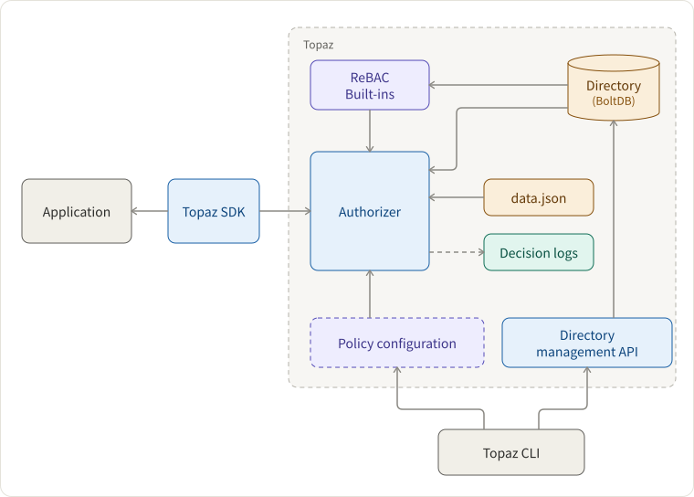
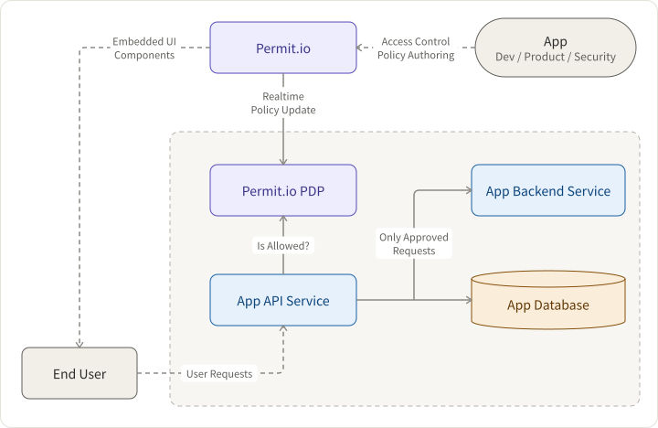

Authorization determines whether an individual or system can access a particular resource. And this process is a typical scenario that could be automated with software. We will review Google's Zanzibar, Zanzibar-inspired solutions, and other AuthZ services on the market.

## Zanzibar: Google's Consistent, Global Authorization System

- Google's = battle-tested with Google products, 20 million permissions check per second, p95 < 10ms, 99.999% availability
- Consistent = ensure that authorization checks are based on ACL data no older than a client-specified change
- Global = geographically distributed data centers and distributes load across thousands of servers around the world.
- Authorization = general-purpose authorization

In Zanzibar's context, we can express the AuthZ question in this way:

```
isAuthorized(user, relation, object) = does the user have relation to object?
```

It's called relationship-based access control (==ReBAC==). Clients could build ABAC and RBAC on top of ReBAC. Unfortunately, Zanzibar is not open-sourced nor purchasable as a out-of-box service.

Zanzibar Architecture



Why is Zanzibar scalable?

- Use Spanner as the database
- Leopard indexing system
  - flatten group-to-group paths like a reachability problem in a graph
  - store index tuples as ordered lists of integers in a structure, such as a skip list, to achieve efficient union and intersections among sets.
  - async dataflow client > aclserver > changelog > Leopard indexing system
- How to maintain external consistency? Zookie protocol - Clients check permissions with a timestamp-based token.

## Auth0 Fine-Grained Authorization (FGA)

[Auth0 FGA](https://github.com/openfga/openfga) is an [open-source implementation](https://github.com/openfga) of Google Zanzibar. Check the interactive tutorial at https://zanzibar.academy/.

For enterprise developers in the context of microservices, how to use the managed solution of FGA?



1. Go to the FGA dashboard to define the authorization model in DSL and relation tuples, and finally, add authorization assertions like automated tests (this is great!).
2. Developers go back to their services and call the FGA wrapper's check endpoint

Unfortunately, I don't see changelog audits and version control to rollback in case developers break things in the FGA dashboard, probably because FGA is still a work in progress.

## OSO

With Oso, you can:

- **Model**: Set up common permissions patterns like role-based access control (RBAC) and relationships using Oso's built-in primitives. Extend them however you need with Oso's declarative policy language, Polar (DSL).
- **Filter**: Go beyond yes/no authorization questions. Implement authorization over collections too - e.g., "Show me only the records that Juno can see."
- **Test**: Write unit tests over your authorization logic now that you have a single interface for it. Use the Oso debugger or REPL to track down unexpected behavior.



## Ory Keto

[Keto](https://github.com/ory/keto) is an open Source (Go) implementation of Zanzibar. Ships gRPC, REST APIs, newSQL, and an easy and granular permission language (DSL). Supports ACL, RBAC, and other access models.

## Authzed SpiceDB

[SpiceDB](https://github.com/authzed/spicedb) is an open-source database system for managing security-critical application permissions inspired by Google's Zanzibar paper.



## Aserto Topaz

[Topaz](https://github.com/aserto-dev/topaz) is an open-source authorization service providing fine-grained, real-time, policy-based access control for applications and APIs.

It uses the [Open Policy Agent](https://www.openpolicyagent.org/) (OPA) as its decision engine, and provides a built-in directory that is inspired by the Google [Zanzibar](https://research.google/pubs/pub48190/) data model.

Authorization policies can leverage user attributes, group membership, application resources, and relationships between them. All data used for authorization is modeled and stored locally in an embedded database, so authorization decisions can be evaluated quickly and efficiently.



## Cloudentity

It seems to be an integrated CIAM solution, and there is no standalone feature for enterprise authorization. Documentation is confusing...

## Open Policy Agent

The [Open Policy Agent (OPA)](https://www.openpolicyagent.org/) is an open-source, general-purpose policy engine that unifies policy enforcement across the stack. OPA provides a high-level declarative language that lets you specify policy as code and simple APIs to offload policy decision-making from your software. You can use OPA to enforce policies in microservices, Kubernetes, CI/CD pipelines, API gateways, and more.

OPA was originally created by [Styra](https://www.styra.com/) and a graduated project from [Cloud Native Computing Foundation (CNCF)](https://www.cncf.io/).

## Permit.IO

Permit.IO is a low-code AuthZ platform based on OPA and OPAL.



## Scaled Access

[Scaled Access](https://www.scaledaccess.com/) is an european company that was acquired by onewelcome. It offers rich context-aware access control, real-time policy enforcement, fine-grained authorization, and relationship-based access control. There are APIs in the documentation but no SDKs.

## Casbin

[Casbin](https://casbin.org/) is an authorization library that supports access control models like ACL, RBAC, ABAC in Golang. There are SDKs in many programming languages. However, its configuration is pretty static in CSV files, and it's more for corporation internal and less for customer-facing authorization.

## SGNL

This service looks pretty scrappy - beautiful websites without any content for developers. No doc, no video or self-service demo. I suspect its positioning is for non-tech enterprises. Not recommended.

## Summary

Here is a preliminary ranking after my initial check. Ideally, I want a LaunchDarkly-like AuthZ platform - easy to integrate and operate, fully equipped with audit logs, version control, and a developer-facing web portal.

<br/>

<div style={{ fontSize: 16 }}>

|                                                     | Github Stars | Models     | DevEx                              | Perf | Score (out of 5) |
| --------------------------------------------------- | ------------ | ---------- | ---------------------------------- | ---- | ---------------- |
| [Oso](https://github.com/osohq/oso)                 | 2.8k         | ReBAC      | DSL, API, SDK, web portal          | ?    | 3                |
| [Spicedb](https://github.com/authzed/spicedb)       | 3k           | ReBAC      | DSL, API, SDK, web portal          | ?    | 3                |
| [permit.io](https://permit.io/)                     | 840          | ReBAC      | DSL, API, SDK, low-code web portal | ?    | 3                |
| [Aserto Topas](https://github.com/aserto-dev/topaz) | 534          | ReBAC      | DSL, API, SDK, web portal          | ?    | 3                |
| [FGA](https://github.com/openfga/openfga)           | 657          | ReBAC      | DSL, API, SDK, web portal          | ?    | 3                |
| [Keto](https://github.com/ory/keto)                 | 3.8k         | ReBAC      | DSL, API, SDK                      | ?    | 2                |
| [Casbin](https://casbin.org/)                       | 13.4k        | ABAC, RBAC | Library, static file for policies  | ?    | 1                |

</div>
