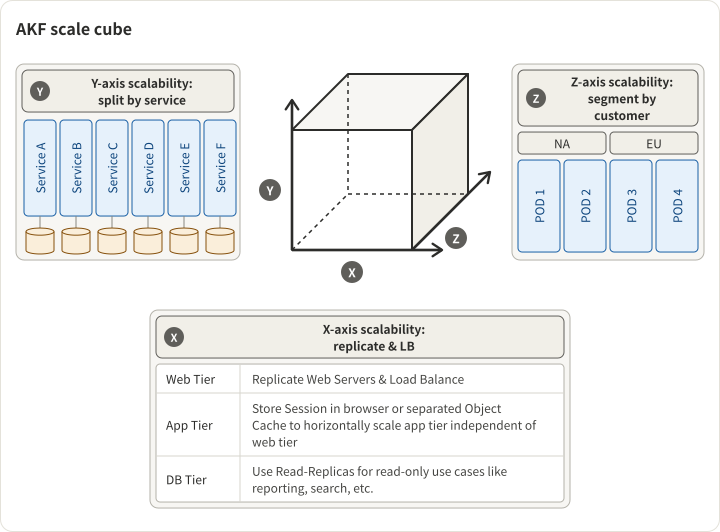

The AKF Scale Cube from _The Art of Scalability_ compresses the entire vocabulary of web-service scaling into three orthogonal axes. Almost every real-world scaling decision can be placed somewhere in this cube, which makes it the most useful single diagram for thinking about capacity.

## The three axes

1. **X-axis — Horizontal Duplication / Cloning.** Run N identical, preferably stateless instances behind a load balancer. Any request can be served by any instance. This is the "just add more boxes" axis.
2. **Y-axis — Functional Decomposition / Microservices.** Split the monolith by responsibility: auth service, user profile service, photo service, checkout service. Different services scale independently and are owned by different teams.
3. **Z-axis — Horizontal Data Partitioning / Sharding.** Split the data so each "pod" owns a slice of users, regions, or tenants. Uber's China and US data centers are a canonical example — each region runs the full stack for its own users.

## When each axis matters

The axes aren't substitutes. Each solves a different bottleneck, and using the wrong axis for the problem wastes engineering time.

**X-axis solves stateless CPU/request-volume bottlenecks.** If your p50 latency is fine but you're running out of CPU under peak load, you need more boxes. Cheap to implement if the app is already stateless; brutal to implement if state is scattered across sticky sessions, in-memory caches, or singleton background jobs. Roughly 70% of "we need to scale" problems are actually X-axis problems and solvable in days.

**Y-axis solves organizational and deploy-risk bottlenecks.** The honest reason most companies adopt microservices isn't technical — it's that a 200-engineer monolith becomes unshippable. Deploys block each other, blast radius of a bad change is too large, and teams can't own anything end-to-end. Y-axis is expensive: it introduces network I/O, distributed-transaction headaches, versioning, and a service-mesh tax. Use it when the org, not the compute, is the bottleneck.

**Z-axis solves data-volume and tenancy bottlenecks.** You hit Z-axis when a single database can't hold the data, a single region can't meet latency SLOs, or regulatory boundaries (GDPR, China data residency) require isolation. Sharding is the most operationally expensive axis — re-shards, cross-shard joins, and hot-shard rebalancing are genuinely hard and rarely reversible without downtime.

## The order matters

In most companies, the right application order is X → Y → Z:

1. **Start with X-axis.** Make the service stateless. Add boxes. This buys most companies 10-100x growth with modest engineering cost. If you skip this and go straight to microservices, you end up with 30 services that each need to be stateless anyway.
2. **Then Y-axis, but only when the org demands it.** A 20-person team running a well-factored monolith will out-ship a 20-person team running 15 microservices. Y-axis is an org-scale tool, not a compute-scale tool. Most "we need microservices" decisions at small companies are premature.
3. **Z-axis last, only when necessary.** Data partitioning is the highest-cost, least-reversible axis. Don't shard until you actually can't fit the data on a single tier. Once sharded, plan for re-sharding as a first-class operational concern.

The common failure mode is doing Y before X — building a microservice architecture on top of stateful services. You pay the distribution tax without getting the horizontal-scaling benefit.

## What each axis actually costs

| Axis          | Engineering cost   | Operational cost                                 | Reversibility        |
| ------------- | ------------------ | ------------------------------------------------ | -------------------- |
| X (Clone)     | Low (if stateless) | Load balancer, autoscaling                       | Fully reversible     |
| Y (Decompose) | High               | Service mesh, observability, API versioning      | Hard to reverse      |
| Z (Shard)     | Very high          | Shard management, re-shards, cross-shard queries | Very hard to reverse |

A useful rule: **any scaling step whose reversal would require downtime is a bet-the-architecture decision**. X-axis usually isn't. Y and Z usually are.

## Real-world combinations

Most production systems are at specific (X, Y, Z) coordinates rather than at a pure axis. Some typical coordinates:

- **Early SaaS startup:** High X, low Y, low Z. Stateless monolith behind a load balancer with a single Postgres primary. This architecture carries most SaaS companies through Series B.
- **Mid-stage SaaS (100-500 eng):** High X, moderate Y, low Z. Monolith split into a handful of major services (auth, billing, core), but data is still one primary DB. Typical 5-10 service count.
- **Hyperscale consumer product:** Very high X, very high Y, very high Z. Hundreds of services, regional pods, read replicas, sharded data stores. Uber, Meta, Google.
- **Multi-region B2B:** Moderate X, moderate Y, high Z along geography. Y-axis split by product area; Z-axis split by region for compliance. Salesforce, Workday.

## A concrete example — Facebook TAO

Facebook's social-graph store is a textbook multi-axis application: X-axis for stateless query servers, Y-axis to isolate graph-serving from other concerns, Z-axis to shard the graph across regions and DB clusters. See [how Facebook scaled its social graph data store](https://tianpan.co/notes/49-facebook-tao) for the full architecture.

## The scaling decision tree

When you hit a scaling problem, work the question in this order:

1. **Is the service stateless?** If not, make it stateless before anything else. This is the highest ROI work you'll ever do.
2. **Are we CPU- or throughput-bound?** If yes, go X. Add boxes. Done.
3. **Is the deploy or team-ownership structure broken?** If yes, consider Y — but only if the org actually needs independent deployability. Start with one new service, not ten.
4. **Can a single database tier fit the data at projected 12-month growth?** If not, start planning Z. Design shard keys with 10x headroom.
5. **Are we hitting region-latency or regulatory constraints?** If yes, Z along geography.

Answering the questions in that order prevents the most expensive scaling mistake: using a high-cost axis to solve a low-axis problem.

## See also

- [Facebook TAO](https://tianpan.co/notes/49-facebook-tao) — a real-world multi-axis case study.
- [Bloom Filter](https://tianpan.co/notes/68-bloom-filter) — used in many horizontally-sharded stores to avoid cross-shard lookups.
- [Skiplist](https://tianpan.co/notes/69-skiplist) — the in-memory data structure behind many of the per-shard storage layers.
