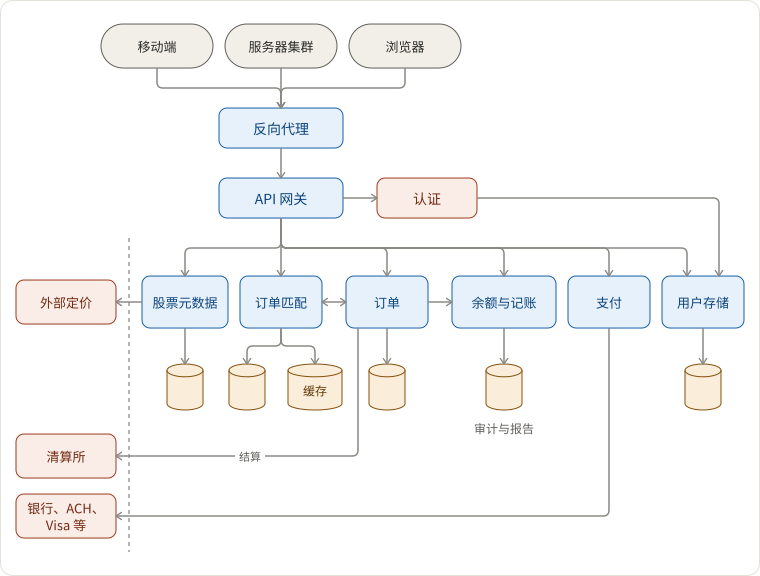
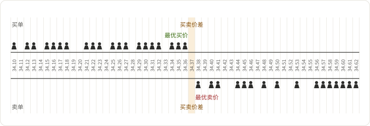
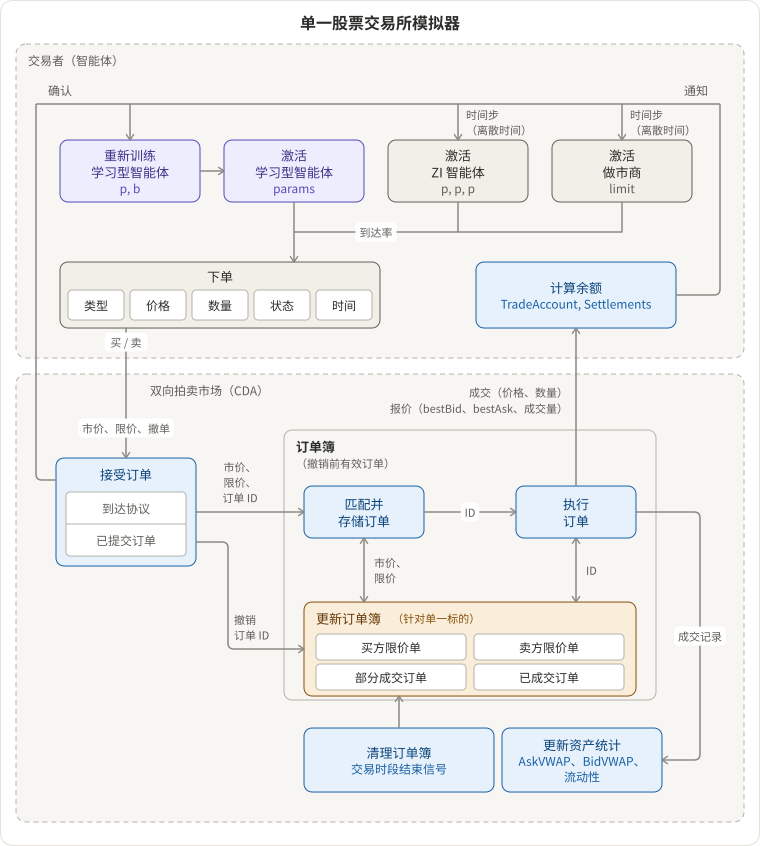
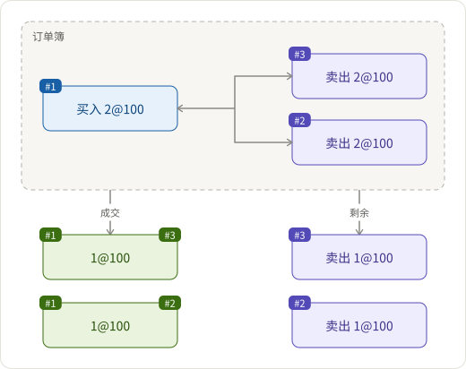

## 需求

- `买入` 和 `卖出` 订单的订单匹配系统。订单类型：
  - 市场订单
  - 限价订单
  - 止损订单
  - 完全成交或取消订单
  - 订单有效期
- 为数百万用户提供高可用性和低延迟
  - 异步设计 - 广泛使用消息队列（顺便提一下，副作用：工程师在一个服务上发布到队列，不知道下游服务具体在哪里，因此无法做坏事。）

## 架构



## 组件及其相互作用

### 订单匹配系统

- 按股票代码分片
- 订单的基本数据模型（其他元数据省略）：`Order(id, stock, side, time, qty, price)`
- 订单簿的核心抽象是匹配算法。有许多匹配算法（[参考 stackoverflow](http://web.archive.org/web/20120626161034/http://www.cmegroup.com/confluence/display/EPICSANDBOX/Match+Algorithms)，[参考 medium](https://medium.com/lgogroup/a-matching-engine-for-our-values-part-1-795a29b400fa)）
- 示例 1：[价格-时间 FIFO](https://stackoverflow.com/questions/13112062/which-are-the-order-matching-algorithms-most-commonly-used-by-electronic-financi) - 一种将二维向量投射或展平为一维向量的方式
  - x 轴是价格
  - y 轴是订单。价格/时间优先队列，FIFO。
    - 买方：按价格升序，按时间降序。
    - 卖方：按价格升序，按时间升序。
  - 换句话说
    - 买方：价格越高，订单越早，越接近匹配中心。
    - 卖方：价格越低，订单越早，越接近匹配中心。

x 轴



y 轴投射到 x 轴上

```text
Id   Side    Time   Qty   Price   Qty    Time   Side
---+------+-------+-----+-------+-----+-------+------
#3                        20.30   200   09:05   卖出
#1                        20.30   100   09:01   卖出
#2                        20.25   100   09:03   卖出
#5   买入    09:08   200   20.20
#4   买入    09:06   100   20.15
#6   买入    09:09   200   20.15
```

来自 Coinbase Pro 的订单簿


[单一股票交易所模拟器](http://homepages.gold.ac.uk/nikolaev/aalts.htm)



- 示例 2：按比例分配



如何实现价格-时间 FIFO 匹配算法？

- 按股票分片，CP 优于 AP：一股一个分区
- 有状态的内存树图
  - 定期迭代树图以匹配订单
- 使用 Cassandra 进行数据持久化
- 订单匹配服务的进出请求通过消息队列进行
- 故障转移
  - 内存树图快照到数据库
  - 在错误情况下，从快照恢复并与缓存去重

如何实时将订单簿数据传输到客户端？

- websocket

如何支持不同类型的订单？

- 在树图中使用相同的 `卖出或买入：数量 @ 价格`，但具有不同的创建设置和匹配条件
  - 市场订单：以最后市场价格下单。
  - 限价订单：以特定价格下单。
  - 止损订单：以特定价格下单，并在特定条件下匹配。
  - 完全成交或取消订单：以特定价格下单，但仅匹配一次。
  - 订单有效期：以特定价格下单，但仅在给定时间范围内匹配。

### 订单服务

- 保留所有活动订单和订单历史。
- 接收到新订单时写入订单匹配。
- 接收匹配的订单并与外部清算所结算（异步外部网关调用 + 定时任务同步数据库）

### 参考文献

- 交易是如何发生的？[在 Scala 中模拟金融交易所](http://falconair.github.io/2015/01/05/financial-exchange.html)
- 开源
  - [GitHub - objectcomputing/liquibook: 现代 C++ 订单匹配引擎](https://github.com/objectcomputing/liquibook)
  - [GitHub - cyanly/gotrade: 用 Go 编写的电子交易系统的概念验证](https://github.com/cyanly/gotrade)
- [金融信息交换（"FIX"）协议](http://help.cqg.com/continuum/default.htm#!Documents/fixserver.htm)
- 订单类型：[技术分析课程。交易者/投资者的培训、辅导与指导 - 买卖股票时使用的订单类型](http://www.tradersplace.in/TypesofOrders.html)
- [GitHub - fmstephe/matching_engine: 一个简单的金融交易匹配引擎。旨在了解它们的工作原理。](https://github.com/fmstephe/matching_engine)
- [自动化算法交易：限价订单簿交易的学习代理](http://homepages.gold.ac.uk/nikolaev/aalts.htm)
