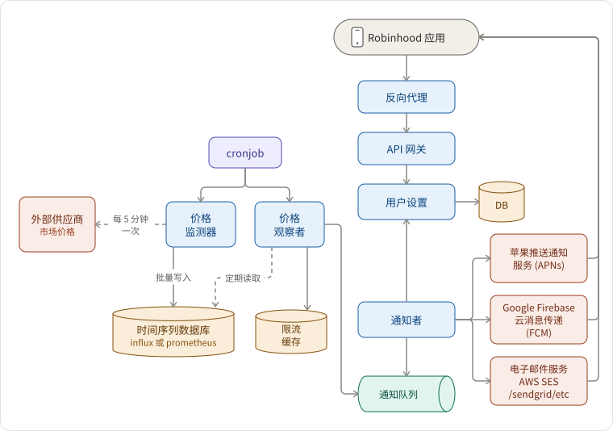

## 需求

- 300 万用户
- 5000 支股票 + 250 支全球股票
- 用户在以下情况下会收到价格变动通知：
  1. 订阅该股票
  1. 股票价格变动达到 5% 或 10%
  1. 自 a) 上周或 b) 昨天以来
- 可扩展性。可能支持其他类型的通知，如突发新闻、财报电话会议等。

## 构建架构草图

上下文：

- 什么是清算？清算是金融交易结算的程序——即资金及时准确地转移给卖方，证券转移给买方。通常，清算由一个称为清算所的专业组织作为中介。
- 什么是证券交易所？一个股票经纪人和交易者可以买卖证券的场所。

## 这些组件是什么，它们如何相互作用？

- 价格监测器
  - 数据获取策略
    - 选项 1 初步：每 5 分钟获取一次数据，并批量写入时间序列数据库。
    - 选项 2 高级：如今外部系统通常直接推送数据，因此我们不必一直拉取。
  - 每次请求或每次价格变动约 6000 个点。
  - 数据保留 1 周，因为这只是 lambda 架构的加速层。
- 价格观察者
  - 读取过去一周或过去 24 小时内每只股票的数据。
  - 计算波动是否超过 5% 或 10% 在这两个时间段内。我们得到的元组如 (股票, 上涨 5%, 1 周)。
    - 边缘情况：我们是否应该规范化价格数据？例如，某人错误地将 UBER 以 1 美元的价格出售。
  - **速率限制（因为 5% 或 10% 的变化可能在一天内发生多次）**，然后发出事件 `PRICE_CHANGE(STOCK_CODE, timeSpan, percentage)` 到通知队列。
- 定期触发器是 cron 作业，例如 Airflow、Cadence。
- 通知队列
  - 在用户和股票数量较少时，可能不一定会引入。
  - 可能接受通用消息事件，如 `PRICE_CHANGE`、`EARNINGS_CALL`、`BREAKING_NEWS` 等。
- 通知者
  - 订阅通知队列以获取事件
  - 然后从用户设置服务中获取通知对象
  - 最后根据用户设置，通过 APNs、FCM 或 AWS SES 发送消息。
