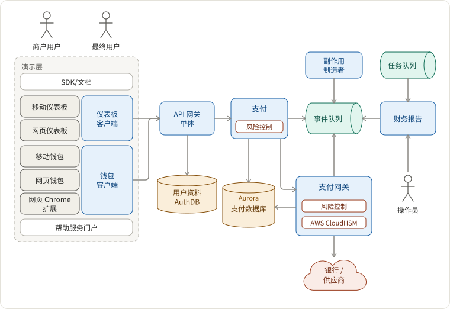

## 澄清需求

设计一个类似于 Square Cash（以下称为 Cash App）或 PayPal 的转账后端系统，以实现：

1. 从银行存款和支付
2. 账户之间转账
3. 高扩展性和可用性
4. 国际化：语言、时区、货币兑换
5. 非幂等 API 和至少一次交付的去重
6. 跨多个数据源的一致性

## 架构



## 功能和组件

### 支付服务

支付数据模型本质上是“[复式记账](https://en.wikipedia.org/wiki/Double-entry_bookkeeping_system)”。每个账户的每一笔入账都需要在另一个账户中有相应的对立入账。所有借方和贷方的总和等于零。

#### 存款和支付

交易：新用户 Jane Doe 从银行向 Cash App 存入 100 美元。这一笔交易涉及以下数据库条目：

记账表（用于历史记录）

```txt
+ 借方, 美元, 100, CashAppAccountNumber, txId
- 贷方, 美元, 100, RoutingNumber:AccountNumber, txId
```

交易表

```txt
txId, 时间戳, 状态（待处理/已确认）, [记账条目], 叙述
```

一旦银行确认交易，更新上述待处理状态和以下资产负债表，均在一笔交易中完成。

资产负债表

```txt
CashAppAccountNumber, 美元, 100
```

#### 在 Cash App 内部账户之间转账

与上述情况类似，但没有待处理状态，因为我们不需要慢速外部系统来更改其状态。所有记账表、交易表和资产负债表的更改都在一笔交易中完成。

### 国际化

我们在三个维度上解决国际化问题。

1. 语言：所有文本，如文案、推送通知、电子邮件，均根据 `accept-language` 头部进行选择。
2. 时区：所有服务器时区均为 UTC。我们在客户端将时间戳转换为本地时区。
3. 货币：所有用户转账交易必须使用相同货币。如果他们想要跨货币转移，必须先以对 Cash App 有利的汇率兑换货币。

例如，Jane Doe 想以 0.2 的汇率将 1 美元兑换为 6.8 人民币。

记账表

```txt
- 贷方, 美元, 1, CashAppAccountNumber, txId
+ 借方, 人民币, 6.8, CashAppAccountNumber, txId, @7.55 人民币/美元
+ 借方, 美元, 0.1, ExpensesOfExchangeAccountNumber, txId
```

交易表、资产负债表等与存款和支付中讨论的交易类似。主要区别在于银行或供应商提供兑换服务。

### 如何在交易表和外部银行及供应商之间同步？

- [使用幂等性重试以提高外部调用的成功率并确保没有重复订单](https://tianpan.co/notes/43-how-to-design-robust-and-predictable-apis-with-idempotency)。
- 检查待处理订单是否已完成或失败的两种方法。
  1. `轮询`：定时作业（SWF、Airflow、Cadence 等）轮询待处理订单的状态。
  2. `回调`：为外部供应商提供回调 API。
- 优雅关闭。银行网关调用可能需要数十秒才能完成，重启服务器可能会从数据库恢复未完成的交易。该过程可能会创建过多连接。为减少连接，在关闭之前停止接受新请求，并等待现有的外发请求完成。

### 去重

为什么去重是一个问题？

1. 不是所有端点都是幂等的
2. 事件队列可能是至少一次的。

#### 不是所有端点都是幂等的：如果外部系统不是幂等的怎么办？

对于上述 `轮询` 情况，如果外部网关不支持幂等 API，为了不淹没重复条目，我们必须记录外部系统给我们的订单 ID 或参考 ID，并通过订单 ID 查询 `GET`，而不是一直使用 `POST`。

对于 `回调` 情况，我们可以确保实现幂等 API，并且无论如何我们将 `待处理` 更改为 `已确认`。

#### 事件队列可能是至少一次的

- 对于事件队列，我们可以使用一个完全一次的 Kafka，生产者吞吐量仅下降 3%。
- 在数据库层，我们可以使用 [幂等性密钥或去重密钥](https://tianpan.co/notes/43-how-to-design-robust-and-predictable-apis-with-idempotency)。
- 在服务层，我们可以使用 Redis 键值存储。

### 可用性和扩展性

- 整体故障转移策略：[通过故障转移提高可用性](https://tianpan.co/notes/85-improving-availability-with-failover)：冷备份、热备份、温备份、主动-主动。
- 服务层扩展：[AKF 扩展立方体](https://tianpan.co/notes/41-how-to-scale-a-web-service)
- 数据层扩展：CQRS 模式
- 需要速度层吗？[Lambda 架构](https://tianpan.co/notes/83-lambda-architecture)
