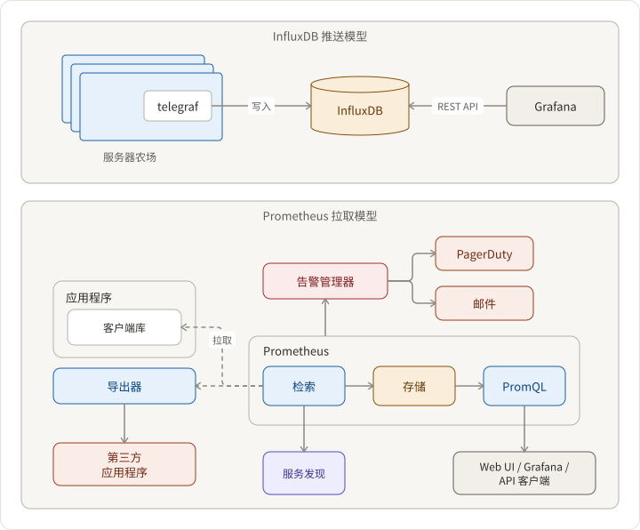

## 需求

日志与度量：日志是发生的事件，而度量是对系统健康状况的测量。

我们假设该系统的目的是提供度量——即计数器、转化率、计时器等，用于监控系统性能和健康。如果转化率大幅下降，系统应警告值班人员。

1. 监控商业指标，如注册漏斗的转化率
2. 支持各种查询，如在不同平台上（IE/Chrome/Safari，iOS/Android/桌面等）
3. 数据可视化
4. 可扩展性和可用性

## 架构

构建系统的两种方式：

1. 推送模型：Influx/Telegraf/Grafana
2. 拉取模型：Prometheus/Grafana

拉取模型更具可扩展性，因为它减少了进入度量数据库的请求数量——没有热路径和并发问题。



## 特性与组件

### 测量注册漏斗

以移动应用的四步注册为例

```txt
输入手机号码 -> 验证短信代码 -> 输入姓名 -> 输入密码
```

每一步都有 `IMPRESSION` 和 `POST_VERIFICATION` 阶段。并发出如下度量：

```json5
{
  sign_up_session_id: "uuid",
  step: "VERIFY_SMS_CODE",
  os: "iOS",
  phase: "POST_VERIFICATION",
  status: "SUCCESS",
  // ... ts, contexts, ...
}
```

因此，我们可以查询 `iOS` 上 `VERIFY_SMS_CODE` 步骤的整体转化率，如下所示：

```txt
(counts of step=VERIFY_SMS_CODE, os=iOS, status: SUCCESS, phase: POST_VERIFICATION) / (counts of step=VERIFY_SMS_CODE, os=iOS, phase: IMPRESSION)
```

### 数据可视化

Grafana 在数据可视化工作中已经相当成熟。如果你不想暴露整个网站，可以使用 [嵌入面板与 iframe](https://grafana.com/docs/reference/sharing/#embed-panel)。

```

```
