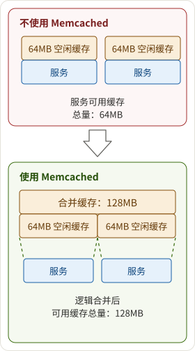
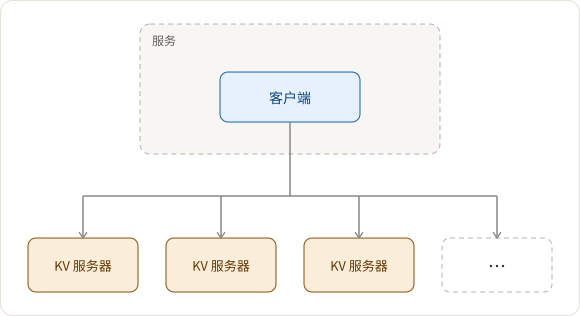
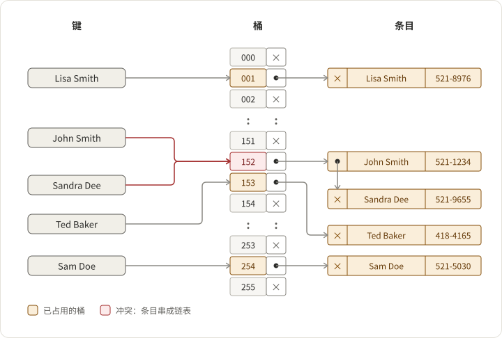

## 需求

1. 高性能，分布式键值存储

- 为什么分布式？
  - 答：为了存储更大规模的数据
    

2. 用于小数据对象的内存存储
3. 简单的服务器（将复杂性推给客户端），因此可靠且易于部署

## 架构

大局：客户端-服务器

- 客户端
- 给定一组 Memcached 服务器
- 根据键选择服务器
- 服务器
- 将 KV 存储到内部哈希表中
- LRU 驱逐

键值服务器由固定大小的哈希表 + 单线程处理程序 + 粗粒度锁组成

如何处理冲突？主要有三种解决方法：

1. 分离链：发生冲突的桶链表中包含相同索引的多个条目，你可以始终将新发生冲突的键值对附加到列表中。
2. 开放寻址：如果发生冲突，转到下一个索引，直到找到可用的桶。
3. 动态调整大小：调整哈希表的大小并分配更多空间；因此，冲突发生的频率会降低。

## 客户端如何确定查询哪个服务器？

请参见 [数据分区与路由](https://puncsky.com/notes/2018-07-21-data-partition-and-routing)

## 如何使用缓存？

请参见 [键值缓存](https://puncsky.com/notes/122-key-value-cache)

## 如何进一步优化？

请参见 [Facebook 如何扩展其社交图存储？TAO](https://puncsky.com/notes/49-facebook-tao)
