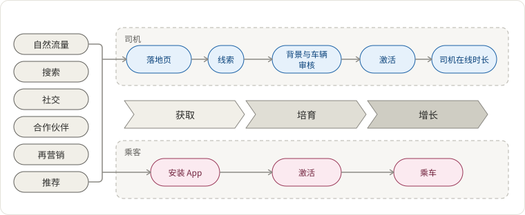
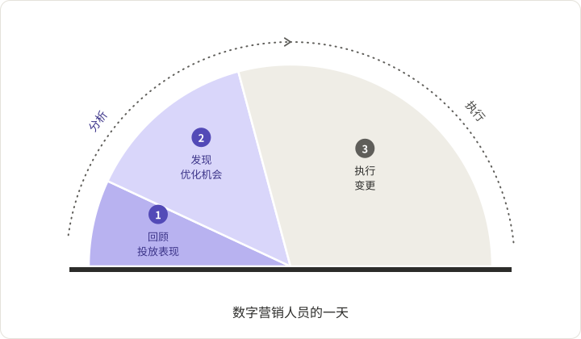
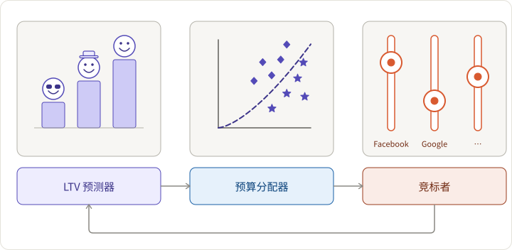
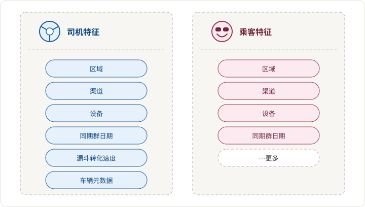
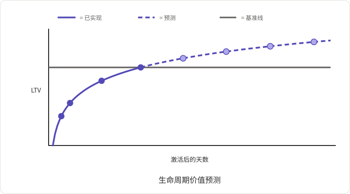
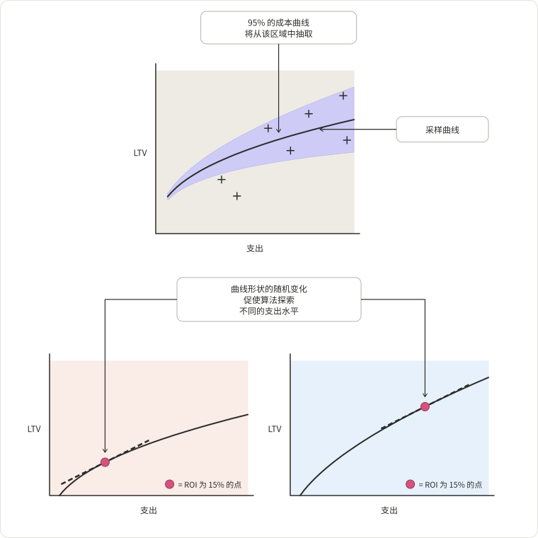
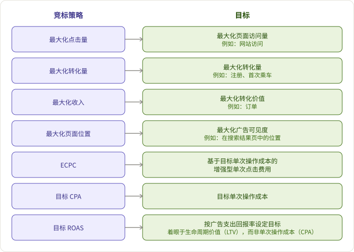

## 获取效率问题：如何在广告中实现更好的投资回报率？

具体来说，Lyft 的广告应满足以下要求：

1. 能够管理区域特定的广告活动
2. 以数据驱动的增长为指导：增长必须是可扩展的、可衡量的和可预测的
3. 支持 Lyft 独特的增长模型，如下所示

然而，最大挑战是管理跨区域营销的所有流程，包括选择竞标、预算、创意、激励和受众，进行 A/B 测试等。你可以看到数字营销人员一天的工作：

我们发现 _执行_ 占用了大部分时间，而 _分析_，被认为更重要的，所花的时间要少得多。一个扩展策略将使营销人员能够专注于分析和决策过程，而不是操作活动。

## 解决方案：自动化

为了降低成本并提高实验效率，我们需要

1. 预测新用户对我们产品感兴趣的可能性
2. 有效评估并在各渠道分配营销预算
3. 轻松管理成千上万的广告活动

营销绩效数据流入 Lyft 的强化学习系统：[Amundsen](https://guigu.io/blog/2018-12-03-making-progress-30-kilometers-per-day)

需要自动化的问题包括：

1. 更新搜索关键词的竞标
2. 关闭表现不佳的创意
3. 按市场更改推荐值
4. 识别高价值用户细分
5. 在活动之间共享策略

## 架构

技术栈包括 - Apache Hive、Presto、ML 平台、Airflow、第三方 API、UI。

## 主要组件

### 生命周期价值（LTV）预测器

用户的生命周期价值是衡量获取渠道效率的重要标准。预算由 LTV 和我们愿意在该地区支付的价格共同决定。

我们对新用户的了解有限。历史数据可以帮助我们在用户与我们的服务互动时更准确地进行预测。

初始特征值：

随着互动历史数据的积累，预测会得到改善：

### 预算分配器

在预测 LTV 之后，接下来是根据价格估算预算。一个形式为 `LTV = a * (spend)^b` 的曲线拟合数据。在成本曲线创建过程中将注入一定程度的随机性，以便收敛到全局最优解。

### 竞标者

竞标者由两个部分组成 - 调整器和执行者。调整器根据价格决定特定渠道的确切参数。执行者将实际竞标传达给不同的渠道。

一些在不同渠道应用的流行竞标策略如下所示：

### 结论

我们必须重视自动化过程中的人类经验；否则，模型的质量可能会是“垃圾进，垃圾出”。一旦从繁重的任务中解放出来，营销人员可以更多地专注于理解用户、渠道以及他们想要传达给受众的信息，从而获得更好的广告效果。这就是 Lyft 如何以更少的时间和精力实现更高的投资回报率。
