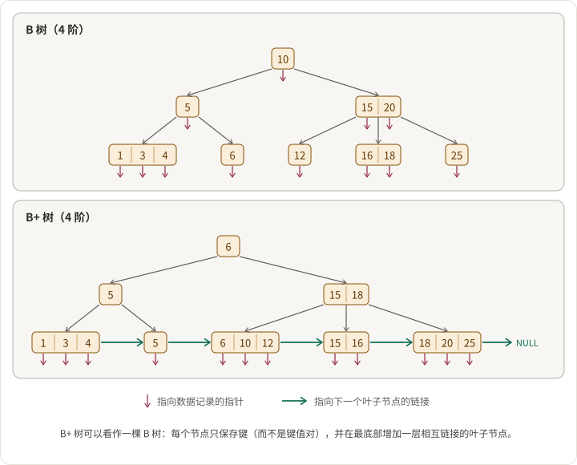

B 树和 B+ 树是支撑整个数据库行业的磁盘数据结构。MySQL（InnoDB）、PostgreSQL 索引、SQL Server、Oracle、SQLite 以及几乎所有文件系统的元数据存储都使用其中之一。一旦理解了结构上的差异，运维上的权衡就自然而然推导出来。

## 结构差异

两者都是为块式存储优化的、平衡的多路搜索树：每个节点对应一个磁盘页（通常是 4-16 KB），分支因子足够宽，使得树的高度非常小（即使是数十亿键，通常也只有 3-5 层）。

差异在于数据存放的位置：

- **B 树：** 每个节点——无论是内部节点还是叶子节点——都存放键*和*相关联的数据（或数据指针）。
- **B+ 树：** 内部节点只存放键（作为路由信息）。所有数据都在叶子节点。叶子节点之间通过双向链表相连。

```
B 树（每个节点都有数据）：
                    [10:val | 20:val]
                   /       |         \
        [4:val | 7:val]  [12:val|15:val]  [23:val|28:val]

B+ 树（数据只在叶子，叶子之间相连）：
                    [10 | 20]
                   /    |    \
        [4 | 7] ↔ [10 | 12 | 15] ↔ [20 | 23 | 28]
          值          值              值
```

注意在 B+ 树中，内部节点的键在叶子中*重复出现*——它们只是路由用途，不是存储用途。叶子层的链表是改变一切下游特性的关键。

## B 树的优势

- **对热点键的点查可能更快。** 频繁访问的键存放在内部节点，只需走到树的部分深度就能返回。而 B+ 树中每次查询都必须一直走到叶子。
- **在键相对于值较大的场景下，存储开销略低**——因为不需要 B+ 树那样的键重复。

这些优势是真实的但范围狭窄。对大多数真实负载，劣势占主导。

## B+ 树的优势（以及为何在实践中占主导）

### 1. 更高的分支因子 → 更矮的树 → 更少的磁盘寻道

因为内部节点只携带键（没有值或值指针），每页能容纳更多键。一个 16 KB 的页在 B+ 树中可以容纳 500 个键，在同等 B 树中可能只有 200 个。更高的分支因子在每一层都会复合：

- 分支因子 200 的 B 树，10 亿键 → 高度 ≈ `log₂₀₀(10⁹) ≈ 4`
- 分支因子 500 的 B+ 树，10 亿键 → 高度 ≈ `log₅₀₀(10⁹) ≈ 3.3`

缓存未命中时，每一层都是一次磁盘寻道。在机械硬盘上，这意味着点查 p99 延迟降低 10-20%。在 SSD 上效果不那么显著，但仍有意义——更少的页意味着更好的缓冲池利用率。

### 2. 范围扫描非常简单

这是 B+ 树占主导的最大原因。一个范围扫描（`WHERE price BETWEEN 100 AND 500`、`ORDER BY timestamp LIMIT 100`、任何基于有序数据的 `GROUP BY`）都要按序遍历键。在 B+ 树中：

```
找到起点叶子 → 沿叶子链表向前走 → 到达上界时停止。
```

在 B 树中，没有叶子链表。你必须对树做中序遍历——回到父节点、下降到下一子树、再回去、再下降，如此循环。这就意味着同一范围要访问更多指针和更多页。

任何涉及有序扫描的负载——OLTP 中的二级索引、时序查询、分页、排序结果集——在 B+ 树上都会显著更快。

### 3. 扫描时更好的缓存行为

B+ 树的叶子节点按链表顺序在存储上是顺序（或近乎顺序）布局的，这与操作系统和存储的预取模式相吻合。范围扫描往往吻合大致顺序的 I/O 模式。B 树无法享受这一好处，因为相邻键可能位于相距甚远的子树中。

### 4. 更简单的并发

因为针对某键的读写最终都落在叶子层，锁协议可以更简单、更局部化。"Latch crabbing"（标准的 B+ 树并发技术）在内部节点只承担路由职责时更容易推理。

## 为何几乎每个关系型数据库都用 B+ 树

考虑到这些权衡，所有主流 OLTP 数据库都使用 B+ 树（或其变种）并非偶然：

- **MySQL InnoDB：** 聚簇 B+ 树——主键索引*就是*表存储。二级索引是独立的 B+ 树，其叶子通过主键回指。
- **PostgreSQL：** 默认索引类型使用 B+ 树（名字是 `btree`，略有误导——实际上是 B+ 树）。表数据本身存放在 heap 而非索引中。
- **SQL Server、Oracle、SQLite：** B+ 树变种。

这些系统针对的负载——对大数据集的点查与范围扫描，读写比偏读——正是 B+ 树优化的目标。

## B 树（或其变种）仍然出现的地方

- **文件系统的写时复制 B 树：** Btrfs、ZFS。每个节点都带数据的特性与 B 树对分形树式更新的友好，使 CoW 更新在某些场景下更便宜。
- **纯内存存储：** 如果不用支付磁盘页的代价，B+ 树的紧凑优势就没那么重要了。内存中的 map 实现通常选择完全不同的结构（哈希表、跳表、ART trie）。
- **学术和嵌入式系统**：递归结构更简洁易实现，且负载主要是点查。

## 值得了解的变种

- **B\* 树：** 节点填充率保持在约 2/3 而非约 1/2，通过旋转实现。在现代数据库中很少使用——实现复杂度不值得那点密度提升。
- **B-link 树：** 每层都添加右兄弟指针，能以更少的 latch 实现更好的并发性。PostgreSQL 某些索引路径内部使用。
- **分形树（TokuDB/MySQL）：** 在内部节点缓冲更新以摊销 I/O。对高分支因子的写密集负载表现出色；在一些专用数据库中有使用。
- **LSM 树：** 一种完全不同的方法（不是 B 树的变种），把写缓冲在内存中然后刷新为有序文件。由 RocksDB、Cassandra、HBase、LevelDB 使用。写放大更好，读放大比 B+ 树更差。B+ 树 vs LSM 的选择是另一个更大的架构决策。

## 快速决策

如果你是为选择而来：**磁盘上有序键的负载，选 B+ 树。** 对几乎所有真实访问模式，范围扫描和缓存行为的优势都会压倒 B 树在点查上的微小优势。如果你构建的东西只做随机点访问，没有范围或排序需求，不如考虑哈希索引，而不是其中任何一个。

## 参见

- [跳表](https://tianpan.co/notes/69-skiplist) —— 无需磁盘持久化时的内存类比。
- [布隆过滤器](https://tianpan.co/notes/68-bloom-filter) —— 在 LSM 树系统中，常置于 B+ 树叶子之前以跳过磁盘读取。
- [如何扩展一个 Web 服务？](https://tianpan.co/notes/41-how-to-scale-a-web-service) —— Z 轴数据分区决策常建立在 B+ 树支撑的存储之上。
