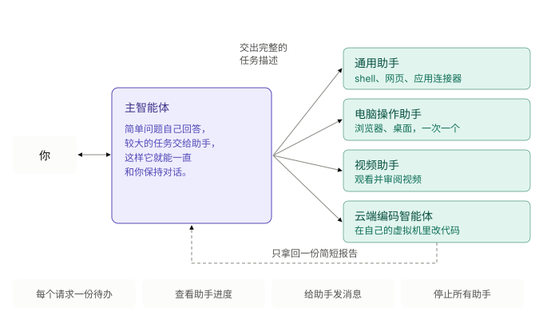

智能体的核心就是"模型在循环中调用工具"。如果这个循环跑在终端里，合上笔记本它就停了。*常驻智能体*把同一个循环变成一个长期运行的服务。它更像一位同事，而不是命令行工具：运行在云端，拥有自己的电脑，记忆可以保存数周，能被各种事件唤醒，并且只在值得打扰你的时候才汇报。

本章基于 Lee Robinson 在斯坦福 CS146S 的讲座 *How always-on agents work*（见参考资料）所介绍的架构，并按照本书的四步法来组织。

## 需求

功能需求

* 用户可以从任意客户端与智能体对话：手机 App、桌面端、Slack、邮件，甚至会议。
* 除了用户之外，其他事件也能唤醒智能体：新消息、定时任务（routine）、webhook、后台任务完成等。
* 智能体拥有自己的沙箱电脑（shell、文件、浏览器、桌面）来完成实际工作。
* 智能体能记住用户、自己过去做过的工作以及学会的技能。
* 智能体懂得何时保持安静：在后台工作，只在必要时打扰用户，比如重要进展、需要审批、需要 2FA 验证码等。
* 不可逆的操作（发邮件、付款）需要用户批准。

非功能需求

* 持久性：任务可能持续数小时到数周，必须能扛过崩溃、发布和虚拟机重建，且不重复已完成的步骤。
* 成本效率：算力和 token 是主要成本。空闲的智能体和机器必须休眠，提示词要尽可能命中提供商的提示缓存（prompt cache）。
* 与用户对话要低延迟；长时间后台任务追求吞吐而非延迟。
* 安全：不可信的输入（邮件、webhook、网页）绝不能被当作用户指令，密钥等敏感信息不应进入模型上下文。

## 架构

架构分为三层：

1. **触发源和客户端**：薄客户端，与服务器之间只有一个工具 `send_to_user`。
2. **智能体服务器**：厚服务器，负责智能体循环、所有工具和全部持久状态。
3. **电脑**：一台可丢弃、可快照的 Linux 虚拟机，智能体像人一样使用它。

图中的"持久状态"其实是两个存储：应用数据库保存智能体知道什么，持久化工作流引擎的历史保存每个任务进行到了哪一步（见下文"用持久化工作流，而不是任务队列"）。

## 组件

### 生命周期：默认休眠

为每个用户一直开着一个服务器进程和一台虚拟机太贵了，规模一大硬件也根本不够。所以两层默认都处于休眠状态：

1. 收到触发后，服务器从数据库加载智能体状态（对话、记忆、定时任务），开始一轮执行。
2. 只有这一轮需要用电脑时，才启动虚拟机。
3. 工作完成后保存状态，虚拟机和智能体重新休眠。

### 为什么循环跑在服务器上而不是虚拟机里

* **薄客户端，厚服务器**：智能体逻辑的修改通过服务器发布上线，不用等应用商店审核；转写、图像生成等重计算跑在服务器硬件上；应对流量波动的服务器扩容是成熟的问题。
* **生命周期相互独立**：如果循环跑在虚拟机里，就无法在不中断智能体的情况下重建虚拟机（比如修补零日内核漏洞）。把所有持久状态放在服务器上，虚拟机就可以随时丢弃重建。

### 触发路由与优先级队列

所有触发都先经过一个路由器，它负责：

* **去重**：处理重试和重复事件。
* **排优先级**：主人的直接消息会打断正在运行的循环，比如"改到周四吧"应当立即生效；群聊、Slack 讨论串和定时任务排到队尾。
* **合并**：把短时间内连续到达的几条消息合并成一轮。
* **决定是否通知用户**：好同事不会每有一点进展就来打扰你。什么时候保持安静、什么时候主动出击，仍是一个没有完全解决的问题。

讲座描述了这个队列做什么，但没有说它是怎么实现的。它可以是一个普通队列，把每一轮交给下文的工作流引擎；也可以是该引擎的一部分。

向客户端投递消息是常规的实时同步问题：客户端乐观地确认发送；服务器把每一轮写入数据库；客户端订阅变更后拉取最新状态，并用幂等键避免重试导致消息重复显示（参见[幂等 API](https://tianpan.co/notes/43-how-to-design-robust-and-predictable-apis-with-idempotency)）。

### 用持久化工作流，而不是任务队列

使用普通任务队列时，长任务在第 3 步崩溃，重试就要重放第 1 到 3 步，可能导致同一封邮件发两次。**持久化工作流**引擎（如 Temporal）会记录每个已完成的步骤，重试时直接从第 3 步继续。每个助手都作为独立的持久化工作流运行，因此持续数周的任务也能扛过发布和基础设施故障。

**Temporal 处在什么位置**：Temporal 是负责执行智能体多步骤工作、并在崩溃后让它继续的那一层。智能体循环仍然是你自己的代码，只是运行在 Temporal 之上。因此持久状态分成两部分：应用数据库和文件保存智能体*知道什么*（对话、记忆、技能、大段输出），Temporal 的历史保存每个任务*进行到了哪一步*（哪些步骤已完成、返回了什么、正在等待什么）。手写的检查点文件也能做后一件事，但只能恢复到最后一次保存，而且重试、超时和等待状态都得自己写。

讲座只确认了两件事：Grok Bot 用 Temporal 取代任务队列，以及每个助手都是独立的持久化工作流。讲座没有说接收消息的队列是否也建在 Temporal 上。本节其余内容是基于 Temporal 构建的标准做法，并非 Grok Bot 的实际代码。

#### 工作流与活动：各管什么

Temporal 把代码分为两类：

* **工作流（workflow）**是编排代码，必须是确定性的：不能发网络请求、不能读写磁盘、不能读时钟、不能用随机数。Temporal 会把工作流的每个事件记录到它的*事件历史*中。崩溃后，worker 会从头重新执行工作流代码，但对已完成的步骤不再真正执行，而是直接回填记录下的结果（即"重放"），于是代码恰好回到中断的位置。
* **活动（activity）**是一切与外部世界打交道的操作：调用模型、在虚拟机上执行 shell 命令、读文件、发邮件。活动可能失败，会按重试策略（次数、指数退避、超时）自动重试。只有活动的结果会写入历史。

对智能体来说，由此得出一条清晰的规则：

| 关注点 | 放在哪里 | 原因 |
| --- | --- | --- |
| 模型调用、工具调用、shell、浏览器、改文件 | 活动 | 非确定性的副作用，可能失败，所以需要重试。 |
| 步骤顺序、遍历大量条目、"下一步做什么" | 工作流 | 处理到 1000 个条目中的第 543 个时崩溃，就从第 543 个继续。 |
| 等待："3 小时后提醒我"、退避、截止时间 | 工作流定时器 | 持久化定时器能扛过重启；进程内的 `sleep()` 不能。 |
| 等待人：审批、2FA 验证码、新的聊天消息 | 工作流信号（signal） | 工作流可以等上好几天，期间不占用进程、内存或 CPU。 |
| *决定*做什么（用哪个工具、写哪种语言） | 模型，在活动内部 | 工作流只记录这个决定，并据此路由。 |

你的智能体代码不需要轮询结果。Temporal 把工作分派给智能体服务器（即它的 worker），再把每一步的结果交还给工作流，就像调用本地函数一样。客户端仍然和其他消息一样，从数据库获知进度。

#### 注意事项

* 恢复是步骤级的，不是行级的。worker 崩溃时*正在执行*的活动会再执行一次，所以活动是**至少执行一次**的。发邮件、付款这类不可逆操作需要[幂等键](https://tianpan.co/notes/43-how-to-design-robust-and-predictable-apis-with-idempotency)。长时间运行的活动（比如 20 分钟的构建）应发送心跳，以便尽快发现 worker 已经挂掉。
* 历史不是大对象存储。Temporal 限制了负载大小，所以对话记录、截图和大段工具输出应放在对象存储或虚拟机磁盘上，工作流里只传引用。

#### 可选方案：消息队列也建在 Temporal 上

一种做法是每个对话对应一个长期运行的工作流，用它取代单独的队列。它会：

1. 持久化地等待，直到路由器通过信号送来新消息（用户、Slack、邮件、定时任务）。
2. 把上一轮之后到达的所有消息合并成一批。
3. 运行智能体循环：每次模型调用是一个活动，每次工具调用也是一个活动。每一步之间都会检查有没有新消息，因此主人的消息可以抢占当前这一轮。
4. 当 Temporal 提示历史过长时，通过 Continue-As-New 重启自己（见下文），只带上已保存状态的引用。

无论哪种做法，助手都很自然地对应**子工作流（child workflow）**：主智能体为每个委派的任务启动一个子工作流，可以给它发信号（"给助手发消息"）、查询它（"查看助手进度"），或取消它（"停止所有助手"）。每个子工作流有自己的历史，所以视频助手崩溃后会自行恢复，不会影响对话。

#### 一次性任务、定时任务与清理

* **一次性任务**（"修复这个 bug"）：用业务 ID（如 `task-<id>`）启动的工作流。它以完成、失败或取消结束，历史不再增长。
* **定时任务**（"每天早上总结我的收件箱"）：使用 Temporal 的 **Schedule**，每次触发都会启动一次全新的工作流运行。优先用 Schedule，而不是旧的 cron 工作流选项。
* **常驻工作流**（比如上面的每对话一个的工作流）：历史随每一轮增长，而事件数和大小都有硬性上限。在达到上限之前，它会调用 **Continue-As-New**：关闭当前运行，用同一个工作流 ID 开始新的运行，只带上精简的状态引用。这相当于执行层面的上下文压缩。

清理发生在三个层面：

1. **工作流历史**：已关闭的运行在命名空间的**保留期**（如 7 天）过后自动删除；如需审计记录，可以先归档。通过 Continue-As-New 关闭的运行同样算作已关闭。
2. **沙箱状态**：在临时目录或容器中工作的助手，会在最后的清理活动中删除它们，即使失败或被取消也会执行。虚拟机本身在休眠时会回到快照状态。
3. **记忆**：让过时的事实和草稿笔记过期（见下文）。Temporal 对这一层一无所知。

### 电脑：Firecracker 微虚拟机

每个智能体都有一台 Linux 微虚拟机（Firecracker）：

* 启动快，可以**快照**、休眠和恢复，所以智能体的文件和桌面能以很低的成本在多次唤醒之间保留下来；
* 把有风险的 shell 命令与用户自己的机器隔离开；
* 运行 Chrome 和**虚拟桌面**，多个智能体或子智能体可以在共享的基础设施上各用一块屏幕；
* 支持实时画面，用户可以旁观或接管操作。

读取网页时，智能体选用最便宜且能奏效的方式：先用**无障碍树**（体积小，列出可点击的元素），再用原始 HTML，再用截图，最后对付顽固的弹窗时才直接点击像素坐标。

### 只有一个客户端工具：`send_to_user`

跨越客户端与服务器边界的工具只有 `send_to_user`。所有重量级工具（shell、文件、浏览器、录屏、云端智能体）都留在服务器上，所以新增任何客户端（iOS、桌面、Slack、邮件）都很简单。每个客户端自行决定如何丰富地展示消息：接入密码管理器的登录表单、支付面板、在不可逆发送前供用户编辑和批准的草稿，或者只是一个表情回应。

### 逐级升级

在打扰用户之前，智能体先尝试最便宜、最可靠的信息来源：

1. 对话和记忆中已有的信息。
2. 插件、MCP 服务器或 API。
3. 网页搜索。
4. 自己电脑上的浏览器。
5. 完整的桌面环境：脚本、构建、命令。
6. 以上都不行时，才去询问用户（审批、2FA 验证码、验证码）。

### 编排者与子智能体（"助手"）

主智能体充当编排者，保持自己的上下文尽量精简。昂贵或嘈杂的工作，比如大量 shell 调用、截图或视频处理，都交给**助手**。助手是拥有全新上下文窗口的子智能体，只把结果返回给主智能体。主智能体像管理待办清单一样管理助手：可以查看进度、发消息或终止它们。由于每个助手都是独立的持久化工作流，崩溃后会继续执行而不是从头开始。产品正是靠这一点让人*感觉*上下文是无限的。

### 工具与动态发现

* 把每个连接器的完整工具 schema 都塞进提示词，工作还没开始上下文就满了。更好的做法是只列出工具**名称**，让模型在需要时再加载对应的 schema（即"工具搜索"工具）。
* 不要在一轮执行中途增删工具，否则会破坏提示缓存。工具描述要简短。
* "只给一个 shell"也能用，但如果大部分 shell 调用都花在同一类任务上，专用工具会更省，也更便于人审查。
* 给智能体写错误信息，就像给人写一样：说明哪里出错、下一步该怎么做。

### 上下文工程与提示缓存

每一轮都会重新发送整个对话，所以大部分输入 token 应该是便宜得多的**缓存** token。具体做法：

* 保持前缀（系统提示词、工具定义）静态且顺序固定。对提示词各部分做哈希，这样 A/B 测试或新增工具时不会打乱顺序，导致所有人的缓存失效。
* 大段输出写入文件，之后让智能体去读取或 grep，而不是放进上下文。
* 截图等昂贵的输入交给助手处理。
* **提前预热缓存**：用户一开始打字就着手准备提示词，类似鼠标悬停时预取页面。
* 把缓存未命中当作 bug 来对待。

### 压缩与记忆

长时间运行的智能体必须做摘要，而所有压缩都是有损的。一个实用技巧：**趁缓存还热时压缩**。用户在长对话后转去忙别的时，立即做摘要，因为此时重读长历史还很便宜；用户回来时，就从简短的摘要继续。

记忆是分层的：

| 层级 | 生命周期 | 示例 |
| --- | --- | --- |
| 核心用户事实 | 每次提示都包含 | "喜欢全小写的消息" |
| 带日期的工作日志 | 持久保存，按需搜索 | 上周做了什么 |
| 草稿笔记 | 临时，数分钟到数小时 | 当前任务的状态 |
| 技能 / 定时任务 | 持久保存，相关时加载 | 一篇 markdown 操作指南；类似 cron 的定时提示 |
| 其他一切 | 文件 | 需要时用 `grep` / `find` 查找 |

文件是通用的存储格式，因为模型非常擅长用 shell 命令搜索文件。记忆中的事实需要垃圾回收：持续相关的就保留并提升，其余的任其过期。

### 安全

* **自动审查**：由另一个模型在每条命令执行前进行检查。这比让人审批几百条命令、最后审到疲劳要可靠。
* 把邮件、webhook 和网页内容当作**不可信的数据**而不是指令，以防御提示注入。
* 不可逆的操作需要用户明确批准。
* 密码和支付凭据只在产品流程中流转，永远不进入模型上下文。

## 总结：瓶颈与开放问题

* **改进飞轮**：内循环是把每次失败转成评测（eval），修复 harness、提示词或推理，然后发布；外循环是在这些失败上训练下一代模型（针对 harness 工具做 SFT，针对指令遵循、技能选择和点击做 RL）。
* **延迟与吞吐**：主智能体要为快速回复而优化；助手可以用延迟换成本，因为后台任务跑 10 分钟还是 12 分钟几乎没有区别。
* **如何评测运行一个月的智能体**，而模型每个月都在发布新版本。
* **记忆算法**（文件、图，或者别的形式）以及数月尺度上的召回质量。
* **主动性的分寸**：有帮助还是烦人。
* **多智能体行为**：群聊中多个机器人互相对话时如何表现得当。
* **token 效率**：全球 token 总量还在持续增长。
* **为下一代模型设计**：假设今天的模型是你用过最差的，尽量少构建，并做好几个月内重做 UI 的准备。
