**智能体（Agent）**是一种自主运行的软件系统：用 LLM 推理目标、调用工具、执行多步操作，直到任务完成。流程是：*规划 → 行动 → 观察 → 调整 → 交付*。

可以把它看作**一种新型计算机**：

| 传统计算机 | 智能体 |
| --- | --- |
| CPU | LLM |
| 内存 | 上下文窗口 |
| 外设 | 工具 |
| 操作系统 | 智能体 harness（运行框架） |
| 应用程序 | 智能体 |

LLM 在知识、语言和代码上超乎常人，但在持久记忆、幻觉和对抗性输入上很弱。系统的其余部分，就是为了弥补这些弱点。

## 技术栈（分层）

| 层 | 内容 | 记忆口诀 |
| --- | --- | --- |
| 应用 / 用户 | 任务及其所有者 | 目标 |
| **智能体 / Harness** | 规划 · 上下文 · 记忆 · 工具 · 子智能体 | 操作系统 |
| 模型 | LLM | CPU |
| **推理服务系统** | 批处理 · 调度 · 路由 · KV/前缀缓存 | 调度器 |
| 运行时 / 内核 | CUDA · Triton · 集合通信 | 驱动 |
| 硬件 | GPU · CPU · 内存 · 网络 · 存储 | 机器 |
| 外部环境 | 工具：网页 · 文件 · API · 人 | 外部世界 |

分成两半：

* **智能体**（上半部分）：决定*做什么*。
* **服务系统 + 硬件**（下半部分）：决定*多快、多省*。

最大的收益来自两半的**协同设计**，例如 harness 保持提示词前缀稳定，服务层才能缓存它。

**优化什么？** 不是每秒 token 数。目标是：

> 最大化**任务成功率**，约束条件：延迟、成本、资源、可靠性、安全

衡量**每次成功任务的成本（$/成功任务）**和端到端延迟，而不是 GPU 利用率。

## 逻辑组件（单个智能体内部）

| 组件 | 作用 | 说明 |
| --- | --- | --- |
| **LLM** | 大脑 | 一个或多个模型，各司其职 |
| **工作流** | 控制流 | *规划器*拆分任务，*执行器*完成步骤 |
| **记忆** | 记住什么 | 会话轨迹 · 长期存储 · 内部 RAG |
| **工具** | 双手 | 三类动作：**读**、**写**、**执行** |
| **环境** | 在哪里行动 | 网页 · 计算机 · 特定领域 · 第三方服务 · 外部 RAG · 其他智能体 |
| **用户界面** | 人如何与它交互 | 文本、预览、可交互元素 |

循环：LLM 选择**工具调用** → 环境返回**观察结果** → 重复。

智能体与传统软件有两点不同：

1. 它把 **AI 模型**与普通代码混合在一起。
2. 它的工作流是**运行时生成**的，而不是事先写好的。

## 为什么智能体是系统问题

普通 LLM 服务只有一跳：*请求 → 推理 → 响应*。智能体是一条链：*推理 → 工具 → 推理 → 工具 → 检索 → 推理……*。关键路径横跨 GPU、CPU、存储、网络和外部服务。

| 负载特征 | 对应的系统问题 |
| --- | --- |
| 长轨迹 | 状态与上下文管理 |
| 重复的前缀 | 前缀缓存 |
| 工具依赖 | 感知依赖的调度 |
| 工具延迟不定 | 异步执行 |
| 多个智能体 | 编排与通信 |
| 超大上下文 | 内存层次与检索 |
| 分支推理 | 推测执行 |
| 不同的模型 | 路由 |
| 外部副作用 | 安全与隔离 |
| 长时间任务 | 检查点与容错 |

**可观测性**是一等公民：追踪变成嵌套的轨迹（会话 → 轮次 → 智能体步骤 → 模型请求 → 工具调用 → 结果 → 子智能体）。无法观测，就无法优化。

## 灵活性即风险

SoK 论文从七个相互独立的维度刻画智能体。每个维度从最不灵活到最灵活，而**每提升一级，能力和攻击面都随之增加**。

| 维度 | 最不灵活 | 最灵活 |
| --- | --- | --- |
| 输入可信度 | 无外部数据 | 任意外部数据 |
| 访问敏感度 | 无敏感数据 | 任意敏感数据 |
| 工作流 | 简单聊天机器人 | 由 LLM 动态定义 |
| 动作 | 仅文本响应 | 响应 + 检索 + 执行 |
| 记忆 | 无 | 跨会话持久 |
| 工具 | 无 | 任意工具 |
| 用户界面 | 仅文本 | 可交互的网页元素 |

三类攻击者：

* **外部攻击者：** 只能控制智能体会读取的内容，如网页或文档（间接提示词注入、工具投毒）。
* **用户级攻击者：** 直接与智能体对话（直接提示词注入）。
* **内部攻击者：** 恶意的开发者或工具提供方。

三条防御原则：

* **纵深防御：** 护栏、信息流控制、监控、人工审批和加固层层叠加。
* **最小权限：** 每个任务只给它需要的工具。
* **完全仲裁：** 对敏感资源的每次访问都要检查。

## 速记表

* 智能体 = **LLM + 上下文 + 工具 + harness**，一种新型计算机。
* 上半部分**做决策**，下半部分**做服务**；要协同优化。
* 组件：**LLM、工作流、记忆、工具、环境、UI**。
* 工具只做三件事：**读、写、执行**。
* 优化**每次成功任务的成本**，而不是每秒 token 数。
* 越灵活，风险越大。坚持**最小权限**。

完整的设计实例见[设计常驻智能体](https://tianpan.co/notes/2026-10-21-designing-always-on-agent)。
