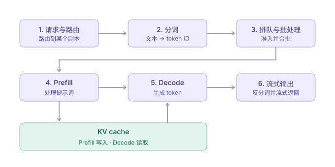

推理（inference）值得投入不亚于训练的工程精力。以 DeepSeek 公开的数据为例：训练约消耗 280 万 H800 小时，而线上服务每天就消耗约 4.3 万 H800 小时。按此推算，一年的推理算力约为训练的 6 倍；在模型两年的生命周期内，推理计算量约为训练的 **12 倍**。因此推理效率同时决定了服务成本和产品毛利，比较模型时也应把推理算力计入，而不只看训练算力。

## 一次请求的生命周期

一个请求依次经过：

1. **路由**：选择数据中心和 GPU。
2. **分词（tokenization）**：包括正确表示工具调用指令。
3. **调度与批处理**：与其他在途请求合并。
4. **Prefill**：一次性处理整个提示词，构建 KV 缓存。
5. **Decode**：逐个生成输出 token。
6. **反分词**：转换回文本，并解析、处理工具调用。

生产系统必须统一管理路由、缓存局部性、分词、批处理、调度、GPU 执行和缓存保留。调度本身是权衡：让全体用户的吞吐最大，与让单个用户的延迟最小并不相同。

### Prefill 与 Decode

| 阶段    | 做什么             | 瓶颈         |
| ------- | ------------------ | ------------ |
| Prefill | 批量处理提示词     | 计算受限     |
| Decode  | 每次生成一个 token | 显存带宽受限 |

Prefill 的吞吐远高于 Decode，所以 Decode 通常是主要瓶颈。两个阶段适合不同的调度策略和硬件优化。

### 关键指标

- **首 token 时间（TTFT）**：主要由排队和 Prefill 决定。
- **每输出 token 时间**：即 Decode 单步延迟。
- **单 GPU 吞吐**：在给定服务水平（SLO）下的吞吐。

### KV 缓存与路由

重复的提示词和智能体工作流可以复用已缓存的键值（KV）数据，而互不相关的对话通常不能。把请求路由到已持有相关 KV 缓存的 GPU，既是负载均衡，也直接提升性能，因此路由器必须感知缓存。

## 三层优化

1. **模型层**：混合专家（MoE）、状态空间模型、多头潜在注意力（MLA）、量化、蒸馏，减少每个 token 的计算量或显存占用。
2. **内核与运行时层**：FlashAttention、PagedAttention、RadixAttention，借鉴了 GPU 编程、数据库和操作系统的思想。
3. **服务框架层**：路由、推测解码、递归语言模型、上下文压缩，避免不必要的计算或缩小缓存需求。

## GPU 内核

归一化、softmax 等小算子如果各自作为独立内核运行，会浪费硬件算力。算子融合是常见做法；也可以结合真实流量特征和线上测量数据，针对具体负载调优内核，甚至由智能体自动完成。

## 并行执行

大模型放不进单张 GPU，需要张量并行、流水线并行或数据并行。用高带宽链路连接大量 GPU 的"大规模扩展域"（例如 72 卡机架）支持**专家并行**：每个 MoE 专家放在特定 GPU 上，吞吐大幅提升。代价是可靠性：大型副本中任何一张 GPU 故障，都可能拖垮整个工作负载。

## 量化

用更少的比特存储权重（FP16 → FP8 → FP4）可以降低显存占用、提升吞吐，但可能损害质量。上线前必须仔细验证：

- 运行基准测试、工具调用测试和端到端智能体任务（例如让模型反复编写一个小游戏），确认推理能力没有退化。
- 无需训练的量化方案可以接近原始 FP8 的质量，但前提是经过充分测试。

## 不同服务商的质量差异

同样的开源模型权重，并不保证不同推理服务商给出同样的结果。量化方式、硬件、推理引擎、采样参数、模型版本、工具调用处理方式都会改变输出。在对 31 个 Llama 端点的对比中，服务同一开源模型的不同服务商之间的差距，可能大于开源模型与闭源模型之间的差距。

这对智能体尤其危险，因为调用链上的小错误会累积。监控服务商的方法：

- 运行基准测试和端到端评测（准确，但慢且昂贵）。
- 用专门的验证集测试工具调用行为。
- 将输出分布与参考模型对比。
- 跟踪 token 对数概率，发现服务栈的"静默变更"。
- 在不保留用户数据的前提下，监控聚合的请求模式和工具调用成功率。
- 保留私有的、针对自身业务的测试用例，覆盖公开基准测不到的问题。

## 编译器：用搜索代替启发式规则

与其为每一代新芯片手写和维护大量启发式规则，编译器可以采用**等价饱和（equality saturation）**：

- 把模型归约为少量基本算子（约 15 个），使用可跨硬件后端的中间表示。
- 应用小的等价规则，构建由等价程序组成的搜索空间。
- 通过**在目标硬件（GPU、TPU）上实测候选方案**来选择实现，而不依赖预测式成本模型。

该表示是 PyTorch 完备但非图灵完备的，这限制了搜索规模，也使部分性能上界可以解析计算。搜索本身是有界的，常用遗传算法，目标是找到较好的局部最优。由于编译产物会运行很多次，多花一些编译时间是值得的。这类编译器专注于模型前向计算，与 vLLM、SGLang 等服务引擎互补，而不是取代它们的调度和批处理能力。

## 面向智能体负载的缓存与内存

智能体会拆分出共享同一系统提示词的子任务，因此共享上下文和内存管理越来越重要。

- **RadixAttention**：用基数树（radix tree）存储共享的提示词前缀，共享上下文的请求复用已缓存的计算，避免重复 Prefill。
- **重叠调度（overlap scheduling）**：GPU 执行当前批次时，CPU 同时准备下一批，减少 GPU 空闲。在部分 Blackwell 配置中报告了最高 2 倍的吞吐提升。
- **分层缓存**：把 token 缓存分布在 GPU 显存、主机内存和存储之间，降低重新加载上下文的成本。实验中首 token 时间最多降低 56%。
- **统一内存池**：用一个池统一管理全注意力 token、滑动窗口 token 和循环状态，而不是为每种类型预留固定大小的分区，避免碎片和浪费；内存整理会重排碎片化的物理内存，同时保持虚拟映射不变。

更长的上下文、重复的智能体调用，以及采用不同注意力或循环状态设计的模型，都要求缓存系统能灵活地共享和管理内存。

## 要点

- 先为推理做预算：它占生命周期算力的大头。
- 把 Prefill 和 Decode 当作不同的负载，并按 KV 缓存局部性路由。
- 同时运用模型、内核和服务层的优化。
- 用自己的端到端测试和分布测试验证量化结果和每个第三方服务商。
- 为智能体设计缓存与内存层：共享前缀、分层存储、统一内存池。

延伸阅读：CS336《从零开始的语言模型》系列课程。
