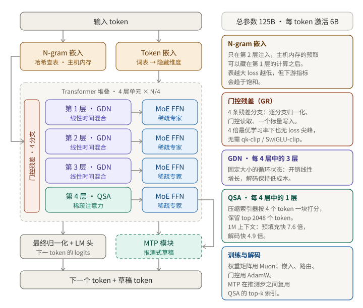

设计 LLM 架构本质上是一个预算问题。你要找的不是抽象意义上"最好的模型"，而是在单位训练算力、单位服务成本、单位不稳定风险下最好的模型。本章以千问团队的论文 [On the Design of Qwen3.8-Next Architecture: Evaluation, Efficiency, and Training Stability](https://arxiv.org/html/2608.30320v1)（arXiv 2608.30320，2026 年 8 月 31 日）为例。下文所有数字都来自论文自己的报告。

结果是一个稀疏混合专家（MoE）模型：**总参数 125B，激活参数 6B**（论文正文称之为 Qwen3.8-Flash-Next）。它在 14 项预训练基准中的 8 项领先于上一代 397B-A17B 旗舰，其余项最多落后 2.6 分，而激活参数约为后者的 1/3、训练 token 约为 1/3、训练 FLOPs 约为 1/9。

## 明确需求

论文对每一项架构改动都同时用三个维度评判，并强调这三者经常互相矛盾：

| 维度         | 要回答的问题                             | 如何衡量                               |
| ------------ | ---------------------------------------- | -------------------------------------- |
| 质量         | 这项改动能否降低 loss、提高下游分数？    | 预训练 loss、基准套件、长上下文测试    |
| 成本         | 训练、预填充、解码各自要付出多少？       | kernel 速度、FLOPs、显存流量、激活参数 |
| 稳定性与调参 | 高学习率下是否稳定？最优超参会不会改变？ | loss 尖峰、梯度范数统计、裁剪触发次数  |

一个具体的矛盾：把 n-gram 嵌入表做大，loss 会持续下降，但下游准确率会趋于平稳。只看 loss 就会选错设计。

## 高层设计

跟着一个 token 走一遍：

1. **嵌入。** token 嵌入，加上在第 2 层注入残差流的 **n-gram 嵌入**。
2. **Transformer 堆叠。** 重复的四层单元：三层 **Gated DeltaNet（GDN）**，再加一层注意力。在长上下文阶段，这层注意力换成 **Qwen 稀疏注意力（QSA）**。每个 token 混合层之后接一个稀疏 MoE 前馈块。
3. **门控残差（GR）。** 残差流扩宽成四条分支，每个子层都通过学习到的门来读写它。
4. **输出头与 MTP。** 最终归一化和 LM 头产生下一个 token 的 logits。多 token 预测（MTP）模块为推测解码生成额外草稿，并复用 QSA 的索引。

每个组件各自针对一个瓶颈：

| 组件        | 针对的瓶颈               | 代价或风险                            |
| ----------- | ------------------------ | ------------------------------------- |
| GDN 混合    | 注意力开销与 KV 缓存增长 | 精确召回弱于全注意力，所以每 4 层留 1 |
| QSA         | 长上下文下的二次方注意力 | 多一个训练阶段和一个索引器            |
| 门控残差    | 不稳定性（限制学习率）   | 每个子层多出归一化和门                |
| N-gram 表   | 不增加算力的参数容量     | 主机内存、预取延迟、收益趋于饱和      |
| Muon 优化器 | 每 token 的收敛速度      | 正交化开销与按参数分组的例外          |

## Token 混合：GDN 加 QSA

### 为什么用混合结构

全注意力的计算是 O(n²)，KV 缓存还随长度增长。GDN 保持**固定大小的循环状态**，所以开销线性增长。门控 delta 规则把依赖数据的衰减 αₜ 和写入门 βₜ 结合起来，写入是纠错式的：这一层只写入某个 key 的残差误差，而不是盲目叠加到状态上。Q 和 K 做 L2 归一化，经过短的因果深度卷积，输出使用 sigmoid 门。

纯循环层会丢失精确的长程召回，所以堆叠中**每四层保留一层全注意力**。在一次 25B-A3B 的对比中（训练 400B + 80B token），GDN 混合结构平均分为 53.81，滑动窗口混合为 51.15，全注意力为 49.87。

全注意力层保留 RoPE。NoPE 变体在预训练中表现相同，但后训练后会产生更多无休止的生成。

### Qwen 稀疏注意力

即使每四层只剩一层全注意力，在超长上下文下它也会成为主要开销。QSA 在 256K 序列长度的继续预训练阶段引入，并替换**所有**全注意力层，包括 MTP 模块里的那一层。

- **压缩的轻量索引器。** 一个多查询注意力，4 个查询头、1 个共享的 key 头。key 以 4 个 token 为一个微块做平均池化，得分是跨头求和的 ReLU 点积。这把索引器开销从 O(n²) 降到 O(n²/4)。
- **选择。** 取得分最高的 2048 个 token（最多 512 块），再加上不完整的尾块，送入稀疏核心注意力。
- **两阶段训练。** 先做稠密蒸馏（索引器用 KL loss 向教师的最大池化注意力学习，约 2B token），再联合训练主干和索引器（约 200B token）。

结果：基准平均分从 75.9 提高到 76.8，512K 以上的 RULER 从 90.08 提高到 93.00，1M 的 MRCR 从 20.71 提高到 26.44。在 1M 上下文下，kernel **预填充快 7.6 倍，解码快 4.9 倍**。注意：主预训练仍然使用全注意力，QSA 只出现在继续预训练中。

## 残差流：门控残差

普通的 pre-norm 残差流给每个子层相同的、未经缩放的输入。GR 把它扩宽成**四条分支**，并让每个子层的读和写都可学习：

1. 每条分支有自己的 RMSNorm。
2. 由所有分支计算一个小的瓶颈门（秩 d/8，SiLU 加 sigmoid）。
3. 块的输入是门控后、归一化后各分支的平均。
4. 块的输出通过每条分支一个依赖数据的**标量**写回所有分支。

没有分支混合矩阵，这样每个块省去了一次完整的残差状态读取。注意力子层和 MLP 子层各有自己的 GR 模块，GR 取代了 pre-norm。

在一次 560B token 的 25B-A3B 实验中，GR 的 loss 为 1.590、平均分 54.66，pre-norm 则为 1.617 和 50.91。经受住检验的设计选择：sigmoid 门优于 tanh 和 SiLU；依赖数据的读取有帮助，写入则保持为简单的标量。没有保留的一个：只写入前 2 条分支的稀疏写入，在后训练后表现变差，所以被放弃。

## N-gram 嵌入

一个 n-gram 嵌入层位于**第 2 层**，用多头哈希查找向量，再通过上下文门注入残差流。这些表（51B 参数）放在**主机内存**中并被预取，放在第 2 层可以让预取与第 1 层的计算重叠。把词表从基础分词器（250K）的 20 倍扩大到 200 倍，loss 单调下降，但下游准确率趋于饱和。把这一层拆到多个深度没有带来稳定的收益。

## 优化器与超参数

- **Muon**（Nesterov 动量 0.95，8 步 Newton-Schulz）负责矩阵参数：注意力的 Q/K/V 与输出投影、GDN 的输入与输出投影、专家的 fc1/fc2，以及 n-gram 的 key/value 投影。
- **AdamW** 负责其余部分：输入嵌入、输出头、MoE 路由、GR 的低秩投影、GDN 的衰减与 beta 投影，以及输出门。n-gram 表使用不带权重衰减的 Adam。
- 融合参数在**正交化之前先拆开**（QKV 按头拆，fc1 拆成 gate 和 up 两半）。一个分区器在数据并行的各 rank 之间平衡 Newton-Schulz 的工作量，整个优化器步骤被捕获进一个 CUDA graph。
- 重新拟合的缩放律预测应使用更大的 batch size 和学习率。batch size warmup 被放弃：它多花了 18.8% 的优化器步数，却没有得到更好的终点。

## 稳定性是设计需求

团队对稳定性做了压力测试：在 28 层 MoE 上把学习率固定为最优值的 2 倍和 4 倍，裁剪阈值为 0.5：

- 在 4 倍时，AdamW 每 10k 步产生 183 次 loss 尖峰，并在 19,932 步中有 213 步触及裁剪阈值，所以裁剪几乎一直在起作用。两个 Muon 实验都从未越过阈值，而 **Muon 加 GR 记录到零次尖峰**。
- 在 AdamW、3 倍学习率下，同一团队更早的一种门设计（GatedNorm）单独就把尖峰率从每 10k 步 32.0 次降到 3.2 次。
- 在生产配置中，带门的实验在 1000 步窗口内的梯度范数标准差低 4.3 到 4.7 倍。

在完整规模下，训练据报告没有出现 loss 尖峰，也不需要 qk-clip 或 SwiGLU-clip 这类显式裁剪。关键洞察是：稳定性余量是可以兑换的，它让你提高学习率和 batch size，从而改善吞吐和收敛。

## 取舍与被否决的捷径

| 选项                   | 决定   | 原因                                         |
| ---------------------- | ------ | -------------------------------------------- |
| 纯线性注意力           | 否决   | 每 4 层保留 1 层全注意力（后为稀疏）以保召回 |
| 注意力层使用 NoPE      | 否决   | 预训练相同，后训练后无休止生成更多           |
| 门控残差中的稀疏写入   | 否决   | 预训练没问题，后训练后变差                   |
| batch size warmup      | 否决   | 多 18.8% 优化器步数，终点没有更好            |
| 把 n-gram 拆到多个深度 | 否决   | 相比第 2 层单层没有稳定收益                  |
| 更大的 n-gram 词表     | 有上限 | loss 持续下降，基准趋于饱和                  |
| sigmoid 门             | 保留   | 优于 tanh 和 SiLU                            |

有两条教训反复出现：有些效果只有在**后训练之后**才会显现，所以只看预训练指标可能会误导；以及，便宜的代理指标可能选出错误的赢家。

## 局限

- 许多消融实验在更小的模型上进行（25B-A3B、35B-A3B，以及一个 20 层 MoE）。向 125B 的迁移是推断，并没有被展示。
- 本章所概括的论文部分没有说明 MoE 的专家数、路由或负载均衡，所以本章没有涉及这些内容。
- 论文指出评估吞吐是剩下的瓶颈：如果有一个更便宜、能预测后训练排序的中等规模探针，搜索设计空间会容易得多。

## 要点

- 对每项改动同时从质量、成本、稳定性三方面评判，它们的矛盾比你预期的更常见。
- 把便宜的和精确的 token 混合层搭配使用：大部分层用线性时间的 GDN，远距离依赖层用稀疏注意力。
- 把不稳定性预算花在残差流上：带门的多分支残差让你能以更高的学习率训练。
- 把参数容量放在算力便宜的地方，比如放在主机内存里的 n-gram 表，并预期收益会递减饱和。
- 在确定配方之前，先用最优学习率的数倍做压力测试，并在后训练之后而不只是预训练之后检查决策。
