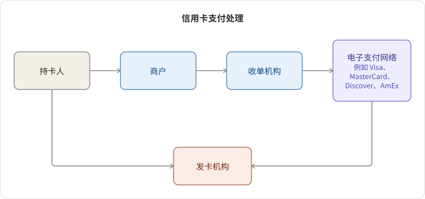

## 5 个参与方

1. 持卡人：卡的授权用户。例如，任何拥有信用卡的人。
2. 发卡机构：向其用户发放信用卡的机构。例如，Chase、BOA、Discover 等。
3. 商户：提供产品或服务并接受信用卡支付的实体。例如，Uber、Doordash 等。
4. 收单机构：向商户提供卡服务的机构。例如，BOA 商户服务、Chase Paymentech。
5. 电子支付网络：收单机构和发卡机构的清算中心。例如，VisaNet、MasterCard、Discover、American Express 等。

Square 和 Stripe 是收单机构吗？不，它们是支付聚合商。

## 2 个工作流程

1. 授权：持卡人向商户提供卡片/卡片信息，商户处理后将（卡号、金额、商户 ID）发送给收单机构。收单机构通过电子支付网络联系发卡机构。发卡机构检查信用额度和防欺诈系统，然后授权或拒绝交易。

2. 清算/结算
   1. 批处理：在营业结束时，商户向收单机构请求一批支付信息进行清算。
   2. 清算和结算：收单机构通过电子支付网络与发卡机构协调清算，发卡机构结算资金并为持卡人记账交易。
