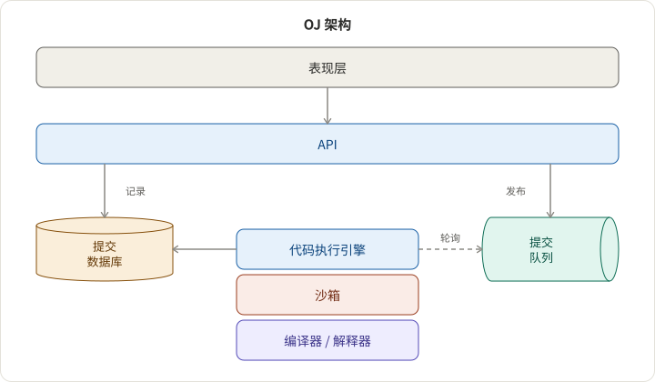

## 需求

在线评测系统主要是一个可以远程执行代码的地方，用于教育或招聘目的。在这个设计中，我们专注于设计一个用于面试准备的 OJ，类似于 Leetcode，具有以下需求：

- 它应该具有核心的 OJ 功能，如获取问题、提交解决方案、必要时编译和执行。
- 它应该具有高可用性，采用 **异步** 设计，因为运行代码可能需要时间。
- 它应该具备水平扩展性，简单易扩展。
- 它应该稳健且安全，以执行不受信任的源代码。

## 架构

下面的架构以异步执行的队列和安全执行的沙箱为特色。每个组件都是可单独部署和扩展的。



## 组件

### 表现层

用户代理通常是一个像 coderoma.com 这样的网页或移动应用。它显示问题描述，并为用户提供一个代码编辑器来编写和提交代码。

当用户提交代码时，客户端将获得一个令牌，因为这是一个异步调用。然后客户端轮询服务器以获取提交状态。

### API

请参见 [公共 API 选择](https://tianpan.co/notes/66-public-api-choices) 以了解我们可以选择的协议。让我们在这里设计接口本身，并以 GraphQL 为例：

```gql
type Query {
  problems(id: String): [Problem]
  languageSetup(id: String!, languageId: LanguageId!): LanguageSetup
  submission(token: String!) Submission
}

type Mutation {
  createSubmission(
    problemId: String!
    code: String!
    languageId: LanguageId!
  ): CreatedSubmission!
}

enum LanguageId {
  JAVA
  JS
  ELIXIR
  # ...
}


type Problem {
  id: String!
  title: String!
  description: String!
  supportedLanguages: [Float!]!
}

type LanguageSetup {
  languageId: LanguageId!
  template: String!
  solutions: [String!]!
}

type Status {
  id: Float!
  description: String!
}

type Submission {
  compileOutput: String
  memory: Float
  message: String
  status: Status
  stderr: String
  stdout: String
  time: String
  token: String
}

type CreatedSubmission {
  token: String!
}

```

API 层将提交记录在数据库中，将其发布到队列中，并返回一个令牌供客户端将来参考。

### 代码执行引擎

代码执行引擎 (CEE) 轮询队列以获取代码，使用沙箱来编译和运行代码，并解析编译和执行的元数据。

沙箱可以是 LXC 容器、Docker、虚拟机等。我们可以选择 Docker，因为它易于部署。

## Coderoma.com

我最近在学习 [Elixir](https://elixir-lang.org/) 并创建一个在线评测系统 [coderoma.com](https://coderoma.com) 以进行日常练习。它现在支持 Elixir 和 JavaScript。我正在添加更多语言（如 Java）和问题。

我们可能会举办未来的活动来提高你的编码技能。请加入我们，访问 https://t.me/coderoma 以获取英语社区，或使用你的微信扫描以下二维码 `onetptp` 并回复 `刷题` 以加入中文社区。


