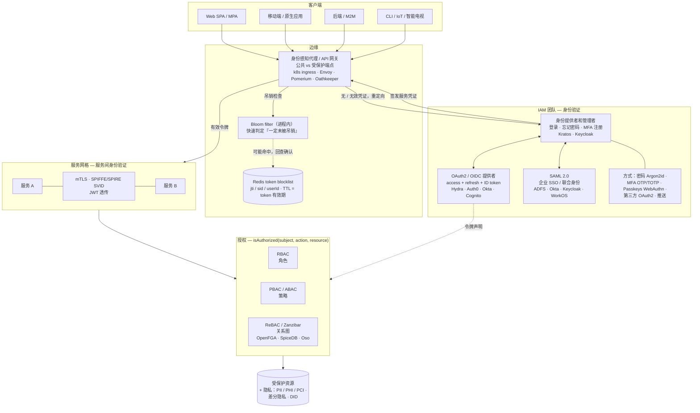

## 需求

- 设计一个从简单开始但可以随着业务扩展的身份验证解决方案
- 考虑安全性和用户体验
- 讨论该领域的未来趋势

## 大局观：身份验证（AuthN）、授权（AuthZ）和身份管理

首先，回归基础

- 身份验证：确定你是谁
- 授权：确定你可以做什么

在开始时……让我们有一个简单的服务……

<div style={{ display: "flex", flexDirection: "row" }}>
  <div style={{ width: "40%" }}>
    
  </div>
  <div style={{ width: "60%" }}>
    <ul>
      <li>分层架构 </li>
      <li>
        客户端存储一个cookie或token作为登录状态的证明。（代客钥匙模式）{" "}
      </li>
      <li>服务器持久化相应的会话 </li>
      <li>
        token通常采用JWT格式，由从安全位置（环境变量、AWS KMS、HashiCorp Vault等）获取的密钥签名
      </li>
      <li>流行的Web框架通常提供开箱即用的身份验证解决方案</li>
    </ul>
  </div>
</div>

然后，随着业务的增长，我们用AKF规模立方体来扩展系统：

- X轴：水平克隆
- Y轴：功能分解
- Z轴：分片

加上康威定律：组织设计的系统反映其沟通结构。我们通常将架构演变为微服务（参见[为什么选择微服务？](https://tianpan.co/notes/120-designing-uber#why-micro-services)了解更多）

- 顺便说一句，"微服务与单体"和"多仓库与单仓库"是不同的概念。
- 对于企业，有员工身份验证和客户身份验证。我们更关注客户身份验证。

在微服务世界中，让我们抽取身份验证和授权服务的功能切片，并有一个身份和访问管理（IAM）团队在进行相关工作。


- **身份感知代理** 是一个反向代理，允许公共端点或检查受保护端点的凭证。如果凭证未提供但被要求，则将用户重定向到身份提供者。例如：[k8s ingress controller](https://res.cloudinary.com/dohtidfqh/image/upload/v1615539051/web-guiguio/ingress-controller.jpg)、nginx、envoy、[Pomerium](https://www.pomerium.io/)、[ory.sh/oathkeeper](https://www.ory.sh/oathkeeper)等。
- **身份提供者和管理者** 通过登录、忘记密码、MFA注册等工作流管理用户身份。例如：[ory.sh/kratos](https://www.ory.sh/kratos/)、[keycloak](https://www.keycloak.org/)
- **OAuth2和OpenID Connect提供者** 为第一方登录（OIDC）签发令牌，并允许第三方开发者通过OAuth2接入。实践中通常与身份提供者合并在同一服务中——Keycloak、Auth0和Okta均同时具备两者——但也可分离：例如使用Ory Kratos管理身份 + Ory Hydra处理OAuth2/OIDC。
- **授权** 服务控制谁可以做什么。

### 一图看懂全貌



## 身份验证

### 1. 身份提供者

- 最简单的解决方案是提交用户的身份证明并发放服务凭证。
  - 密码哈希推荐使用 Argon2id（OWASP当前首选）、bcrypt 或 scrypt
- 然而，现代应用程序通常处理复杂的工作流，如条件注册、多步骤登录、忘记密码等。
  这些工作流本质上是状态机中的状态转换图。


_工作流：用户设置和个人资料更新_

Ory.sh/Kratos作为示例架构


### 2. 第三方OAuth2

OAuth2让用户或客户端经历几种授权类型（[不确定使用哪个？请查看这个](https://auth0.com/docs/get-started/authentication-and-authorization-flow/which-oauth-2-0-flow-should-i-use)），如

1. 授权码 + PKCE 授权 — Web（SPA）和移动/原生应用
1. 客户端凭证授权 — 后端/机器间（M2M）服务
1. 设备授权授权 — 输入受限的设备（智能电视、CLI工具、物联网）

然后最终获得访问令牌和刷新令牌

1. 访问令牌是短期有效的，因此如果被泄露，攻击窗口很短
2. 刷新令牌一次性使用并在每次使用后轮换；机密客户端（服务端）将其与客户端密钥配对，而公共客户端（SPA、移动端）依赖轮换刷新令牌——存储在 httpOnly cookie 中，切勿存入 localStorage

**边缘处的吊销。** JWT 是无状态的，签发后到过期前一直有效，但"登出所有设备"、token 泄露、用户被封禁等场景必须在过期*之前*就生效。因此身份感知代理会在每个受保护请求上查一次吊销列表。权威存储是一个 **Redis token blocklist**，以 `jti` / 会话 id / 用户 id 为 key，每个条目的 TTL 设为 token 的剩余有效期，从而自动清理。为了避免在绝大多数（*未*被吊销的）请求上都打一次 Redis，前面放一个进程内 **Bloom filter**：它以零网络开销回答"一定未被吊销"并直接放行，只有在可能命中时（Bloom filter 有假阳性、但绝无假阴性——所以已吊销的 token 永远不会被误放行）才回查 Redis 确认。标准 Bloom filter 无法删除条目，可定期从 Redis 全量重建（条目本来就随 token TTL 过期），或改用 counting/cuckoo 变体。短期访问令牌（5~15 分钟）能缩小吊销窗口、降低对这条路径的依赖；若 Redis 不可达，auth 通常采用 fail-closed。

假设在这个工作流中涉及许多实体——客户端、资源拥有者、授权服务器、资源服务器、网络等。更多的实体会增加被攻击的暴露面。一个全面的协议应该考虑所有边缘情况。例如，如果网络不是 HTTPS / 不能完全信任怎么办？

OpenID Connect 是构建在 OAuth2 之上的身份协议，它添加了携带用户身份声明的签名 ID 令牌（JWT），从而实现跨服务的单点登录（SSO）。

SAML 2.0 是更早期的基于 XML 的联合身份标准，在企业 / B2B SSO 场景中仍占主导（如 ADFS、Okta、Azure AD 等企业 IdP）。新的面向消费者的应用默认使用 OIDC；但要打入企业市场，通常必须支持 SAML。许多提供商（Okta、Keycloak、WorkOS）同时桥接两者，使应用无论上游协议如何都能看到统一的身份。

在这些工作流和令牌处理过程中有很多棘手的细节。不要重新发明轮子。

### 3. 服务间身份验证

在微服务中，服务之间同样需要互相验证身份——这与面向用户的身份验证不同，但经常被忽视：

- **mTLS（双向TLS）** — 双方均出示证书；服务网格（Istio、Linkerd）通过 sidecar 透明地处理此过程。身份绑定到工作负载，而非人类用户。
- **SPIFFE/SPIRE** — 工作负载身份标准。每个服务获得一个加密的 SVID（SPIFFE 可验证身份文档），可与 mTLS 或 JWT-SVID 配合使用。
- **JWT传播** — 将原始用户 JWT 转发到下游服务，或由网关为下游服务签发新的服务令牌，从而无需每个服务重新验证用户凭证即可完成授权。

不要在每个服务中各自实现令牌验证——使用共享库或 sidecar 统一处理。

### 4. 多因素身份验证

问题：凭证填充攻击

用户倾向于在多个网站上重复使用相同的用户名和密码。当其中一个网站遭遇数据泄露时，黑客会使用这些泄露的凭证对其他网站进行暴力攻击。

- 多因素身份验证：短信、电子邮件、电话语音一次性密码、身份验证器 TOTP
- 速率限制器、失败禁止和异常检测

挑战：电子邮件或短信的送达率差

- 不要将营销电子邮件渠道与事务性渠道共享。
- 语音一次性密码通常具有更好的送达率。

### 5. 无密码

1. **通行密钥（WebAuthn/FIDO2）** — 当前防钓鱼无密码身份验证的标准。所有主流平台（Apple、Google、Microsoft）和浏览器均原生支持。凭证是绑定到设备和源域名的私钥，从结构上杜绝了钓鱼攻击。推荐所有新实现优先采用。
   - 同步通行密钥（iCloud 钥匙串、Google 密码管理器）支持跨设备使用
   - 硬件安全密钥（YubiKey）适用于高保障场景

2. 生物识别：指纹、面部识别——通常通过底层使用 WebAuthn 的平台身份验证器实现。[权衡依然存在](https://www.onelogin.com/learn/biometric-authentication)。

3. 推送通知——被 Duo、Okta Verify 等应用采用


客户端如何订阅服务器的状态？短轮询、长轮询、WebSocket 或服务器推送事件。

### 6. 市场上的供应商

不要重新发明轮子。

- **托管解决方案**：[Auth0、Okta、Amazon Cognito、Firebase Authentication、Clerk、WorkOS、Stytch](https://tianpan.co/notes/116-auth-solutions-on-the-market)。Clerk 和 WorkOS 已成为新创业公司的首选——Clerk 以开发者体验见长，WorkOS 专注 B2B/企业 SSO 功能；Auth0/Okta 在大型企业合规需求方面依然强势。
- **本地/自托管**：[ory.sh](https://www.ory.sh/)、Keycloak、SuperTokens。

### 7. 优化

挑战1：Web登录非常慢或根本无法提交登录表单。

- JS包对于移动Web来说太大
  - 构建一个轻量级的PWA版本的SPA（单页面Web应用）。无论如何使包小——例如，preact或inferno
  - 或者根本不使用SPA。简单的MPA（多页面Web应用）与原始HTML表单提交效果很好
- 浏览器兼容性
  - 使用BrowserStack或其他工具在不同浏览器上进行测试
- 数据中心距离太远
  - 将静态资源放到边缘/CDN，并通过Google骨干网中继API请求
  - 建立一个本地数据中心 😄

请参见[Web应用交付优化以获取更多信息](https://tianpan.co/notes/15-web-app-delivery-optimization)

挑战2：账户接管

- [使用半监督学习进行欺诈检测](https://tianpan.co/notes/136-fraud-detection-with-semi-supervised-learning)
- [datavisor的无监督学习](https://www.datavisor.com/industry-solutions/financial-services-old/account-takeover/)

挑战3：账户创建耗时过长

当后端系统变得过于庞大时，用户创建可能会分散到许多服务，并在不同数据源中创建许多条目。在注册结束时等待15秒感觉很糟糕，对吧？

1. 收集并逐步注册
2. 异步

## 授权

`isAuthorized(subject, action, resource)`

### 1. 基于角色的访问控制（RBAC）


### 2. 基于策略的访问控制（PBAC / ABAC）

```json
{
  "subjects": ["alice"],
  "resources": ["blog_posts:my-first-blog-post"],
  "actions": ["delete"],
  "effect": "allow"
}
```

挑战：单点故障和级联故障

- 预处理和缓存权限
- 利用请求上下文
  - 假设：数据中心内部的请求是可信的，而外部请求则不可信
- 失败开放与失败关闭

### 3. 基于关系的访问控制（ReBAC）

由 [Google Zanzibar 论文](https://research.google/pubs/pub48190/)开创，该模型将权限表示为用户与对象之间关系的图谱——例如，"alice 是 document:X 的编辑者，该文档位于 folder:Y 中，而 alice 的团队对该文件夹有查看权限。"权限通过图谱递归组合，支持针对数十亿对象的细粒度权限检查。

- 开源实现：[OpenFGA](https://openfga.dev/)（由Okta出品）、[SpiceDB](https://github.com/authzed/spicedb)、[Oso](https://www.osohq.com/)
- 适用场景：文档共享、多租户 SaaS、社交图谱——任何权限源自数据关系的场景

## 隐私

### 1. 个人可识别信息（PII）、受保护的健康信息（PHI）、支付卡行业（PCI）

西方文化有尊重隐私的传统，尤其是在纳粹杀害数百万人之后。
以下是一些典型的敏感数据类型：个人可识别信息（PII）、受保护的健康信息（PHI，受HIPAA监管）和信用卡或支付卡行业（PCI）信息。

### 2. 差分隐私

仅仅删除敏感信息可能不足以防止与其他数据集相关的数据泄露。

差分隐私帮助分析师从包含个人信息的数据库中提取数据，但仍然保护个人隐私。


### 3. 去中心化身份

为了将身份与集中式身份提供者及其相关的敏感数据解耦，我们可以使用[去中心化身份（DID）](https://tianpan.co/notes/159-did)。

- 它本质上采用URN格式：`did:example:123456789abcdefghijk`
- 它可以从非对称密钥及其目标业务领域派生。
  - 与传统方式不同，它不涉及你的个人信息
  - 请参见[DID方法](https://w3c.github.io/did-spec-registries/#did-methods)了解其如何与区块链一起工作。
- 它通过以下方式保护隐私
  - 为不同目的使用不同的DID
  - 选择性披露/可验证声明

想象一下，艾丽斯有一个州政府颁发的DID，想在不透露真实姓名和确切年龄的情况下购买一些酒。


一个DID解决方案：

- 艾丽斯有一个身份档案，包含`did:ebfeb1f712ebc6f1c276e12ec21`、姓名、头像URL、生日和其他敏感数据。
- 创建一个声明，表明`did:ebfeb1f712ebc6f1c276e12ec21`超过21岁
- 一个受信任的第三方签署该声明，使其成为**可验证声明**
- 使用可验证声明作为年龄的证明

## 总结

本文概述了微服务中的身份验证和授权，你不必记住所有内容才能成为专家。以下是一些要点：

1. 遵循标准协议，不要重新发明轮子
2. 不要低估安全研究人员/黑客的力量
3. 完美是很难的，也不必完美。全面优先考虑你的开发工作
