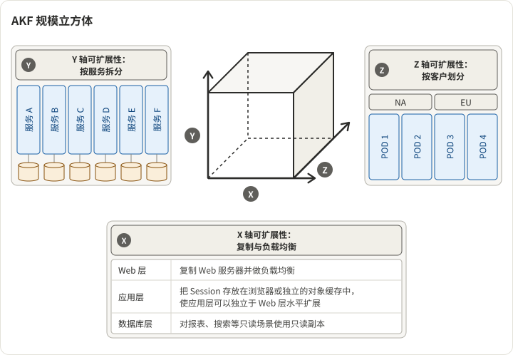

《Art of Scalability》中的 AKF 规模立方体把 Web 服务扩展的全部词汇压缩为三个正交的轴。几乎每一个真实世界的扩展决策，都可以被放到这个立方体里的某个位置，这使得它成为思考容量问题的最有用的单一图示。

## 三个轴

1. **X 轴 —— 水平复制 / 克隆。** 在负载均衡器后运行 N 个相同、最好无状态的实例。任何请求都可由任意实例服务。这是"再加几台机器"的轴。
2. **Y 轴 —— 功能分解 / 微服务。** 按职责拆分单体：鉴权服务、用户资料服务、照片服务、结账服务。不同服务独立扩展，由不同团队拥有。
3. **Z 轴 —— 水平数据分区 / 分片。** 把数据切分，让每个"pod"拥有一部分用户、区域或租户。Uber 的中国数据中心和美国数据中心是经典案例——每个区域为自己的用户运行完整技术栈。

## 每个轴何时起作用

这三个轴不可互相替代。每个轴解决不同的瓶颈，用错轴就是浪费工程时间。

**X 轴解决无状态 CPU/请求量瓶颈。** 如果你的 p50 延迟正常，但在高峰负载下 CPU 不够用，那就加机器。如果应用已经无状态，实现起来便宜；但如果状态散布在粘性会话、内存缓存或单例后台任务中，就会很痛。大约 70% 的"需要扩展"问题其实是 X 轴问题，几天内就能解决。

**Y 轴解决组织与发布风险瓶颈。** 多数公司采用微服务的真实原因并非技术——而是一个 200 人工程师的单体变得无法发布。发布互相阻塞、坏改动的爆炸半径太大，团队无法端到端拥有任何东西。Y 轴代价昂贵：它引入网络 I/O、分布式事务问题、版本管理和 service mesh 税。只在*组织*而非*算力*成为瓶颈时使用。

**Z 轴解决数据量与租户瓶颈。** Z 轴起作用的时机是：单个数据库装不下数据、单个区域无法满足延迟 SLO，或监管边界（GDPR、中国数据驻留）要求隔离。分片是运维成本最高的轴——重分片、跨分片连接、热分片再平衡都非常困难，很少能在无停机的情况下回滚。

## 顺序很重要

对多数公司，正确的应用顺序是 X → Y → Z：

1. **从 X 轴开始。** 让服务无状态。加机器。这条路能让多数公司有 10-100 倍的增长空间，工程成本适中。如果你跳过这步直接做微服务，最终你会得到 30 个仍需无状态的服务。
2. **然后是 Y 轴，但只在组织要求时。** 一个运行良好的单体由 20 人团队维护，会胜过一个运行 15 个微服务的 20 人团队。Y 轴是组织规模工具，不是算力规模工具。小公司多数的"我们需要微服务"都是过早决策。
3. **Z 轴最后，只在必要时做。** 数据分区是成本最高、最难回滚的轴。在数据确实装不下单层之前不要分片。一旦分片，就要把再分片当作一等运维关切来规划。

常见失败模式是先做 Y 再做 X——在有状态服务之上搭建微服务架构。你付出了分布式代价，却没有获得水平扩展的好处。

## 每个轴的实际成本

| 轴        | 工程成本         | 运维成本                           | 可回滚性   |
| --------- | ---------------- | ---------------------------------- | ---------- |
| X（克隆） | 低（若已无状态） | 负载均衡、自动伸缩                 | 完全可回滚 |
| Y（分解） | 高               | Service mesh、可观测性、API 版本化 | 难以回滚   |
| Z（分片） | 极高             | 分片管理、重分片、跨分片查询       | 极难回滚   |

一个有用的规则：**任何回滚需要停机的扩展决策都是赌上架构的决策。** X 轴通常不是。Y 和 Z 通常是。

## 真实世界的组合

多数生产系统处于具体的 (X, Y, Z) 坐标，而非纯粹在某一轴上。一些典型坐标：

- **早期 SaaS 创业公司：** 高 X、低 Y、低 Z。负载均衡后的无状态单体 + 单 Postgres 主库。这套架构让多数 SaaS 公司顺利走到 Series B。
- **中期 SaaS（100-500 工程师）：** 高 X、中 Y、低 Z。单体拆成几个主要服务（鉴权、账单、核心），但数据仍是一个主库。典型是 5-10 个服务。
- **超大规模消费级产品：** 非常高的 X、非常高的 Y、非常高的 Z。数百个服务、区域 pod、读副本、分片数据存储。Uber、Meta、Google。
- **多区域 B2B：** 中 X、中 Y、按地理高 Z。Y 轴按产品域切；Z 轴按区域切以合规。Salesforce、Workday。

## 具体案例 —— Facebook TAO

Facebook 的社交图存储是多轴应用的教科书案例：X 轴用于无状态查询服务器，Y 轴把图服务与其他关切隔离，Z 轴把图跨区域和数据库集群分片。完整架构见[Facebook 如何扩展其社交图数据存储](https://tianpan.co/notes/49-facebook-tao)。

## 扩展决策树

当你遇到扩展问题时，按以下顺序处理问题：

1. **服务是无状态的吗？** 如果不是，先让它无状态。这是你能做的最高 ROI 工作。
2. **是 CPU 或吞吐瓶颈吗？** 如果是，走 X。加机器。搞定。
3. **发布或团队所有权结构是否坏了？** 如果是，考虑 Y——但仅当组织*真正*需要独立可发布性时。从一个新服务开始，而不是十个。
4. **单数据库层能装下 12 个月预期增长的数据吗？** 如果不能，开始规划 Z。分片键要留 10 倍余量。
5. **是否遇到了区域延迟或监管约束？** 如果是，按地理做 Z。

按此顺序回答问题，可以防止最昂贵的扩展错误：用高成本轴去解决低轴的问题。

## 参见

- [Facebook TAO](https://tianpan.co/notes/49-facebook-tao) —— 真实的多轴案例研究。
- [布隆过滤器](https://tianpan.co/notes/68-bloom-filter) —— 在许多水平分片存储中用于避免跨分片查找。
- [跳表](https://tianpan.co/notes/69-skiplist) —— 许多每分片存储层背后的内存数据结构。
